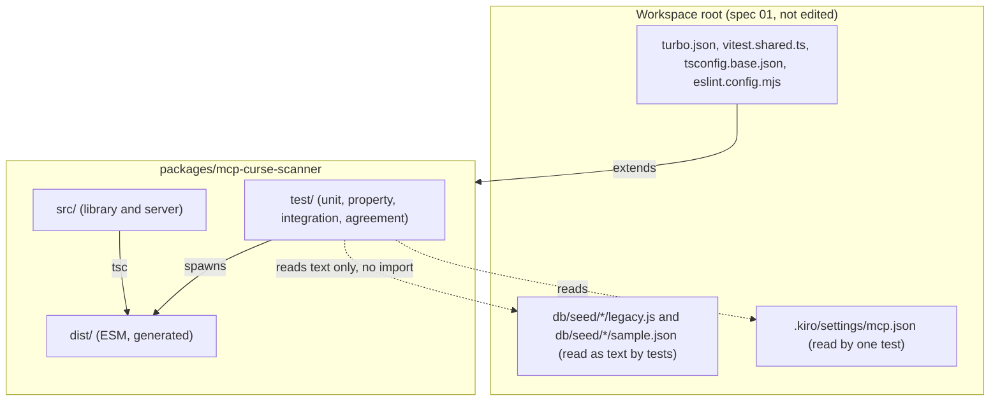
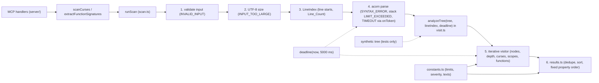
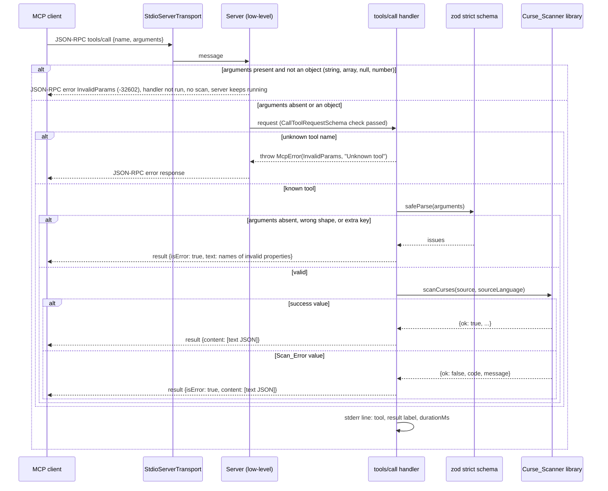
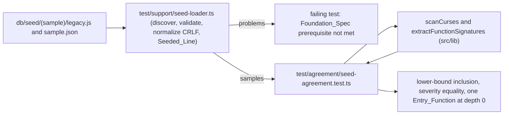

# Design Document

## Overview

This design covers one package of the Lazarus monorepo, defined in `requirements.md`: `packages/mcp-curse-scanner` (`@lazarus/mcp-curse-scanner`). It is a deterministic static analyzer for legacy JavaScript built on `acorn`. It is exposed as a TypeScript library (`scanCurses`, `extractFunctionSignatures`) and as an MCP server over stdio with the tools `scan_ast_curses` and `extract_function_signatures`.

The equivalence verifier `packages/pbt-verifier` is owned by spec `03-pbt-verifier`. This design does not touch it, and the scanner imports nothing from it and nothing from `db/harness`. The package edits no file outside its own directory, except `pnpm-lock.yaml` (Requirement 20.1).

Spec `01-lazarus-foundation` provides the workspace tooling and the seed data. The files this design depends on already exist in the repository and were read while writing this document: `package.json`, `pnpm-workspace.yaml`, `turbo.json`, `tsconfig.base.json`, `eslint.config.mjs`, `vitest.shared.ts`, `scripts/workspace-task.ts`, `.gitignore`, `.kiro/settings/mcp.json`, and the three Sample_Sources under `db/seed/`.

### Decision summary

| # | Decision | Choice | Why (short) |
|---|---|---|---|
| D1 | Module format | ESM (`"type": "module"`), emitted by `tsc` only (`module: NodeNext`, no bundler) | Node 24 runs ESM natively and can `require()` ESM. `acorn`, `zod`, and the MCP SDK ship ESM builds. `dist/` mirrors `src/`, so no import can resolve outside the package. |
| D2 | Scanner shape | Parse once with `acorn`, then one iterative (non-recursive) visitor with scope resolution on scope exit | Deep trees cannot overflow the call stack in our code. Node and depth limits are enforced while visiting. |
| D3 | MCP server | Low-level `Server` class of `@modelcontextprotocol/sdk@^1.32.2` with hand-registered `tools/list` and `tools/call` handlers and `zod@^4` validation | The high-level `McpServer` catches every error in `tools/call`, including its own "Tool X not found" `McpError`, and returns it as a result with `isError: true` that carries the exception message. Requirement 14.9 needs an unknown tool to be a protocol error, and Requirement 14.10 needs a constant message with no exception content. |
| D4 | Agreement with the seed data | Data-driven tests that read `legacy.js` and `sample.json` of each `db/seed/<sample>/` directory as text, with no import from `db/` | Requirements 17.10 and 2.5. The scanner is validated against the seeded data and against its own Curse_Corpus. |
| D5 | Exact-limit tests | Node count: flat statement list. Depth: member-expression chain. Stack-sensitive shapes get only the weak assertion | Measured: acorn builds these two shapes without recursion, so the exact boundaries of Requirement 12.3 are reachable (see "Resource-limit test shapes"). |
| D6 | Turborepo | Package `turbo.json` with `test` depending on `build`, `cache: true`, and the seed files as extra inputs | Requirements 18.12 and 18.13. The root `turbo.json` is not edited. |
| D7 | ES3 reserved words | `allowReserved: false` plus a small `Parser.extend` plugin in `es3-reserved.ts` that rejects every word of `ES3_Reserved_Words` where acorn checks an identifier | Measured with acorn 8.19.0: 30 of the 31 words already behave as Requirement 3.13 requires. `const` does not, because acorn's ES3 list omits it. The plugin makes all 31 words uniform and keeps the error at the first offending token. |
| D8 | Determinism scope | Byte-identical results for every source except a `Stack_Limit_Source` (and `TIMEOUT`). A `Stack_Limit_Source` gets only "success value or `LIMIT_EXCEEDED`, never a throw". | Requirements 11.1, 11.6, 12.3, and 12.8. The scanner cannot know in advance that a source is near the parser stack limit, so the guarantee comes from construction and from test generators that stay far away from that limit. |
| D9 | Tree entry point of the visitor | `analyzeTree(tree, lineIndex, deadline)` is the visitor's entry point. It enforces Node_Limit and Depth_Limit on any tree it is given. It is exported from `visit.ts` for tests only. | Requirement 12.3 (limits enforced independent of the parser) and Requirement 18.8 (depth-512 fallback on synthetic trees). |

### Research summary

- **`acorn` 8.19.0 on Node 23.5.0 (measured with local probes during this revision).**
  - Acorn catches a stack overflow and rethrows it as a `SyntaxError` with the message `Not enough stack space to parse input (line:column)`. Older versions throw a `RangeError`. The scanner maps both to `LIMIT_EXCEEDED`.
  - Parser recursion by shape (details in "Resource-limit test shapes"; sources that sit near this recursion limit are the `Stack_Limit_Source` of the requirements):
    - Iterative in acorn: flat statement lists, member-expression chains (`a.a.a…`, 400,000 links parse), call chains (`a()()…`, 100,000 links), and sequence expressions (`a,a,a…`, 150,000 elements).
    - Recursive in acorn: nested arrays, parentheses, blocks, callbacks, object literals, unary operators, ternaries, and also left-leaning binary chains (`a+a+a…`; 5,000 operators parse, 50,000 fail). An earlier draft of this design claimed that binary chains are iterative. That claim was wrong.
  - Column numbers from acorn are 0-based UTF-16 code-unit offsets. Acorn treats LF, CR, CR LF, U+2028, and U+2029 as line terminators, which is the Line_Count definition of the requirements. `allowHashBang: true` accepts `#!` only at offset 0 (a hashbang on line 2 fails with `Unexpected character '#' (2:0)`). `allowReturnOutsideFunction: true` accepts a top-level `return`.
  - ES3: `ecmaVersion: 3` rejects trailing commas in object literals but accepts ES3 future reserved words as identifiers (`var class = 1;`, `var int = 1;`) unless `allowReserved: false` is set. With `allowReserved: false` they fail (`The keyword 'class' is reserved`). Reserved words as property names (`a.class`, `{class: 1}`) stay accepted with `allowReserved: false` (only `allowReserved: "never"` rejects them, which Requirement 3.13 does not want). ES5 rejects `var class` by default, accepts `var int`, rejects `let x = 1`, and rejects `#!` and a top-level `return` by default.
  - **Every word of `ES3_Reserved_Words` under `ecmaVersion: 3, allowReserved: false` (measured, acorn 8.19.0, Node 23.5.0).** Each of the 31 words was tried as a `var` name, a function declaration name, a parameter, and an expression reference (all must be rejected), and as `a.<w> = 1;`, `{<w>: 1}`, and `o.<w>` (all must be accepted). The remaining forms (a `catch` parameter, a label, a named function expression name, a second declarator, and `o.<w>()`) were tried with `int` on plain acorn and with all 31 words in the plugin run below.
    - 30 words behave as Requirement 3.13 requires. `debugger` is rejected through acorn's keyword path (`Unexpected keyword 'debugger'`), and the statement `debugger;` stays valid, as in the ES5 grammar.
    - **`const` is the only exception.** Acorn's ES3 reserved list omits it, so `var const = 1;`, `function const() {}`, and `function f(const) {}` are accepted. Acorn's ES5 list contains it, so `es5-jquery` and `legacy-node` already reject it.
    - Acorn skips the reserved-word check for an identifier written with an escape when `ecmaVersion < 6` (`var c\u006Cass = 1;` parses). Requirement 3.13 does not name escaped identifiers, but the design closes this gap with the plugin below.
    - **Fix, measured.** `acorn.Parser.extend(Base => class extends Base { checkUnreserved(ref) { … } })` with a check of the decoded `ref.name` against the 31 words, run before `super.checkUnreserved(ref)`, gives 0 mismatches over all 31 words and all 12 forms above. It also rejects `const x = 1;` (error at 1:1), rejects the escaped forms `c\u006Cass` and `c\u006Fnst`, and keeps `a.const`, `{const: 1}`, and `a.c\u006Cass` accepted, because acorn calls `checkUnreserved` only for identifiers and not for property names (`parseIdent(liberal)`). A source with `var const = 1; var @x;` reports the first offender (1:5 in the 1-based convention of the scanner).
    - `Parser.extend` is documented acorn API. `checkUnreserved` is a prototype method that the acorn documentation does not list, so it is on the re-verify list (Open Items 4) and covered by the test over all 31 words.
  - `onToken` accepts a function (called once per token). Parentheses create no nodes: `(eval)(x)` is a `CallExpression` with the callee `Identifier eval`, and the call node starts at the opening parenthesis (offset 0 in the probe). `(a) == b` is a `BinaryExpression` that starts at its opening parenthesis.
  - Error `pos` points at the first offending token (`#` of a misplaced hashbang, `@` of an invalid character).
- **MCP SDK `@modelcontextprotocol/sdk` 1.32.2 (verified in the published package and its type declarations; `latest` on npm is 1.32.2).**
  - `Server` is marked `@deprecated` in its JSDoc ("use `McpServer` for the high-level API; only use `Server` for advanced use cases"). Hand-registered handlers and a protocol error for an unknown tool are such a use case. The range is pinned to `^1.32.2`, so the class stays available.
  - `McpServer` (`dist/esm/server/mcp.js`) throws `McpError(InvalidParams, "Tool <name> not found")` inside a `try` and its `catch` converts every error except `UrlElicitationRequired` into a result with `isError: true` and `error.message` as text. That is why D3 uses `Server`.
  - `Server.setRequestHandler` wraps a `tools/call` handler (read in `dist/esm/server/index.js` of 1.32.2). The wrapper validates the request with `CallToolRequestSchema`, whose `arguments` field is `z.record(z.string(), z.unknown()).optional()` (`dist/esm/types.js`). A present `arguments` value that is not an object (a string, an array, `null`, a number) therefore throws `McpError(InvalidParams, "Invalid tools/call request: …")` before the handler runs, and the client receives a JSON-RPC error with code -32602. An absent `arguments` passes this check and reaches the handler. The wrapper also validates the handler result with `CallToolResultSchema`. A handler that throws a non-`McpError` produces an error response that contains the exception text, so the handler catches everything itself.
  - `StdioServerTransport` registers listeners only for the `data` and `error` events of stdin. It does not react to `end` or `close`, so the entry point must. Its read buffer is limited to 10 MB by default. A source of 1,048,576 characters that needs `\uXXXX` escaping for every character is about 6.3 MB of JSON text, which fits.
  - The package `exports` map has a `./*` pattern, so `@modelcontextprotocol/sdk/server/index.js`, `server/stdio.js`, `types.js`, `inMemory.js`, `client/index.js`, and `client/stdio.js` resolve. `InMemoryTransport.createLinkedPair()` exists. The peer range of `zod` is `^3.25 || ^4.0`.
  - A separate 2.x line (`@modelcontextprotocol/server`, `@modelcontextprotocol/client`) has a different API. The requirements name `@modelcontextprotocol/sdk`, so this design pins the 1.x line.
- **zod 4.6.7 (probed).** `z.strictObject({...})` rejects unknown keys with one issue `{ code: 'unrecognized_keys', path: [], keys: [...] }`. A wrong type gives `{ code: 'invalid_type', path: ['source'] }` and a value outside an enum gives `{ code: 'invalid_value', path: ['sourceLanguage'] }`. Parsing `undefined` gives one `invalid_type` issue with an empty path. `z.toJSONSchema` of the schema below returns `{"$schema":"https://json-schema.org/draft/2020-12/schema","type":"object","properties":{"source":{"type":"string","maxLength":1048576},"sourceLanguage":{"type":"string","enum":["es3","es5-jquery","legacy-node"]}},"required":["source","sourceLanguage"],"additionalProperties":false}`.
- **Turborepo ([package configurations](https://turborepo.dev/docs/reference/package-configurations), [configuration reference](https://turborepo.dev/docs/reference/configuration)).** A package `turbo.json` starts with `"extends": ["//"]`. Scalar fields such as `cache` are inherited. Array fields (`dependsOn`, `inputs`, `outputs`) replace the root value unless the array starts with `$TURBO_EXTENDS$`. `inputs` globs are relative to the package, `$TURBO_DEFAULT$` restores the default inputs, and a glob that starts with `$TURBO_ROOT$` is relative to the repository root. `cache` defaults to `true`. The root `turbo.json` of this repository sets no `cache` value; its `test` task has `dependsOn: ["^build"]` and `outputs: []`.
- **Repository facts that shape the design.** The root `vitest.shared.ts` has a default export (not a named one). The root `tsconfig.base.json` sets `module` and `moduleResolution` to `NodeNext` and `verbatimModuleSyntax` to `true`. The root `eslint.config.mjs` ignores `**/dist/**` and `packages/**/test/fixtures/**` and sets `@typescript-eslint/no-explicit-any` to `error`. The root scripts call `scripts/workspace-task.ts`, which runs `pnpm exec turbo run <task>` when a package defines the script and exits with the non-zero code of Turborepo otherwise.
- **fast-check 4.10.** `fc.assert` fails with a message that contains the seed and the shrunk counterexample, which Requirement 18.15 needs.
- Content from the web sources above was rephrased for compliance with licensing restrictions.

## Architecture

### Package boundaries and dependency rules



Rules that keep the package independent:

- `src/` imports only relative files inside `src/`, its declared dependencies (`acorn`, `@modelcontextprotocol/sdk`, `zod`), and the Node built-in `node:module`. It uses none of the modules forbidden by Requirement 15.2.
- Only files under `test/agreement/` and `test/support/seed-loader.ts` read from `db/seed/`, and only with `node:fs` text reads. Nothing under `db/` is imported or executed (Requirement 17.10).
- The package does not import `packages/pbt-verifier`, `apps/web`, or `db/harness`.

### Module format and build tool (D1)

- **Format.** ESM: `"type": "module"`, `tsc` option `module: NodeNext` (inherited from `tsconfig.base.json`), relative imports written with the `.js` suffix. Vite (Vitest) resolves a `.js` specifier to the `.ts` file when the importer is TypeScript. Every `.js` file in `dist/` is ESM, which satisfies Requirement 2.7.
- **Build tool: `tsc` only.** A bundler is not needed.
  - The only runtime consumers are Node (the Registration command) and workspace code.
  - Without bundling, `dist/` mirrors `src/` one file per module. Every import is either relative inside `dist/` or a bare dependency specifier that Node resolves from the package's `node_modules`. No `dist/` file can reference a path outside the package (Requirement 2.5). A test scans `dist/` to prove it.
  - Declaration files come from `tsc` (`declaration: true`), which the `types` export condition needs.
- **Entry points.** `exports["."]` must not start a server (Requirement 2.4), while the Registration runs `dist/index.js` (Requirement 2.1). So the files have two roles:
  - `dist/index.js` is the server executable. It has side effects and is not listed in `exports`.
  - `dist/lib.js` is the side-effect-free library barrel. `exports["."]` points to it. It imports neither the SDK nor `zod`.
- **Stack size.** Running Node with a larger stack (`--stack-size`, a worker, or a child process) is rejected: the Registration command is fixed, and Requirement 15.2 forbids `node:worker_threads` and `node:child_process` in `src/`.

### Scanner architecture



The pipeline is a pure function of `(source, sourceLanguage)` plus an injectable clock used only for the timeout. The steps run in the order that matches the error precedence of Requirement 12.9. `TIMEOUT` can interrupt any step after the first two. Step 5 starts at `analyzeTree`, which takes a syntax tree and does not care how the tree was produced. That is how Requirement 12.3 is met ("enforce the limits in the visitor, independent of how the tree was produced"), and it is how the depth-512 fallback test of Requirement 18.8 hands a synthetic tree to the visitor.

**Determinism scope (Requirements 11.1, 11.6, 12.3, 12.8).** The pipeline has two classes of input:

| Class | Guarantee | Why it holds |
|---|---|---|
| Every source that is not a `Stack_Limit_Source` | Repeated calls, and calls in separate processes, operating systems, working directories, locales, and time zones, return byte-identical JSON. The only exception is `TIMEOUT`. | The result is a pure function of `(source, sourceLanguage)`. The parse outcome of such a source does not depend on how deep the call stack already is, because the source needs far less parser recursion than the stack allows. No clock, path, locale, or random value enters a result. |
| A `Stack_Limit_Source` (the parser exhausts the call stack or comes within its headroom) | Each call returns a success value or a Scan_Error with the code `LIMIT_EXCEEDED`, and never throws. Two calls may differ, and the byte-identical guarantee does not apply. | V8 runs out of stack at a depth that depends on the current stack depth and on JIT state, so the same near-limit source can parse on a warm run and fail on a cold run. The scanner maps every `RangeError` and acorn's `Not enough stack space` `SyntaxError` to `LIMIT_EXCEEDED`, and an outermost `try/catch` turns any other exception into a Scan_Error, so the weak guarantee holds by construction. |

The scanner does not try to detect a `Stack_Limit_Source` before parsing, because no reliable test exists. The consequence for the tests is that every test which compares repeated results (Properties 2, 5, 6, the cross-process test) must use sources that are far from the limit, and every test that uses a source near the limit asserts only "success value or `LIMIT_EXCEEDED`, no throw". "Testing Strategy" lists how each test keeps that separation.

### Sequence: one MCP tool call



Two layers answer a bad `arguments` value (Requirement 14.8):

- **Present and not an object.** The SDK's wrapper around the `tools/call` handler validates the request with `CallToolRequestSchema` and answers with a JSON-RPC `InvalidParams` error. The handler does not run, no scan happens, nothing is written to stderr by our code for that call, and the server answers the next request.
- **Absent, or an object that fails the zod schema.** The handler returns the tool-level `isError` result that names the invalid properties.

An unexpected exception inside the handler is caught once around the whole body and becomes a constant `isError` result. The handler throws nothing except the unknown-tool `McpError`.

### Flow: agreement with the seed data



## Components and Interfaces

### Workspace integration

#### File tree

```text
packages/mcp-curse-scanner/
├── package.json  tsconfig.json  tsconfig.build.json  vitest.config.ts  turbo.json  README.md
├── scripts/clean.mjs                      # removes dist/ before a build (cross-platform)
├── src/
│   ├── lib.ts                             # library barrel (exports["."])
│   ├── index.ts                           # MCP server executable (dist/index.js)
│   ├── scanner/
│   │   ├── types.ts  constants.ts  limits.ts  line-index.ts  input.ts
│   │   ├── parse.ts  es3-reserved.ts  child-keys.ts  visit.ts  scopes.ts  detectors.ts
│   │   ├── functions.ts  results.ts  deadline.ts  scan.ts
│   └── server/
│       ├── create-server.ts  schemas.ts  tools.ts  diagnostics.ts  shutdown.ts
└── test/
    ├── unit/          # Curse_Corpus, limits, syntax errors, constants, schemas, README, packaging, source scans
    ├── property/      # Properties 1 to 17
    ├── integration/   # SDK client over stdio, raw stdio, Registration, cross-process determinism
    ├── agreement/     # seed-agreement, seed-loader, db-untouched
    └── support/       # clean-corpus.ts, curse-corpus.ts, shapes.ts, depth-capability.ts, synthetic-tree.ts, seed-loader.ts, generators
```

#### `package.json`

```json
{
  "name": "@lazarus/mcp-curse-scanner",
  "version": "0.1.0",
  "private": true,
  "type": "module",
  "engines": { "node": ">=24" },
  "main": "./dist/lib.js",
  "types": "./dist/lib.d.ts",
  "exports": {
    ".": { "types": "./dist/lib.d.ts", "import": "./dist/lib.js", "default": "./dist/lib.js" }
  },
  "files": ["dist", "README.md"],
  "scripts": {
    "build": "node scripts/clean.mjs && tsc -p tsconfig.build.json",
    "test": "vitest run",
    "lint": "eslint . && tsc --noEmit -p tsconfig.json"
  },
  "dependencies": {
    "@modelcontextprotocol/sdk": "^1.32.2",
    "acorn": "^8.19.0",
    "zod": "^4.6.7"
  },
  "devDependencies": {
    "@types/node": "^24.19.2",
    "acorn-walk": "^8.3.5",
    "eslint": "^10.14.0",
    "fast-check": "^4.10.2",
    "typescript": "^6.0.3",
    "vitest": "^5.1.0"
  }
}
```

Version ranges were checked with `npm view` during this revision:

| Package | Range | Latest found | Note |
|---|---|---|---|
| `@modelcontextprotocol/sdk` | `^1.32.2` | 1.32.2 (`latest`) | 1.x line |
| `zod` | `^4.6.7` | 4.6.7 (`latest`) | The SDK accepts `^3.25 \|\| ^4.0` |
| `acorn` | `^8.19.0` | 8.19.0 | Same range as the root `package.json` |
| `acorn-walk` | `^8.3.5` | 8.3.5 | Test-only independent function counter |
| `fast-check` | `^4.10.2` | 4.10.2 | Same range as the root |
| `vitest` | `^5.1.0` | 5.1.0 | Same range as the root |
| `typescript` | `^6.0.3` | 6.0.3 is the newest 6.x (the `latest` tag is 7.0.2) | `tech.md` pins `^6` |
| `@types/node` | `^24.19.2` | 24.19.2 is the newest 24.x (the `latest` tag is 26.6.6) | Matches the Node 24 runtime and the root |
| `eslint` | `^10.14.0` | not re-checked | Same range as the root; used by the test of Requirement 1.7 through the ESLint API |

After the first `pnpm install` the lockfile is authoritative (`tech.md`). The ranges equal the root ranges where the root declares the same package, so pnpm resolves one copy of each.

#### TypeScript configuration

`tsconfig.json` (editor, lint, tests) extends the base and keeps `strict`:

```jsonc
{
  "extends": "../../tsconfig.base.json",
  "compilerOptions": { "noEmit": true, "allowImportingTsExtensions": true, "types": ["node"] },
  "include": ["src", "test", "vitest.config.ts"]
}
```

`module` and `moduleResolution` stay `NodeNext` from the base, and the package `type` is `module`, so `.ts` files are ESM. `tsconfig.build.json` extends `tsconfig.json` for emit: `noEmit: false`, `allowImportingTsExtensions: false`, `declaration: true`, `sourceMap: true`, `outDir: dist`, `rootDir: src`, `include: ["src"]`. Tests are excluded from the build, so `dist/` contains no import of test support or of `db/`. TypeScript 6 changed the default of `types` to an empty list, so `"types": ["node"]` is explicit.

#### Vitest, ESLint, and Turborepo

- `vitest.config.ts` merges the root default export of `vitest.shared.ts`:

  ```ts
  import { defineConfig, mergeConfig } from 'vitest/config';
  import shared from '../../vitest.shared.ts';
  export default mergeConfig(shared, defineConfig({ test: { include: ['test/**/*.test.ts'], testTimeout: 30_000 } }));
  ```

- ESLint is not configured per package. `eslint .` run in the package directory uses the root `eslint.config.mjs`, where `@typescript-eslint/no-explicit-any` is `error` and `dist` is ignored (Requirement 1.7). The root config also ignores `packages/**/test/fixtures/**`, so a test fixture written as a `.js` file under `test/fixtures/` is not linted. The Curse_Corpus is written as TypeScript strings and needs no fixture files.
- Package `turbo.json`:

  ```jsonc
  {
    "extends": ["//"],
    "tasks": {
      "test": {
        "dependsOn": ["build"],
        "cache": true,
        "inputs": [
          "$TURBO_DEFAULT$",
          "$TURBO_ROOT$/db/seed/*/legacy.js",
          "$TURBO_ROOT$/db/seed/*/sample.json",
          "$TURBO_ROOT$/.kiro/settings/mcp.json"
        ]
      }
    }
  }
  ```

  - `build` inherits `outputs: ["dist/**", ...]` from the root, so it needs no override.
  - `dependsOn` replaces the root value `["^build"]`. The package has no workspace dependency, so `["build"]` (its own build, which the integration tests need) is the complete list.
  - The root sets no `cache` value, and Turborepo's default is `true`. The package sets it explicitly, because Requirement 18.13 asks for it and because the seed files lie outside the package, so their inputs must be declared for the cache key to change when they change.
  - The first three inputs are required by Requirements 18.12 and 18.13. The `mcp.json` input is an addition: the Registration test reads that file, so a cached result must not survive a change of it.
- **Root pipeline.** `pnpm build`, `pnpm test`, and `pnpm lint` call `scripts/workspace-task.ts`, which runs `pnpm exec turbo run <task>` because the package defines the script. A failing package script makes Turborepo exit non-zero and name the failing task (`@lazarus/mcp-curse-scanner#build`), which meets Requirements 1.12 and 1.13. The root `vitest run` runs only `db/tests/**`, so package tests run once, through their own `test` script.
- **Running the tests directly.** The integration tests need `dist/index.js`. Run through Turborepo, `test` builds first (`dependsOn`). Run directly (`vitest run` in the package), a missing `dist/index.js` makes the integration tests fail with the message `dist/index.js is missing. Run: pnpm exec turbo run build --filter=@lazarus/mcp-curse-scanner`. They never skip. The README lists the commands through Turborepo for that reason (Requirement 19.6).

#### Why no root file changes

`pnpm-workspace.yaml` already globs `packages/*`. The root scripts discover the package script. ESLint and the base `tsconfig` are inherited. `pnpm-lock.yaml` changes only by the dependencies listed above (Requirement 20.1).

### Scanner: public API

```ts
// src/lib.ts
export type SourceLanguage = 'es3' | 'es5-jquery' | 'legacy-node';
export type CurseType = 'GLOBAL_POLLUTION' | 'VAR_HOISTING' | 'IMPLICIT_COERCION' | 'CALLBACK_HELL' | 'EVAL_INJECTION' | 'PROTOTYPE_POLLUTION';
export type Severity = 'HEX' | 'BLOOD_CURSE' | 'FATAL';
export type ImpurityMarker = 'GLOBAL_WRITE' | 'OUTER_SCOPE_WRITE' | 'NONDETERMINISTIC_API' | 'TIMER_API' | 'ENVIRONMENT_API' | 'DYNAMIC_CODE';
export type ScanErrorCode = 'INVALID_INPUT' | 'INPUT_TOO_LARGE' | 'SYNTAX_ERROR' | 'LIMIT_EXCEEDED' | 'TIMEOUT';

export interface CurseFinding {            // property order is the declaration order (Requirement 11.5)
  curseType: CurseType; severity: Severity; lineNumber: number; column: number;
  description: string; exorcismStrategy: string;
}
export interface FunctionSignature {
  name: string | null; kind: 'declaration' | 'expression'; params: string[];
  startLine: number; startColumn: number; endLine: number; nestingDepth: number;
  pureCandidate: boolean; impurityMarkers: ImpurityMarker[];
}
export interface ScanSuccess { ok: true; sourceLanguage: SourceLanguage; lineCount: number; curses: CurseFinding[] }
export interface SignaturesSuccess { ok: true; sourceLanguage: SourceLanguage; lineCount: number; functions: FunctionSignature[] }
export interface ScanError { ok: false; code: ScanErrorCode; message: string; line?: number; column?: number }
export type ScanResult = ScanSuccess | ScanError;
export type SignaturesResult = SignaturesSuccess | ScanError;

export function scanCurses(source: string, sourceLanguage: SourceLanguage): ScanResult;
export function extractFunctionSignatures(source: string, sourceLanguage: SourceLanguage): SignaturesResult;
export const LIMITS: Readonly<{ sourceSizeBytes: 1_048_576; nodes: 200_000; depth: 512; timeBudgetMs: 5_000 }>;
```

Both functions are synchronous and never throw. The parameters are typed, but the first statements validate them at runtime, because JavaScript callers and tests can pass anything (Requirements 3.7 and 3.8). Both functions call the same internal `runScan` and select `curses` or `functions` from its result. The internal entry point is not exported from `lib.ts`:

```ts
// src/scanner/scan.ts
export interface ScanHooks { now: () => number; timeBudgetMs: number }   // tests inject a fake clock
export function runScan(source: unknown, language: unknown, mode: 'curses' | 'functions', hooks?: Partial<ScanHooks>): ScanResult | SignaturesResult;
```

### Scanner: parsing, positions, and limits

**Input validation (`input.ts`).** The order is the error precedence of Requirement 12.9:

1. `typeof source !== 'string'` or `language` not exactly one of the three values: `INVALID_INPUT`. No parse happens.
2. UTF-8 size: `Buffer.byteLength(source, 'utf8')`. Node replaces each lone surrogate by U+FFFD, which is 3 bytes, so the result equals the rule of Requirement 12.2. A size of 1,048,576 is accepted. Larger gives `INPUT_TOO_LARGE`. `Buffer` is a global and not an import of a forbidden module.
3. The parse (below) gives `SYNTAX_ERROR`, then the visitor gives `LIMIT_EXCEEDED`. `TIMEOUT` pre-empts any of the steps after the size check when the budget elapses.

**Line index (`line-index.ts`).** One linear scan of the source builds a `Uint32Array` of line start offsets, with the terminators LF, CR, CR LF (one terminator), U+2028, and U+2029. These are the terminators acorn uses, which a differential test confirms.

- `lineCount` is the number of line starts (an empty string and a source without terminators give 1).
- `position(offset)` does a binary search and returns `{ line: index + 1, column: offset - lineStart + 1 }`.
- **Column definition.** `column` is a 1-based count of UTF-16 code units from the line start. It equals acorn's 0-based `loc.column` plus 1. A tab counts as one unit and an astral character counts as two.
- Acorn is called without `locations: true`. That avoids three objects per node (about 1 million nodes are possible in 1 MiB). Positions come from `node.start` and `node.end` through the line index. A property checks that the index agrees with acorn's `locations` output.

**Parse options (`parse.ts`).**

| Source_Language | `ecmaVersion` | Other options |
|---|---|---|
| `es3` | `3` | `allowReserved: false`, and the parser class `Es3Parser` (`Parser.extend` with the `ES3_Reserved_Words` check, below) |
| `es5-jquery` | `5` | none |
| `legacy-node` | `5` | `allowHashBang: true`, `allowReturnOutsideFunction: true` |

All three use `sourceType: 'script'`, no `locations`, no `ranges`, and an `onToken` function for the deadline. `es3` calls `Es3Parser.parse(...)`; the other two call `acorn.parse(...)`.

- **ES3 reserved words (Requirement 3.13).** The rule is: an `ES3_Reserved_Word` used as an identifier is a `SYNTAX_ERROR`, and the same word used as a property name is accepted.
  - `allowReserved: false` makes acorn reject 29 of the 31 words as identifiers, and `debugger` is rejected as a keyword (measured, see the research summary). It leaves property names alone: `a.class = 1;`, `var o = {class: 1};`, and `var v = o.int;` parse. (`allowReserved: "never"` would reject them and is not used.)
  - **`const` is the one word that acorn's ES3 list misses**, and acorn also skips the reserved-word check for identifiers written with a `\u` escape when `ecmaVersion < 6`. `es3-reserved.ts` closes both gaps:

    ```ts
    // src/scanner/es3-reserved.ts
    import { Parser } from 'acorn';
    export const ES3_RESERVED_WORDS: ReadonlySet<string> = new Set([ /* the 31 words of the Glossary */ ]);
    export const Es3Parser = Parser.extend((Base) => class extends Base {
      override checkUnreserved(ref: { start: number; end: number; name: string }): void {
        if (ES3_RESERVED_WORDS.has(ref.name)) this.raise(ref.start, `The keyword '${ref.name}' is reserved`);
        super.checkUnreserved(ref);
      }
    });
    ```

    The exact typing of `checkUnreserved` and `raise` (they are not in acorn's published declarations, so a small local interface or a cast is needed under `strict` with no `any`) is settled at implementation. `name` is the decoded identifier name, so `c\u006Cass` is caught too.
  - **Why this is the first offending token.** Acorn calls `checkUnreserved` from `parseIdent` at the moment it parses an identifier that is not a property name (`parseIdent(liberal)` skips it for property names), so the check runs in source order together with the rest of the grammar. The thrown error is the first error acorn meets, whichever kind it is. Measured: for `var const = 1; var @x;` the reported position is that of `const`, not of `@`.
  - **How `line` and `column` are derived.** The raised error carries `pos = ref.start`, the offset of the first character of the identifier. The scanner converts `pos` through the line index (`position(pos)`) exactly as for every other syntax error: `line` is the 1-based line, `column` is the 1-based UTF-16 code-unit column. For example `var class = 1;` gives line 1, column 5, and `\n\n  var x, int = 2;` gives line 3, column 10 (acorn's own 0-based (3:9) plus 1).
  - **Words rejected before `checkUnreserved` runs.** `debugger` is a keyword token in acorn, so `var debugger;` fails in acorn's keyword path at the same position (`Unexpected keyword`), with the same `line` and `column`. The statement `debugger;` stays valid in `es3`, because Requirement 3.13 concerns identifiers only. The message text of this error is acorn's text and is not asserted by tests; the line and column are.
  - `es5-jquery` and `legacy-node` use acorn's own ES5 reserved list (`class`, `enum`, `extends`, `super`, `const`, `export`, `import`), so `var int = 1;` is valid there, as in ES5.
  - **Fallback if the hook is unavailable.** If a future acorn version changes `checkUnreserved`, the 31-word test fails at once (see "Scanner-specific tests"). The alternative that does not use a private method is a post-parse check: walk the finished tree and report the first `Identifier` (in start-offset order) that is not a non-computed property name or an object key and whose name is in `ES3_RESERVED_WORDS`. It runs only after a successful parse, so for a source with a reserved word on line 1 and an unrelated syntax error on line 9, it would report the line 9 error and not the first offending token. That is why the plugin is the primary choice.
- **ES2015+ rejection.** With `ecmaVersion` 3 or 5, acorn fails on `let` declarations, `const`, arrow functions, template literals, `class`, and `import`/`export`. The error becomes `SYNTAX_ERROR`. `let;` as a plain identifier is valid ES5 and parses.
- **Hashbang and top-level `return`.** `#!` at offset 0 is an acorn error for `es3` and `es5-jquery` (`SYNTAX_ERROR` at line 1, column 1). For `legacy-node`, acorn accepts `#!` only at offset 0, so a hashbang on line 2 is an error. `return` outside a function is an error unless `allowReturnOutsideFunction` is true.
- **Error mapping.** An acorn `SyntaxError` carries `pos`. The scanner converts `pos` through the line index to `line` and `column`. The `message` is acorn's message with the trailing ` (line:column)` removed and truncated to 500 characters. The message can contain one character of the source (`Unexpected character '@'`), which is the parser's own text and is allowed by Requirement 12.6.
- **Stack exhaustion.** A `RangeError`, or a `SyntaxError` whose message starts with `Not enough stack space to parse input`, becomes `LIMIT_EXCEEDED` with no `line` and no `column`. The code does not rely on the message alone: any `RangeError` is also mapped. This holds even when the nesting of the source is below the Depth_Limit (Requirement 12.3). Any other unexpected exception (a bug) is caught by the outermost `try/catch` of `runScan`, which returns `LIMIT_EXCEEDED` with the constant message `Internal scan failure`. This keeps the result inside the five defined codes, because Requirement 12.5 forbids both throwing and any other code.

**Limits and the deadline (`limits.ts`, `deadline.ts`, `visit.ts`).**

- **Node_Limit and Depth_Limit.** Depth is the number of nodes on the longest root-to-leaf path, with `Program` at depth 1. A tree of depth 512 is accepted and 513 is rejected. The node count includes `Program` and every node object of the tree, including identifiers used as property names, keys, and labels: 200,000 is accepted and 200,001 is rejected. The visitor counts both while it walks and stops at the first excess.
- **Non-recursive traversal.** The visitor keeps an explicit stack of tasks `{ node, depth, role, exit }`. Entering a node pushes an exit task, then its children in reverse order (so they pop in source order). No analysis function recurses over the tree, so a tree that acorn managed to build cannot overflow the stack in our code.
- **Parser recursion and `Stack_Limit_Source`.** Acorn's own recursion is the only recursion. It is bounded by the stack, not by us. Some shapes with a syntax-tree depth below 512 exhaust the stack (about 510 nested parentheses, which build no node at all). They return `LIMIT_EXCEEDED` as Requirement 12.3 states. A source that exhausts the stack or comes within the parser's headroom is a `Stack_Limit_Source`. For such a source the outcome can depend on how warm the JIT is and how deep the stack already is, so only "success value or `LIMIT_EXCEEDED`, never a throw" is guaranteed, and the byte-identical guarantee of Requirements 11.1, 11.6, and 12.8 does not apply. Every other source is byte-identical across repeated calls and across processes ("Determinism scope" in the architecture section). The code makes the weak guarantee hold by catching `RangeError` and acorn's stack `SyntaxError` around the parse call and by the outermost `try/catch` of `runScan`.
- **The visitor is the single enforcement point, and it takes a tree.** The limits are enforced by `analyzeTree`, not by the parse step (see "Visitor entry point and test-only use" below), so a tree of 513 levels yields `LIMIT_EXCEEDED` no matter how it was produced.
- **Deadline.** `deadline.ts` holds `start = now()` and `limit = start + 5000`. `check()` throws an internal `ScanAbort('TIMEOUT')` when `now() > limit`. It is called every 256 tokens from acorn's `onToken` callback, every 256 visited nodes, and once between steps. With a 1 MiB source, parse plus visit takes well under one second (a 400,000-link member chain parsed in 0.5 s), so the budget is reached only on a very slow host or with an injected clock. The overshoot after the budget is bounded by one atomic acorn step, far below 500 ms. A `TIMEOUT` result, and the result for a `Stack_Limit_Source`, are the only results that may differ between runs (Requirement 11.1).

### Resource-limit test shapes (Requirements 12.3 and 18.8)

The exact-limit tests need sources that acorn can actually parse at the boundary. Whether a shape parses depends on acorn's recursion. The table shows what was measured with acorn 8.19.0 on Node 23.5.0, in one process, with the options of `es5-jquery`. Depth and node counts are computed by an independent iterative walk.

| Shape | Source | Measured result |
|---|---|---|
| Flat statement list | `';'.repeat(199999)` | parses in about 100 ms; 200,000 nodes (`Program` plus 199,999 `EmptyStatement`), depth 2 |
| Member chain | `'a' + '.a'.repeat(509) + ';'` | parses; depth 512, 1,021 nodes |
| Member chain, longer | `'a' + '.a'.repeat(510) + ';'` | parses; depth 513 |
| Member chain, very long | `'a' + '.a'.repeat(400000) + ';'` | parses in about 0.5 s; depth 400,003; same result with `ecmaVersion: 3` |
| Call chain | `'a' + '()'.repeat(100000) + ';'` | parses in about 65 ms; depth 100,003 |
| Sequence expression | `'a' + ',a'.repeat(150000) + ';'` | parses; depth 4, 150,004 nodes |
| Left-leaning binary chain | `'a' + '+a'.repeat(n) + ';'` | n = 5,000 parses; n = 50,000 fails with `Not enough stack space to parse input` |

Largest nesting that parsed in a binary search inside one warmed process (so the numbers are optimistic; a cold process stops earlier, for example 509 nested parentheses parsed cold):

| Shape | Max nesting parsed | Shape | Max nesting parsed |
|---|---|---|---|
| nested parentheses | 511 | nested callbacks `a(function(){…})` | 292 |
| nested arrays | 781 | nested object literals | 292 |
| nested functions | 1,171 | unary chain `!!!…a` | 4,296 |
| nested blocks | 3,125 | left-leaning binary chain | 5,686 |
| ternary chain | 6,251 | | |

**Decision.**

- **Exact node-count tests** use the flat statement list: `';'.repeat(199_999)` must succeed and `';'.repeat(200_000)` must give `LIMIT_EXCEEDED`. A flat list is built by a loop in acorn's `parseTopLevel`, so it cannot hit the stack limit, and its depth is 2, so the Depth_Limit is not involved.
- **Exact depth tests through the parser** use the member chain: `'a' + '.a'.repeat(509) + ';'` (depth 512) must succeed and `'a' + '.a'.repeat(510) + ';'` (depth 513) must give `LIMIT_EXCEEDED`. Acorn builds a subscript chain in a loop, so the result does not depend on the stack. A second pair uses the call chain (`'a' + '()'.repeat(509)` and `'()'.repeat(510)`), which has the same depth arithmetic: with M links the depth is M + 3. Both pairs run for `es3` and `es5-jquery`. These tests are registered only for the shapes that the depth-capability record (below) lists as usable. If the record is empty, the synthetic-tree tests below carry the depth rule.
- **Far above the Depth_Limit (at least 100,000 levels)** is tested with two kinds of shape. The member chain and the call chain with 100,000 links parse, and the visitor stops at depth 513. Nested arrays, parentheses, and blocks with 100,000 levels exhaust the parser stack. Both kinds must give `LIMIT_EXCEEDED` without throwing.
- **Below the Depth_Limit but over the parser stack** has one strong assertion: 20,000 nested parentheses (tree depth 3, about 40 times the measured limit of 511) must give `LIMIT_EXCEEDED`. The margin makes the result independent of JIT warmth and of the 4 MB default stack of worker threads.
- **Stack-sensitive shapes** (nested arrays, parentheses, blocks, callbacks, object literals, functions, unary chains, ternaries, and left-leaning binary chains) at 400, 500, 512, 513, 600, 800, and 1,000 levels get only the weak assertion required by Requirements 12.3 and 18.8: the call does not throw, and the result is a success value or `LIMIT_EXCEEDED`. These sources are `Stack_Limit_Source`s, so the tests do not compare repeated results byte for byte and do not assert which of the two outcomes occurs.
- **Depth-capability record and guard test (Requirement 18.8).** `test/support/depth-capability.ts` exports `measureDepthCapability()`, computed once per test file. For every nesting construct that the tests use (member chain, call chain, nested arrays, nested blocks, nested functions, nested callbacks, nested object literals, unary chain, ternary chain, left-leaning binary chain) and for `es3` and `es5-jquery`, it builds the source whose tree depth should be exactly 512, and the one for 513, parses each directly with `acorn.parse` (or `Es3Parser.parse`), and measures depth and node count with an independent iterative walk. The outcome of each attempt is `parsed-exact`, `depth-mismatch`, or `parse-failed`. The record also stores `process.version` and `acorn.version`, and a list `usable512` of the constructs for which both the 512 and the 513 source are `parsed-exact` in both languages. Parentheses are not in the list, because they build no node and cannot reach depth 512.
  - The guard test `R18.8 depth-512 capability` calls it and prints one line with `console.info`, for example `depth-512 capability: usable = [member-chain, call-chain]; acorn 8.19.0; node v24.x`. It fails only when the record is incomplete (a construct or language without an outcome).
  - **Reporting a change in acorn or Node behavior.** The test pins the baseline measured for this design (`usable512 = [member-chain, call-chain]`). When the record differs, it prints a second line that starts with `WARN depth-512 capability changed:`, names the constructs gained or lost, the new outcome of each (`parse-failed` or `depth-mismatch`), and the acorn and Node versions. It does not fail, because the fallback keeps Requirement 18.8 verified. The warning tells the maintainer that acorn's recursion changed, which is the cause to look at if a parser-based depth test disappears or the scanner starts returning `LIMIT_EXCEEDED` where it used to succeed.
  - **The node-count precondition does fail the run.** The same file asserts that `';'.repeat(199_999)` parses with exactly 200,000 nodes and depth 2, and that `';'.repeat(200_000)` parses with 200,001 nodes. Nothing replaces the node-count boundary (Requirement 18.8 keeps it on the parser), so a break there is a real failure and the message names the shape, the node counts found, and the acorn and Node versions.
- **Fallback: synthetic trees (Requirement 18.8).** `test/support/synthetic-tree.ts` builds trees iteratively, with no recursion: `makeChainTree(depth)` returns `Program → ExpressionStatement → MemberExpression × (depth − 3) → Identifier` with exactly the requested depth, and `makeFlatTree(nodes)` returns a `Program` with `nodes − 1` `EmptyStatement` children. Every node gets valid `start` and `end` offsets in a one-line source of `"a"`, and the line index of that source is passed along. The tests call `analyzeTree` directly:
  - `makeChainTree(512)` returns a success value, and `makeChainTree(513)` returns `LIMIT_EXCEEDED`. A third case with 100,000 levels returns `LIMIT_EXCEEDED` without a stack error, which shows that the visitor is iterative and stops at level 513.
  - `makeFlatTree(200_000)` returns a success value, and `makeFlatTree(200_001)` returns `LIMIT_EXCEEDED`.
  - These tests are always registered, so the run never reports them as skipped. When the capability record lists a usable construct, they add a second check of the same rule. When it lists none, they are the only check of the depth rule, and the parser-based tests keep verifying the node-count boundary and the stack-exhaustion behavior (`LIMIT_EXCEEDED` for 20,000 nested parentheses and for 100,000-level nested arrays, parentheses, and blocks), as Requirement 18.8 demands. Test titles end with the mode in effect, `(mode: parser, construct: member-chain)` or `(mode: synthetic)`.
- **Node 24.** The measurements were taken on Node 23.5.0, the version installed on this machine, and the baseline above comes from them. The first run on Node 24 either confirms the baseline or prints the `WARN` line and falls back to the synthetic trees, with no change to the design.

### Scanner: the visitor

`visit.ts` implements one pass. For each node on entry it applies the detector for its type and updates the scope state. On exit it closes scopes. `child-keys.ts` is a table of the ES5 node types and the order of their child properties (source order). An unknown node type is treated as an internal error mapped to `LIMIT_EXCEEDED`. A unit test checks that the table is complete: the node count of the visitor equals the count of a generic walk (every object with a string `type`) for the Curse_Corpus and for generated programs.

**Visitor entry point and test-only use (Requirements 12.3 and 18.8).** The visitor does not parse and does not know where its tree comes from. Its entry point takes a tree:

```ts
// src/scanner/visit.ts (exported for tests; not re-exported from lib.ts or listed in package exports)
export interface TreeNode { type: string; start: number; end: number; [key: string]: unknown }
export type AnalysisOutcome =
  | { ok: true; curses: CurseFinding[]; functions: FunctionSignature[] }
  | { ok: false; code: 'LIMIT_EXCEEDED' | 'TIMEOUT'; message: string };
export function analyzeTree(tree: TreeNode, lineIndex: LineIndex, deadline: Deadline): AnalysisOutcome;
```

- `runScan` calls `analyzeTree(program, lineIndex, deadline)` right after a successful parse and maps the outcome to a Scan_Result. This is the only production call site. The function is exported only so that tests can pass a hand-built tree, and `lib.ts` does not re-export it.
- `analyzeTree` enforces the Node_Limit and the Depth_Limit on whatever tree it receives, using `LIMITS` from `limits.ts`. It counts nodes and depth when it pushes a node onto its explicit stack, and returns `{ ok: false, code: 'LIMIT_EXCEEDED' }` at the first node that is the 200,001st or sits at level 513. So a tree of 513 levels is rejected whether acorn built it or a test did, and the tree walk itself cannot overflow the call stack, because it never recurses.
- It also checks the deadline every 256 visited nodes and returns `TIMEOUT` on expiry. It never throws for a well-formed tree. A node whose `type` is missing from the child-keys table is reported as an internal failure and handled by `runScan` (the `Internal scan failure` mapping), as before.
- The `TreeNode` shape is the minimum the visitor reads: `type`, `start`, `end`, and the child properties named in the table below. Synthetic trees for the depth-512 fallback test are built with those fields only (see "Resource-limit test shapes").

| Node type | Child keys in order |
|---|---|
| `Program`, `BlockStatement` | `body` |
| `ExpressionStatement` | `expression` |
| `IfStatement`, `ConditionalExpression` | `test`, `consequent`, `alternate` |
| `ForStatement` | `init`, `test`, `update`, `body` |
| `ForInStatement` | `left`, `right`, `body` |
| `WhileStatement` | `test`, `body` |
| `DoWhileStatement` | `body`, `test` |
| `SwitchStatement` / `SwitchCase` | `discriminant`, `cases` / `test`, `consequent` |
| `TryStatement` / `CatchClause` | `block`, `handler`, `finalizer` / `param`, `body` |
| `FunctionDeclaration`, `FunctionExpression` | `id`, `params`, `body` |
| `VariableDeclaration` / `VariableDeclarator` | `declarations` / `id`, `init` |
| `AssignmentExpression`, `BinaryExpression`, `LogicalExpression` | `left`, `right` |
| `UnaryExpression`, `UpdateExpression`, `ReturnStatement`, `ThrowStatement` | `argument` |
| `CallExpression`, `NewExpression` | `callee`, `arguments` |
| `MemberExpression` | `object`, `property` |
| `ArrayExpression` / `ObjectExpression` / `Property` | `elements` / `properties` / `key`, `value` |
| `SequenceExpression` | `expressions` |
| `LabeledStatement` / `BreakStatement`, `ContinueStatement` | `label`, `body` / `label` |
| `WithStatement` | `object`, `body` |
| leaves | `Identifier`, `Literal`, `ThisExpression`, `EmptyStatement`, `DebuggerStatement` |

A `with` statement is visited like a block. Names that it may bind at run time are resolved lexically, which is a documented heuristic.

Each task carries a `role` so the visitor knows how to treat an `Identifier` or `FunctionExpression` without parent pointers: `ref` (a reference), `skip` (a non-computed property name, an object-literal key, or a label), `declare` (a declaration site handled by the parent), `write` (the target of an assignment or update), and `callArg` (a direct argument of a call or `new`). The role of each child is decided when the parent is entered. Identifiers in the roles `skip` and `declare` still count as nodes.

**Scope model (`scopes.ts`).** A scope is `{ kind: 'program' | 'function' | 'catch', declared: Set<string>, parent, fn: FunctionInfo | null }`. Name resolution happens on scope exit, so a declaration that comes after its use still counts (hoisting):

- *Function scope declares*: parameter names, `var` declarator names (found anywhere in the function body, including inside blocks and `for` initializers), the names of nested function declarations (declared in the enclosing function scope), the identifier `arguments`, and the name of a named function expression (declared inside its own function scope).
- *Program scope declares* the same except `arguments`.
- *Catch scope declares* the catch parameter, visible only inside the catch body.
- Because `var` declarations hoist, the visitor records each declaration into the nearest function or program scope the moment it sees the declaration node. Reads and writes are queued as pending items `{ name, kind, node, originFn }` in the current scope.
- On exit of a scope, each pending item whose name is in `declared` is resolved here. Every other item moves to the parent scope's pending list. At program exit the remaining items are unresolved, which means undeclared.

Resolution results feed three consumers:

1. **GLOBAL_POLLUTION (Requirement 4).** An unresolved write item of kind `assign` (an `AssignmentExpression` with an identifier target) produces one finding at `node.start` of the assignment expression. Update expressions (`i++`) and `for…in` variables produce no finding (Requirement 4.6). An assignment whose target is a member expression with the object directly `window` or `global` (computed or not) produces a finding regardless of any local declaration (Requirement 4.3). `window.a.b = 1` does not, because the object of the target is `window.a`.
2. **Impurity markers (Requirement 13).** For a write that resolves in the scope of function F (or in the program scope), every function from `originFn` up to but not including F gets `OUTER_SCOPE_WRITE`; when the declaring scope is the program scope, every function from `originFn` to the root gets it. For an unresolved write, every function from `originFn` to the root gets `GLOBAL_WRITE`. For an unresolved watched read, every function from `originFn` to the root gets the marker of that name. A function's markers therefore include those of its nested functions. Update expressions also count as writes for the markers (Requirements 13.7 and 13.8). A write to a catch parameter resolves in the catch scope, which belongs to the function that contains the `catch` clause.
3. **Watched reads.** Only names in a fixed set are queued: `Date`, `Math` (for `Math.random`), `setTimeout`, `setInterval`, `setImmediate`, and the thirteen environment names of Requirement 13.11. An identifier in the roles `skip` or `declare` is never a reference, so `obj.Date` and `{ random: 1 }` are ignored (Requirement 13.9). `Math.random` is recognized as a non-computed member (or a computed string-literal member) of an unresolved identifier `Math` with the property `random`.

**Detectors (`detectors.ts`).** All use `node.start` converted through the line index. The finding set is keyed by `(curseType, start offset)`, which enforces Requirement 11.3.

| Curse | Trigger on entering the node |
|---|---|
| `VAR_HOISTING` | `VariableDeclaration` with `kind === 'var'`: one finding at the `var` keyword. This includes `for` and `for…in` initializers. |
| `IMPLICIT_COERCION` | `BinaryExpression` with operator `==` or `!=`, at the start of the expression (a leading parenthesis counts, because acorn starts the node at the first token of the left operand including parentheses). `a == b != c` gives two findings at the same position. |
| `CALLBACK_HELL` | See below. |
| `EVAL_INJECTION` | `CallExpression` with callee `Identifier eval`, `CallExpression` with callee `Identifier Function`, or `NewExpression` with callee `Identifier Function`, at the start of that expression. Parentheses around the callee vanish in the acorn tree, so `(eval)(x)` matches. Member callees (`obj.eval(x)`), `Function` not in callee position, and `(0, eval)(x)` do not match. A local declaration does not suppress the finding. |
| `PROTOTYPE_POLLUTION` | `AssignmentExpression` (any operator) whose left side is a `MemberExpression` and either (a) the property is `__proto__` (non-computed identifier or computed string literal), or (b) the member is computed and the property is anything except a `Literal` whose value is a string or a number. The finding is at the start of the assignment expression. One finding per assignment, so chained assignments give one finding each. |

**CALLBACK_HELL (Requirement 7).** The visitor keeps `callbackDepth`, the number of callback ancestors of the current node.

- A callback is a `FunctionExpression` that is a direct argument of a `CallExpression` or `NewExpression` (role `callArg`).
- On entering a callback with `callbackDepth >= 2`, the visitor records a finding at the start of the `function` keyword. It then increments `callbackDepth` and decrements on exit.
- Function declarations, function expressions assigned to variables, immediately invoked function expressions (callee position), and function expressions that are the object of a member (`function(){}.bind(this)`) are not callbacks. They neither get a finding nor count as ancestors, and they do not reset the count (Requirement 7.6).
- For `a(function () { b(function () { c(function () { d(); }); }); });` on one line, the callback passed to `c` has two callback ancestors, so exactly one finding is produced at its `function` keyword.

**Function signatures (`functions.ts`).** Each `FunctionDeclaration` and `FunctionExpression` creates a `FunctionInfo` on entry with:

- `name`: the node's own identifier; otherwise the identifier on the left of `var name = function(){}` or `name = function(){}` (the function is the direct `init` or the direct right side of an `=` assignment with an identifier target); otherwise `null` (so `obj.name = function(){}` and an argument callback give `null`).
- `kind`, `params` (identifier names in order), `startLine`/`startColumn` (the `function` keyword, via the line index), `endLine` (the line of offset `node.end - 1`, the closing brace), `nestingDepth` (the number of enclosing functions).
- `impurityMarkers` is the set of markers collected as described above plus `DYNAMIC_CODE` when an `EVAL_INJECTION` finding occurs anywhere in the function body (the visitor marks the innermost function and its ancestors when it records an eval finding). The set is emitted in the fixed order `GLOBAL_WRITE`, `OUTER_SCOPE_WRITE`, `NONDETERMINISTIC_API`, `TIMER_API`, `ENVIRONMENT_API`, `DYNAMIC_CODE`, each at most once. `pureCandidate` is `impurityMarkers.length === 0`.
- The list is sorted by `startLine`, then `startColumn` (equivalent to ascending start offset). A source without functions gives `[]`.

**Results (`results.ts`) and constants (`constants.ts`).** Result objects are built with literal property order (`ok`, `sourceLanguage`, `lineCount`, then the list). Findings are sorted by start offset, then by the index of the curse type in the Curse_Type_Order. No timestamp, path, or random value enters a result.

### Scanner: MCP server

**Files.** `src/index.ts` is the executable: it creates the server, connects the stdio transport, installs shutdown handlers, and writes nothing to stdout itself. `src/server/create-server.ts` builds the `Server` without a transport, so tests can attach an `InMemoryTransport`. `src/server/tools.ts` holds the pure function `callTool(name, args, deps)`, which the `tools/call` handler delegates to and the property tests call directly.

**SDK API used (all imports are subpaths of the SDK `exports` map; re-verify at implementation, Requirement 14.13).**

```ts
import { Server } from '@modelcontextprotocol/sdk/server/index.js';
import { StdioServerTransport } from '@modelcontextprotocol/sdk/server/stdio.js';
import { CallToolRequestSchema, ListToolsRequestSchema, McpError, ErrorCode } from '@modelcontextprotocol/sdk/types.js';

export interface ServerDeps { scan: typeof scanCurses; extract: typeof extractFunctionSignatures; log: (line: string) => void }
export function createServer(version: string, deps?: Partial<ServerDeps>): Server;
export function callTool(name: string, args: unknown, deps: ServerDeps): CallToolResult;   // throws only McpError for an unknown name
```

- `new Server({ name: 'lazarus-curse-scanner', version }, { capabilities: { tools: {} } })`. `version` must equal the `version` field of `package.json` (Requirement 14.14). A JSON `import` cannot be used, because `rootDir` is `src` and `tsc` would not emit it. Instead, `src/index.ts` (compiled to `dist/index.js`) calls `createRequire(import.meta.url)('../package.json')` and passes the version to `createServer`. From `dist/index.js` the path `../package.json` is the package root file. `node:module` is not on the forbidden list of Requirement 15.2. A test compares the version reported in the `initialize` response with `package.json`.
- `tools/list` handler returns the two tools. The input schema of each is produced by `z.toJSONSchema(ToolArgs)` so the published schema and the validator cannot drift. A unit test asserts `additionalProperties: false`, both properties required, `maxLength: 1048576`, the three-value `enum`, and that no property name or description mentions a path, directory, URL, or command (Requirement 15.3).
- `tools/call` handler:
  1. If `request.params.name` is neither tool name, throw `new McpError(ErrorCode.InvalidParams, 'Unknown tool')`. The SDK converts it to a JSON-RPC error response (Requirement 14.9). The message is constant and does not echo the name.
  2. `ToolArgs.safeParse(request.params.arguments)`. By the time the handler runs, `arguments` is either absent (`undefined`) or an object, because the SDK rejects every other value first (see "Protocol-level case"). On failure return `{ isError: true, content: [{ type: 'text', text: 'Invalid arguments: ' + names }] }`, where `names` lists the invalid properties: the joined `path` of each issue, each key of an `unrecognized_keys` issue, and `arguments` for an issue with an empty path (absent `arguments`). At most 20 names, each cut to 64 characters, sorted and de-duplicated. The scanner is not called (Requirements 14.8 and 15.10). `callTool` itself also accepts `unknown` and gives the same `isError` result for a non-object value, as a defensive measure for direct callers. The real server never passes it such a value.
  3. Call the library function. A success value gives `{ content: [{ type: 'text', text: JSON.stringify(value) }] }` without an `isError` property. A Scan_Error gives the same shape with `isError: true`.
  4. The whole body is inside one `try/catch`. Any exception gives `{ isError: true, content: [{ type: 'text', text: 'Internal error while handling the tool call.' }] }`. The text is constant, 44 characters, and contains nothing from the exception or the arguments (Requirement 14.10).
- Schemas (`schemas.ts`):

  ```ts
  import { z } from 'zod';
  export const ToolArgs = z.strictObject({
    source: z.string().max(1_048_576),
    sourceLanguage: z.enum(['es3', 'es5-jquery', 'legacy-node']),
  });
  ```

  The schema has no property that names a path, URL, or command. The 1,048,576 limit is in characters (Requirement 14.3). The library applies the separate limit in UTF-8 bytes, so a long non-ASCII source passes the schema and returns an `INPUT_TOO_LARGE` Scan_Error result.
- **Protocol-level case (Requirement 14.8, second sentence).** When `arguments` is present and is not an object (a string, an array, `null`, a number, or a boolean), the SDK's wrapper around the `tools/call` handler rejects the request with `McpError(InvalidParams, "Invalid tools/call request: …")` before our handler runs. The client receives a JSON-RPC error with code -32602 and not an `isError` result. The handler does nothing special for it, performs no scan, and the server stays up and answers the next request. This is the behavior that Requirement 14.8 and Requirement 15.10 now state, so the design needs no code for it. It needs a test that proves it (see "Integration tests"). The text of the SDK error message comes from the SDK and from zod, and the tests check the error code, not the text.
- **Tool descriptions** (English, under 500 characters): `scan_ast_curses`: "Scan legacy JavaScript (ES3, ES5, jQuery-era, or old Node.js) with a static AST analyzer and report six kinds of curses with exact 1-based line and column numbers. Findings are static heuristics." `extract_function_signatures`: "List every function in legacy JavaScript with its name, parameters, position, nesting depth, and a static purity hint. The purity hint is a heuristic and not a proof."

**Diagnostics (`diagnostics.ts`).** One function `logEvent(line)` writes `line + '\n'` with `process.stderr.write`. The only lines are `lazarus-curse-scanner event=started`, `lazarus-curse-scanner event=stopped`, `lazarus-curse-scanner event=transport-error`, and `lazarus-curse-scanner tool=<name> result=<ok|SCAN_ERROR_CODE|INVALID_ARGUMENTS|INTERNAL_ERROR> durationMs=<n>`. The last line is built by the pure function `formatToolEvent(tool, result, durationMs)`. Source text, argument values, findings, and exception messages never reach stderr. Nothing in `src/` calls `console.*` or reads `process.env` (the source scan checks both), so stdout carries protocol messages only and the server reads no environment variable.

**Shutdown (`shutdown.ts`).** `StdioServerTransport` ignores stdin `end`, so `index.ts` adds its own handling:

```ts
process.stdin.on('end', () => void shutdown());
process.stdin.on('close', () => void shutdown());
process.on('SIGINT', () => void shutdown());
process.on('SIGTERM', () => void shutdown());
async function shutdown(): Promise<void> {
  if (stopping) return; stopping = true;
  setTimeout(() => process.exit(0), 4_000);      // fail-safe inside the 5 s of Requirement 14.12 (not unref'd)
  try { await server.close(); } catch { /* ignore */ }
  process.exitCode = 0;                          // the loop drains and the process exits by itself
}
```

The process does not call `process.exit` on the normal path, so pending stdout writes are flushed. The fail-safe timer ends the process with code 0 if a handle stays open.

**Integration tests.**

- `test/integration/stdio-sdk-client.test.ts` starts the built server with the SDK client:

  ```ts
  const transport = new StdioClientTransport({
    command: process.execPath, args: [distEntry], cwd: workspaceRoot,
    stderr: 'pipe', env: { NODE_ENV: 'development' },
  });
  const client = new Client({ name: 'test', version: '0.0.0' });
  await client.connect(transport);               // initialize handshake
  ```

  `distEntry` and `workspaceRoot` come from `fileURLToPath(new URL(…, import.meta.url))` (`../../dist/index.js` and `../../../../` from `test/integration/`), which is safe for Windows drive paths and spaces. The test lists the tools, calls both tools (valid arguments; arguments that fail the schema, which are an object with a wrong type, a value outside the enum, an undeclared property, and absent `arguments`; a syntax error; and an unknown name), and closes the client in `afterAll`. Test timeout is 30,000 ms (Requirement 18.9). The SDK client merges its own default environment with the `env` option; that lookup is SDK code, not package code. This test does not send non-object `arguments`: `Client.callTool` is typed to take a record, and whether the client rejects other values before sending is SDK behavior that the test must not depend on.
- `test/integration/stdio-raw.test.ts` uses `child_process.spawn(process.execPath, [distEntry], { cwd: workspaceRoot, env })` with `env` built from the SDK helper `getDefaultEnvironment()` plus `NODE_ENV`, and writes JSON-RPC by hand to capture raw stdout and stderr bytes. It asserts that every stdout line is one complete JSON-RPC 2.0 message, that stdout is empty before the first request, that a unique marker placed in a source and in an invalid argument value appears only inside the matching JSON-RPC response, that stderr has no marker, and that the process exits with code 0 within 5,000 ms after stdin closes.
  - **Non-object `arguments` (Requirements 14.8, 15.10, 18.9).** After the `initialize` request and the `notifications/initialized` notification, the test writes raw `tools/call` requests with a distinct `id` each, for both tool names, and with `arguments` set to a string (`"x"`), an array (`[]`), `null`, a number (`1`), and a boolean (`true`). For each one it reads the response with the same `id` and asserts that it has an `error` member with `code` -32602 (`InvalidParams`) and no `result` member, that no scan marker appears in stdout outside that response, and that stderr gets no line for that call. After the whole series it sends a valid `tools/call` and asserts a normal, non-error result, which proves the server stayed up and able to handle the next request. Raw JSON-RPC is used for all of these requests, so the test does not depend on what the SDK client allows.
  - The same test sends a `tools/call` with `arguments` absent and asserts the tool-level result: no `error` member, `result.isError` true, and a text that names `arguments`.
- `registration.test.ts` parses `.kiro/settings/mcp.json` (read only), checks `args` and the tool-name set against `autoApprove` (Requirement 16.2), and runs the Registration command line with the working directory set to the workspace root and `NODE_ENV=development`. It also compares the results of one tool call under `NODE_ENV` unset, `development`, `production`, and `test` (Requirement 15.9).
- `cross-process.test.ts` runs the same scans in two separate child processes (with different `TZ` and `LANG` values passed through `env`) and compares the JSON text byte for byte (Requirement 11.6). **The inputs are kept away from any `Stack_Limit_Source`:** they are the Curse_Corpus snippets, the three `legacy.js` seed files, one fixed Clean_Corpus program of 200 lines, one source with a syntax error, one source of `INPUT_TOO_LARGE`, and the flat 200,001-node source, which gives `LIMIT_EXCEEDED` from the node count and not from the stack. A guard assertion in the test checks the maximum syntax-tree depth of each input that parses (all except the syntax-error and size cases) with the independent iterative walk and requires it to be at most 40, which is more than 7 times below the smallest measured parser nesting limit (292 nested callbacks). No nesting-shape source of "Resource-limit test shapes" is used here, and `TIMEOUT` is not provoked.

### Agreement tests (Requirement 17)

**Seed layout (read from the repository).** `db/seed/` contains the file `generate-seed.ts` and three directories: `invoice-totals`, `query-string-parser`, and `batch-calculator`. Each directory holds `legacy.js`, `sample.json`, and also `modern.ts` and `test-code.js`, which the agreement tests never read. The fields of `sample.json` that the tests use are `sourceLanguage`, `entryFunction`, and `curses`, an array of objects with `type`, `severity`, `match` (and the unused `description` and `strategy`). Other fields (`title`, `criteria`, `inputs`, and so on) are ignored.

**Seeded_Line.** `db/seed/generate-seed.ts` computes the stored `line_number` with `code.split('\n').findIndex((line) => line.includes(marker)) + 1`, after reading the file and replacing every CR LF by LF. The loader repeats exactly this rule. `db/migrations/V2__seed_sample_corpses.sql` stores these numbers in `public.curses`:

| Sample_Source | Language | Entry_Function | Seeded_Curses as `type@line` (from V2) |
|---|---|---|---|
| `invoice-totals` | `es3` | `computeInvoiceTotal` | `GLOBAL_POLLUTION@1`, `VAR_HOISTING@13`, `IMPLICIT_COERCION@14`, `IMPLICIT_COERCION@21` |
| `query-string-parser` | `es5-jquery` | `parseQueryString` | `PROTOTYPE_POLLUTION@30`, `VAR_HOISTING@17`, `IMPLICIT_COERCION@5`, `IMPLICIT_COERCION@24` |
| `batch-calculator` | `legacy-node` | `calculateBatch` | `CALLBACK_HELL@37`, `EVAL_INJECTION@26`, `VAR_HOISTING@2`, `VAR_HOISTING@26` |

The tests do not hard-code these numbers; they compute them from `match`. The table is for review. Reading the three `legacy.js` files shows that every marker line starts its construct on that same line (no multi-line expression), so the start-of-expression rule of the scanner and the first-line rule of the seed agree. The scanner is also expected to report more findings than seeded, which the lower-bound rule accepts (Requirement 17.5): for example `CALLBACK_HELL` at lines 33, 34, 36, and 37 of `batch-calculator` (levels 3 to 6, only 37 is seeded), `PROTOTYPE_POLLUTION` for `result[key] = [result[key], value];` on line 26 of `query-string-parser`, and further `IMPLICIT_COERCION` and `VAR_HOISTING` findings. The seeded severities (`BLOOD_CURSE` for `GLOBAL_POLLUTION` and `CALLBACK_HELL`, `HEX` for `VAR_HOISTING` and `IMPLICIT_COERCION`, `FATAL` for `EVAL_INJECTION` and `PROTOTYPE_POLLUTION`) equal the mapping of Requirement 10.1. Each `Entry_Function` is a top-level function declaration that appears once; the helper functions in `batch-calculator` (`readJob`, `runJob`) and in `invoice-totals` (`round2`) have other names and nesting depth 1.

**Loader (`test/support/seed-loader.ts`).**

```ts
export interface SeededCurse { type: CurseType; severity: Severity; match: string; seededLine: number }
export interface LoadedSample { folder: string; sourceLanguage: SourceLanguage; entryFunction: string; legacy: string; curses: SeededCurse[] }
export interface SeedLoad { samples: LoadedSample[]; problems: string[] }
export function loadSeedSamples(seedDir: string): SeedLoad;                 // never throws; collects problems
export function seededLineOf(legacy: string, match: string): number | null;  // null when match does not occur
```

- The seed directory is `fileURLToPath(new URL('../../../../db/seed/', import.meta.url))` from `test/support/` (four levels up is the Workspace_Root). The function takes the directory as a parameter, so unit tests can point it at temporary directories created with `fs.mkdtempSync`.
- Discovery: `readdirSync(seedDir, { withFileTypes: true })`, keep directories only (so `generate-seed.ts` is ignored), sort by name.
- For each directory the loader reads only `legacy.js` and `sample.json` with `readFileSync(…, 'utf8')`. It replaces every CR LF in `legacy.js` by LF before any use. If a `legacy.js` still contains a lone CR, U+2028, or U+2029 after that, `split('\n')` (the seed rule) and the scanner (five terminators) would count lines differently. Today no seed file has one. If one appears, the mismatch surfaces through the Requirement 17.9 message because the lines differ.
- Validation of `sample.json` returns problem strings, not exceptions. It checks, in this order: valid JSON; `sourceLanguage` is one of the three values; `entryFunction` is a non-empty string; `curses` is an array with at least one entry; for each entry, `type` is a Curse_Type, `severity` is a Severity, `match` is a non-empty string and occurs in `legacy.js`.

**Failure messages.** Every problem message starts with `Foundation_Spec prerequisite not met:` and uses paths relative to the Workspace_Root with forward slashes:

| Condition | Message (after the prefix) |
|---|---|
| `db/seed/` missing | `the directory db/seed/ does not exist. Implement spec 01-lazarus-foundation (Sample_Sources under db/seed/) before running the agreement tests.` |
| no subdirectory | `the directory db/seed/ contains no Sample_Source subdirectory (expected folders such as invoice-totals, each with legacy.js and sample.json).` |
| file missing | `Sample_Source "<folder>": db/seed/<folder>/legacy.js is missing.` (same for `sample.json`) |
| invalid JSON | `Sample_Source "<folder>": db/seed/<folder>/sample.json is not valid JSON (<parser message>).` |
| invalid field | `Sample_Source "<folder>": sample.json field "<field>" is missing or invalid (expected <description>).` with `<field>` such as `sourceLanguage`, `entryFunction`, `curses`, `curses[2].type`, `curses[2].severity`, `curses[2].match` |
| `match` absent | `Sample_Source "<folder>": curses[<i>].match "<match>" does not occur in db/seed/<folder>/legacy.js.` |

`seed-loader.test.ts` covers each row with temporary directories. The test file `seed-agreement.test.ts` calls `loadSeedSamples` once at collection time. If `problems` is not empty, it registers one test named `R17.7 R17.8 seed prerequisites are met` that throws the joined problem list, so the run ends with the status failed (never skipped, never passed). Samples without problems still get their per-sample tests, and a run with no valid sample has only the failing test.

**Assertions per Sample_Source.**

- `R17.2`: `scanCurses(legacy, sourceLanguage)` returns `ok: true`.
- `R17.3`: for each Seeded_Curse, at least one finding with `curseType === type` and `lineNumber === seededLine`.
- `R17.4`: every such finding has `severity` equal to the seeded `severity`.
- `R17.5`: the test never asserts the number of findings or the absence of other findings.
- `R17.6`: `extractFunctionSignatures(legacy, sourceLanguage)` succeeds and contains exactly one signature with `name === entryFunction`, and it has `nestingDepth === 0` and `kind === 'declaration'`.
- `R17.9`: a failing assertion builds its message from a pure function `describeMismatch(folder, curse, findings)` that names the folder, the Curse_Type, the Seeded_Line, the `match` text, and the `lineNumber` values of the findings of that Curse_Type that the scanner returned (or `none`), for example `Sample_Source "batch-calculator": CALLBACK_HELL expected at Seeded_Line 37 (match "runJob(job3, error3, function (value3) {") but the scanner returned CALLBACK_HELL at lines [33, 34, 36]`. For the Entry_Function it names the folder, the function name, and the number of signatures found. A unit test checks the message builder with fake results.
- `R17.10`: `db-untouched.test.ts` computes a SHA-256 of every file under `db/` in `beforeAll` and compares in `afterAll`. The source scan test checks that no file under `test/agreement/` or `test/support/` imports a module whose resolved path is inside `db/`, and that these files read no environment variable. The tests open no database connection.

**Scope of the validation.** Because the verifier and the harness belong to other specs, the scanner is validated against the seeded data (three samples, twelve seeded curses) and against its own Curse_Corpus. There is no differential comparison with `db/harness`.

## Data Models

### Scanner constants (`constants.ts`)

Limits (Requirement 12): `sourceSizeBytes` 1,048,576, `nodes` 200,000, `depth` 512, `timeBudgetMs` 5,000. The Curse_Type_Order is `GLOBAL_POLLUTION`, `VAR_HOISTING`, `IMPLICIT_COERCION`, `CALLBACK_HELL`, `EVAL_INJECTION`, `PROTOTYPE_POLLUTION`.

The mapping table below is the only source of `severity`, `description`, and `exorcismStrategy`. All texts are printable ASCII (U+0020 to U+007E), 10 to 500 characters after trimming, pairwise different, without interpolation, and without any Forbidden_Phrase.

| Curse_Type | Severity | `description` | `exorcismStrategy` |
|---|---|---|---|
| `GLOBAL_POLLUTION` | `BLOOD_CURSE` | Assignment to a name that is never declared, or to a property of window or global, which creates or changes mutable global state shared by every caller. | Declare the value as a local binding or pass it as a function argument, and return results instead of writing to global state. |
| `VAR_HOISTING` | `HEX` | A var declaration is function scoped and hoisted to the top of its function, so the name is visible before its line and outside its block. | Replace var with const, or with let when the binding is reassigned, and declare it in the narrowest block that uses it. |
| `IMPLICIT_COERCION` | `HEX` | The loose equality operators == and != convert operand types before comparing, so unrelated values can compare as equal. | Use strict equality (=== and !==) and convert values explicitly where a conversion is intended. |
| `CALLBACK_HELL` | `BLOOD_CURSE` | A callback is nested inside at least two other callbacks, which builds a deep pyramid of control flow that is hard to read, test, and handle errors in. | Extract each callback into a named function, or convert the call chain to promises and async functions with flat control flow. |
| `EVAL_INJECTION` | `FATAL` | Dynamic code evaluation through eval or the Function constructor runs text as code, which allows code injection and blocks static analysis. | Remove dynamic evaluation: replace it with a direct function call, a lookup table, or JSON.parse for data. |
| `PROTOTYPE_POLLUTION` | `FATAL` | A write through __proto__ or through a computed property key can change the prototype chain, so attacker-controlled keys may alter every object. | Reject the keys __proto__, constructor, and prototype, or store the data in a Map or in an object created with Object.create(null). |

Watched names for impurity markers (Requirement 13): `NONDETERMINISTIC_API`: `Date` and `Math.random`; `TIMER_API`: `setTimeout`, `setInterval`, `setImmediate`; `ENVIRONMENT_API`: `window`, `document`, `global`, `$`, `jQuery`, `XMLHttpRequest`, `navigator`, `localStorage`, `sessionStorage`, `require`, `process`, `console`, `module`. The marker order is `GLOBAL_WRITE`, `OUTER_SCOPE_WRITE`, `NONDETERMINISTIC_API`, `TIMER_API`, `ENVIRONMENT_API`, `DYNAMIC_CODE`.

Interpretation choice for `Math.random`: it counts only when `Math` is not declared in the program (consistent with the other watched names).

### Scan result wire format

Examples of the exact JSON (property order is part of the contract, Requirement 11.5):

```json
{"ok":true,"sourceLanguage":"es5-jquery","lineCount":2,"curses":[{"curseType":"VAR_HOISTING","severity":"HEX","lineNumber":1,"column":1,"description":"...","exorcismStrategy":"..."}]}
{"ok":false,"code":"SYNTAX_ERROR","message":"Unexpected token","line":2,"column":7}
```

`line` and `column` appear only on `SYNTAX_ERROR`. A `ScanError` never carries `curses` or `functions`.

### Design-added safety limits

| Limit | Value | Where | Reason |
|---|---|---|---|
| Parser and error message cut | 500 characters | `parse.ts` | Requirements 12.1 and 12.6 |
| Names in an `isError` argument result | 20 names, 64 characters each | `server/tools.ts` | A hostile caller cannot make the error text large. |
| Fail-safe exit timer | 4,000 ms | `server/shutdown.ts` | Requirement 14.12 |

### Clean_Corpus grammar (scanner tests)

`test/support/clean-corpus.ts` exports a fast-check arbitrary that emits an ES5 program as an array of lines. Every line is a complete statement or a block opener or closer (`function f1(p0, p1) {`, `}`, `} else {`), and every `if`, `else`, `for`, and `while` uses braces, so a complete statement can be inserted between any two top-level statements without breaking syntax. All identifiers come from three closed pools: function names `f<n>`, parameter names `p<n>`, and member names `m<n>`. Injected snippets use no identifier that matches `^(f|p|m)[0-9]+$`, so snippet identifiers are disjoint from the identifiers of the Clean_Corpus (Requirement 18.6). A guard test parses every injectable snippet with `acorn`, collects its identifiers, and checks the pattern.

Allowed constructs and the rules that keep each curse and marker absent:

| Curse or marker | Rule in the generator |
|---|---|
| `VAR_HOISTING` | There is no `var`. Locals are function parameters only. |
| `IMPLICIT_COERCION` | Comparisons use `===`, `!==`, `<`, `<=`, `>`, `>=`. Never `==` or `!=`. |
| `GLOBAL_POLLUTION`, `GLOBAL_WRITE`, `OUTER_SCOPE_WRITE` | Assignments target only a parameter of the function that contains the statement, or a non-computed member (`p0.m1 = …`, `this.m1 = …`, `this.m1 = function () {…}`). No update expression on outer variables. |
| `CALLBACK_HELL` | A callback depth counter in the grammar allows at most two nested callbacks (`f1(function () { f2(function () { f3(); }); });`). A non-callback function (a declaration, an IIFE, or a member-assigned function) may sit between them without raising the count. |
| `EVAL_INJECTION`, `DYNAMIC_CODE` | No `eval`, no `Function`. |
| `PROTOTYPE_POLLUTION` | Assignments use non-computed members, or computed members with string or number literals (`p0[0] = 1`). Computed reads with variables are allowed. |
| `NONDETERMINISTIC_API`, `TIMER_API`, `ENVIRONMENT_API` | No reference to a watched name. `Math.floor` and `JSON.stringify` are allowed. Members named `Date` or `random` of a parameter (`p0.Date`) are allowed. |

The top level contains only function declarations and calls of declared functions with literal arguments. Programs have 1 to 200 lines. The generator also returns `topLevelBoundaries`, the line positions between top-level statements (before the first line of a top-level statement, or after the last line), used by the injection property.

**Injection and metamorphic property.** A snippet from the Curse_Corpus (a complete, self-contained statement group such as `counter = 0;` or a three-level callback, valid at top level in all three languages) is inserted on its own lines at a generated position among `topLevelBoundaries`. Insertion inside a block is excluded on purpose (Requirement 18.6): inside an existing callback or function a snippet can legitimately change other findings (a callback snippet gains ancestors, a `var` snippet changes declarations). The insertion is applied once or twice per generated program; the second snippet has an identifier set disjoint from the first one, so the first insertion's findings shift and the second's are new.

### Curse_Corpus structure (scanner tests)

```ts
interface CorpusCase {
  id: string;                    // for example 'R4.4-a'; the test title starts with the requirement and criterion
  requirement: string;           // 'R4.4'
  language: SourceLanguage;
  source: string;
  expected: ReadonlyArray<{ curseType: CurseType; lineNumber: number; column?: number }>;   // exact list, in Requirement 11.2 order
}
```

The corpus holds one case per example named in Requirements 4 to 9. `column` is asserted where the requirement names it.

| Requirement | Positive cases (expected findings) | Negative cases (expected: none for that type) |
|---|---|---|
| R4 `GLOBAL_POLLUTION` | `counter = 0;`; `total += 1;`; `window.cache = {};`; `global.helper = fn;`; `window['x'] = 1;`; `a = b = 0;` (two, at columns 1 and 5) | `var counter = 0;`; parameter assignment; later `var`; outer `var`; `obj.name = 'x';`; `this.value = 1;`; `module.exports = fn;`; `window.a.b = 1;`; catch parameter; `i++`; `for (k in o)` |
| R5 `VAR_HOISTING` | `var a = 1;`; `var a, b = 2;`; `for (var i = 0; i < n; i++) {}`; several statements | `var` in a string, regex, comment, `variable`, `vars`, a parameter; empty source |
| R6 `IMPLICIT_COERCION` | `a == b` (1:1); `a != b` (1:1); `if (x == null) {}` (1:5); `a\n== b` (1:1); `a == b != c` (two at 1:1) | `===`, `!==`, `<=`, `>=`, `=`; `==` in a string, regex, comment |
| R7 `CALLBACK_HELL` | one-line three-level `a(function () { b(function () { c(function () { d(); }); }); });` (one, at the `function` passed to `c`); four levels (two); `new X(function …)` levels; non-callback function between callbacks | two levels; function declaration; `var f = function () {}`; IIFE; `function () {}.bind(this)` |
| R8 `EVAL_INJECTION` | `eval(code)`; `(eval)(x)`; `new Function('a', 'return a')`; `new Function`; `Function('return this')()` (one); `eval(eval(x))` (two); local `eval` declared | `evaluate(x)`; `evalResult`; `obj.eval(x)`; `window.eval(x)`; `new obj.Function('a')`; `Function.prototype.call`; `x instanceof Function`; text in string, regex, comment |
| R9 `PROTOTYPE_POLLUTION` | `obj.__proto__ = p;`; `obj['__proto__'] = p;`; `target[key] = value;`; `target[a + b] = value;`; `a[k1] = b[k2] = v;` (two); `obj.__proto__ += 1;` | `obj.name = v;`; `obj['name'] = v;`; `list[0] = v;`; `x = target[key];`; `x = obj.__proto__;`; `target[key]++` |

Further cases cover syntax errors (`let x = 1;`, arrow function, hashbang placement, `return` outside a function per language, an ES3 trailing comma, an ES3 reserved word), empty and whitespace-only sources, and each Source_Language.

## Correctness Properties

*A property is a characteristic or behavior that should hold true across all valid executions of a system-essentially, a formal statement about what the system should do. Properties serve as the bridge between human-readable specifications and machine-verifiable correctness guarantees.*

The scanner is a pure function over a large input space, and the MCP handlers are pure functions of their arguments, so property-based testing applies. It does not apply to packaging, wiring, README, process, and seed-data requirements (Requirements 1, 2, 16, 17, 19, 20, and most of 18). Those are example, smoke, integration, data-driven, or source-scan tests (see Testing Strategy).

**Scope of "program" and the `Stack_Limit_Source` exception.** Requirements 11.1 and 12.8 exclude a `Stack_Limit_Source` from the byte-identical guarantee. In Properties 2 to 6 and 8 to 12, "program" means a program from the Clean_Corpus grammar, with 0 to 3 injected snippets, of 1 to 200 lines, whose syntax-tree depth is at most 40 (checked by a guard assertion in the generator tests). Such a program is never a `Stack_Limit_Source`, because the smallest measured parser nesting limit is 292 levels. Property 1 is the one property that uses sources near the stack limit, and it asserts only totality and error shape for them.

**Reflection on the prework.** The prework marked many criteria as testable properties. They were merged as follows:

- The per-curse positive criteria (4.1, 4.3, 5.1, 6.1, 7.1, 8.1 to 8.3, 9.1, 9.2) became one metamorphic injection property (Property 9) instead of ten, because one insertion mechanism checks all six curse types. The named examples stay as example tests over the Curse_Corpus.
- The per-curse negative criteria (4.5, 5.5, 5.6, 6.3, 7.4, 7.5, 8.6, 9.5) and the absence of impurity markers collapsed into the clean-program property (Property 8).
- Criteria 3.1 to 3.3, 3.7, 3.8, 12.5 to 12.7, and 13.15 describe one behavior (totality and error shape) and became Property 1.
- Criteria 11.1 to 11.5, 12.8, and 13.17 became one determinism and ordering property (Property 2), restricted to sources that are not a `Stack_Limit_Source`, as these criteria now say. The weak guarantee for a `Stack_Limit_Source` (Requirement 12.3: a success value or `LIMIT_EXCEEDED`, no throw) is part of Property 1. Cross-process determinism (11.6) is an integration test, because it needs separate processes. Position ranges are separate (Property 3) because they also cover function signatures.
- Criteria 10.1 to 10.3 and 10.5 became one table-lookup property (Property 10).
- The six impurity-marker criteria (13.7 to 13.12) became one injection property (Property 12). The structural signature criteria became Property 11.
- Criteria 14.5 to 14.7 and 14.11 became one parity property (Property 13). Criteria 14.4, 14.8, and 15.10 became one argument-validation property (Property 14) for absent and object `arguments`. The second sentence of 14.8 and 15.10 (non-object `arguments` gives a protocol error) is an SDK behavior with five fixed example values, so it is an integration example and not a property. Unknown tool names (14.9), exception handling (14.10), and diagnostic lines (15.5) stay separate because each has a different observable.
- Line shift (11.8), line-ending conversion (11.9), Line_Count (3.9), and the size rule (12.2) stay separate because each uses a different transformation or oracle.

### Property 1: Total function and error shape

*For any* value passed as `source` (any string, including lone surrogates, NUL characters, and the five line terminators, and any non-string value) and any value passed as `sourceLanguage`, `scanCurses` and `extractFunctionSignatures` return a plain value that is not a Promise and do not throw. The value is a success value (`ok: true`, the `sourceLanguage` that was passed, a `lineCount`, and a `curses` or `functions` list) or a Scan_Error with one of the five codes, a `message` of at most 500 characters, and no `curses` or `functions` field. A non-string source or a language that is not exactly one of the three names gives `INVALID_INPUT`. For the same arguments, and when the source is not a `Stack_Limit_Source`, `extractFunctionSignatures` returns a Scan_Error equal to the one of `scanCurses`. A unique marker string embedded in the source never appears in a Scan_Error `message`. For a source near the parser stack limit (a `Stack_Limit_Source`), the only claim is the one above: the call does not throw, and the result is a success value or a Scan_Error with one of the five codes (in practice `LIMIT_EXCEEDED`). The two functions need not agree there.

**Validates: Requirements 3.1, 3.2, 3.3, 3.7, 3.8, 12.3, 12.5, 12.6, 12.7, 13.15**

### Property 2: Determinism, ordering, uniqueness, and serialization shape

*For any* program that is not a `Stack_Limit_Source` (a generated program of 1 to 200 lines, see the scope note above) and any Source_Language, two calls return byte-identical JSON (for `scanCurses`, for `extractFunctionSignatures`, and for a Scan_Error other than `TIMEOUT`). The `curses` are sorted by line, then column, then Curse_Type_Order position, with at most one finding per `(curseType, lineNumber, column)`. The `functions` are sorted by `startLine` then `startColumn`. Every object lists its properties in the documented order.

**Validates: Requirements 11.1, 11.2, 11.3, 11.4, 11.5, 12.8, 13.17**

### Property 3: Positions stay in range

*For any* program, every finding has an integer `lineNumber` from 1 to `lineCount`, an integer `column` of at least 1, a `curseType` of the six values, and a `severity` of the three values. Every function signature has integer `startLine` and `endLine` with `1 <= startLine <= endLine <= lineCount` and `startColumn >= 1`.

**Validates: Requirements 10.7, 11.7, 13.5**

### Property 4: Line_Count follows the terminator definition

*For any* source built only from whitespace, comments (including block comments that contain terminators), and the five line terminators (LF, CR, CR LF, U+2028, U+2029) in any mix, the scan succeeds with no findings and `lineCount` equals one plus the number of terminators, counting CR LF as one.

**Validates: Requirements 3.3, 3.9**

### Property 5: Line-shift invariance

*For any* program and any N from 1 to 1,000, prepending N LF characters returns the same findings and signatures with every line field increased by N, every other field unchanged, and `lineCount` increased by N.

**Validates: Requirements 11.8**

### Property 6: Line-ending invariance

*For any* program without CR, replacing every LF with CR LF returns the same number of findings and signatures with identical values in every field, including all positions and `lineCount`.

**Validates: Requirements 11.9**

### Property 7: UTF-8 size rule

*For any* string, including strings with lone surrogates, the size that the scanner uses for the limit check equals the sum over its code points of 1, 2, 3, or 4 bytes with each lone surrogate counted as 3 bytes, and the scanner treats the source as too large if and only if that size is more than 1,048,576.

**Validates: Requirements 12.2**

### Property 8: Clean programs have no findings and no impurity markers

*For any* program generated by the Clean_Corpus grammar and any Source_Language, `scanCurses` returns an empty `curses` list, and `extractFunctionSignatures` returns signatures that all have empty `impurityMarkers` and `pureCandidate` true. A program with no function returns an empty `functions` list.

**Validates: Requirements 4.5, 5.5, 5.6, 6.3, 7.4, 7.5, 8.6, 9.5, 13.7, 13.8, 13.9, 13.10, 13.11, 13.12, 13.18**

### Property 9: Injected curses are found exactly where they were inserted

*For any* Clean_Corpus program, any Curse_Corpus snippet whose identifiers are disjoint from the Clean_Corpus identifiers, and any top-level statement boundary, inserting the snippet on its own lines reports exactly the snippet's expected `(curseType, lineNumber, column)` list shifted to the insertion line, together with the findings of the unmodified program moved by the number of inserted lines when they follow the insertion point, with `curseType`, `severity`, and `column` unchanged, in the sorted order of Requirement 11.2.

**Validates: Requirements 4.1, 4.3, 5.1, 6.1, 7.1, 8.1, 8.2, 8.3, 9.1, 9.2, 11.2**

### Property 10: Texts and severities depend only on the curse type

*For any* source, every finding's `severity`, `description`, and `exorcismStrategy` equal the table entry of its `curseType`, even when identifiers, strings, and comments in the source contain words such as the other curse names or the Forbidden_Phrases, and each text is printable ASCII of 10 to 500 characters.

**Validates: Requirements 10.1, 10.2, 10.3, 10.5**

### Property 11: Function signature structure

*For any* program, the number of signatures equals the number of function declarations and function expressions counted by an independent walk (`acorn-walk`) in the test. `kind` is `declaration` exactly for declarations. `params` equal the declared parameter names in order. `nestingDepth` equals the number of enclosing functions. `impurityMarkers` are in the fixed order without duplicates, and `pureCandidate` is true if and only if `impurityMarkers` is empty.

**Validates: Requirements 13.1, 13.2, 13.4, 13.6, 13.13, 13.16**

### Property 12: Impurity markers follow the injected statement

*For any* clean function and any statement from the marker snippet set (global write, outer-scope write, `Date`, `Math.random`, timer, environment name, `eval`), inserting the statement into the function body adds exactly the matching marker to that function and to every enclosing function that does not declare the written variable, and adds no other marker to any function. A property named `Date` or `random` on another object adds none.

**Validates: Requirements 13.7, 13.8, 13.9, 13.10, 13.11, 13.12**

### Property 13: Library and MCP parity

*For any* valid argument pair (a source of at most 1,048,576 characters and one of the three names), the result of `scan_ast_curses` has exactly one text item that parses to JSON deeply equal to `scanCurses` for the same arguments, and the same holds for `extract_function_signatures` and `extractFunctionSignatures`. The result has no `isError` flag if and only if the library value has `ok: true`.

**Validates: Requirements 14.5, 14.6, 14.7, 14.11**

### Property 14: Invalid tool arguments are rejected by name before scanning

*For any* arguments value that is absent or an object, the handler accepts it if and only if it is an object with exactly the string `source` (at most 1,048,576 characters), a `sourceLanguage` among the three names, and no other property. Otherwise it returns `isError: true` with text that names every invalid or unexpected property (`arguments` when it is absent), the scanner is not called, and no filesystem path is read. An `arguments` value that is present and is not an object never reaches the handler: the SDK answers it with a JSON-RPC `InvalidParams` error and performs no scan. That case is verified by the raw stdio integration test and by an in-memory round trip, with examples for a string, an array, `null`, a number, and a boolean, and not by this property.

**Validates: Requirements 14.4, 14.8, 15.10**

### Property 15: Unknown tool names never reach the scanner

*For any* tool name that is not `scan_ast_curses` or `extract_function_signatures` and any arguments, the server answers with a JSON-RPC error that does not contain the name, does not call the scanner, and answers the next request.

**Validates: Requirements 14.9**

### Property 16: Exceptions become a constant result

*For any* exception thrown by the scanner, whatever its message, and any arguments, the tool result has `isError: true` and a text that is the same constant string for every exception and contains no part of the source or of the exception message.

**Validates: Requirements 14.10**

### Property 17: Diagnostic lines contain only constant fields

*For any* tool name, result label, and non-negative integer duration, the diagnostic line produced by `formatToolEvent` matches the pattern `lazarus-curse-scanner tool=<name> result=<label> durationMs=<n>` and contains nothing else.

**Validates: Requirements 15.5**

## Error Handling

### Scanner

| Condition | Result | Notes |
|---|---|---|
| `source` is not a string, or `sourceLanguage` is not one of the three names | `INVALID_INPUT` | No parse. No `line` or `column`. Constant messages. |
| UTF-8 size greater than 1,048,576 bytes | `INPUT_TOO_LARGE` | No parse. Exactly 1,048,576 is accepted. |
| Acorn `SyntaxError` | `SYNTAX_ERROR` with `line`, `column` | Message is acorn's text without the position suffix, at most 500 characters. Includes ES2015+ syntax, a bad hashbang, `return` outside a function for `es3` and `es5-jquery`, and in `es3` an `ES3_Reserved_Word` used as an identifier (raised by the `Es3Parser` check at the identifier's first character). |
| Stack exhaustion in acorn (`RangeError`, or `SyntaxError` starting with `Not enough stack space`) | `LIMIT_EXCEEDED` | Occurs below the Depth_Limit for shapes such as deeply nested parentheses. For a `Stack_Limit_Source` the result is a success value or this code, never a throw, and repeated calls may differ. |
| More than 200,000 nodes or depth greater than 512 | `LIMIT_EXCEEDED` | Detected by `analyzeTree` while visiting, for any tree it is given. No partial lists. Byte-identical across repeated calls. |
| Elapsed time above 5,000 ms (deadline checked every 256 tokens and nodes) | `TIMEOUT` | Returned within 500 ms after the budget. Allowed to vary between runs, like the result for a `Stack_Limit_Source`. |
| Unexpected internal exception | `LIMIT_EXCEEDED` with the message `Internal scan failure` | Keeps the result inside the five codes. Nothing from the source is logged. |

Precedence when several conditions apply: `INVALID_INPUT`, `INPUT_TOO_LARGE`, `SYNTAX_ERROR`, `LIMIT_EXCEEDED`, unless the deadline passes first (`TIMEOUT`). A source that nests deeply and also has a later syntax error returns `LIMIT_EXCEEDED` if the parser exhausts the stack before it reaches the syntax error. Such a source is a `Stack_Limit_Source`, so Requirement 12.8 does not require the same code on every call.

### MCP server

| Condition | Response | Process |
|---|---|---|
| Unknown tool name | JSON-RPC error `InvalidParams`, message `Unknown tool` | Keeps running |
| `arguments` present and not an object (string, array, `null`, number, boolean) | JSON-RPC error `InvalidParams` (-32602) raised by the SDK before the handler runs (`Invalid tools/call request: …`) | Handler not run, no scan, no diagnostic line from our code for that call. Keeps running and answers the next request. |
| `arguments` absent, or an object that fails the strict zod schema (missing property, wrong type, value outside the enum, undeclared property) | Tool result `isError: true`, text `Invalid arguments: <property names>` (`arguments` is the name for the absent case) | Scanner not called. Keeps running. |
| Scan_Error from the library | Tool result `isError: true`, text is the Scan_Error JSON | Keeps running |
| Exception in the handler | Tool result `isError: true`, constant text `Internal error while handling the tool call.` | Keeps running. Nothing from the exception is returned or logged. |
| Malformed JSON-RPC from the client | Handled by the SDK transport (`onerror`). Logged as the constant `event=transport-error`. | Keeps running unless the transport closes |
| stdin closes, SIGINT, or SIGTERM | `server.close()`, `process.exitCode = 0` | Exits 0 within 5,000 ms; fail-safe `process.exit(0)` at 4,000 ms |
| Stack overflow or out-of-memory inside the SDK | Not handled; the process may exit | Out of scope; inputs are bounded by the 10 MB transport buffer and the 1 MiB schema limit |

### Agreement tests

| Condition | Outcome |
|---|---|
| `db/seed/` missing, empty, or a Sample_Source with a missing file or invalid field | One failing test with the message of the table in "Agreement tests", prefixed by `Foundation_Spec prerequisite not met:`. Never skipped. |
| Seeded_Curse without a matching finding, wrong severity, or Entry_Function count other than 1 | Failing test with the message built by `describeMismatch` |
| A file under `db/` changed during the run | Failing `db-untouched` test |

## Testing Strategy

### Approach

- **Unit and example tests** cover the named examples (the Curse_Corpus), the resource limits, syntax errors, the constants table, the published tool schemas, the README, packaging facts, and source scans.
- **Property tests** cover Properties 1 to 17, each as a single `fc.assert(fc.property(...), { numRuns })` test in Vitest with `fast-check` (not implemented from scratch), at least 100 runs each. A failing run prints the seed and the shrunk counterexample, and Vitest exits non-zero (Requirement 18.15). Tests set no fixed seed, so a failing seed is only in the output and is copied into the test to replay.
- **Integration tests** start `dist/index.js` (SDK client over stdio, raw stdio, the Registration command line, `NODE_ENV` variants, two processes for cross-process determinism).
- **Agreement tests** read `db/seed/*/legacy.js` and `db/seed/*/sample.json` as text (Requirement 17).
- **Source scans** (one test file) parse `src/**/*.ts` with the TypeScript API and fail with the file name and the offending item for: imports of `node:vm`, `node:child_process`, `node:worker_threads`, `node:fs`, `node:net`, `node:http`, `node:https`, `node:dgram`, `node:dns` (static, dynamic, `require`, with or without `node:`), calls of `eval`, `new Function`, and `Function(...)`, `console.*`, `process.env`, `fetch`, and network or database modules (Requirements 3.10, 15.1, 15.2, 15.8, 20.3, 20.4). The same scan checks that `test/agreement/` and `test/support/` import nothing from `db/`.
- **Tag and naming rules (Requirement 18.14).** Every `it` and `test` title starts with `R<number>.<number>` (a property test lists a requirement it validates, and data-driven titles are built from a template that starts with the literal prefix). Every property test carries the comment `Feature: 02-scanner-and-verifier, Property <n>: <title>`. A source-scan test checks every `*.test.ts` file for both rules.

### Test environments

| Area | Runs against | Notes |
|---|---|---|
| Scanner unit and property | `src/` through Vitest | No build needed |
| MCP handler properties (13 to 17) | `callTool` and `formatToolEvent` with stubbed `deps`, plus a smaller in-memory round trip (`createServer` + `InMemoryTransport.createLinkedPair()` + SDK `Client`) to prove the wiring; the round trip also sends the five non-object `arguments` examples through `client.request` with a cast, because it bypasses the typed `callTool` helper | Fast enough for 100 runs |
| MCP integration | `dist/index.js` (the `test` task depends on `build`) | One child process per test; killed in `afterAll`; 30,000 ms limit. Non-object `arguments` (string, array, `null`, number, boolean) are sent as raw JSON-RPC and must give `InvalidParams` (-32602), followed by a valid call that succeeds. |
| Agreement | `db/seed/*/legacy.js`, `db/seed/*/sample.json` | Read only; fails if missing |

### Generators and helpers

- **Clean_Corpus and injection** (`test/support/clean-corpus.ts`): described under Data Models. The same file exports the marker snippet set for Property 12.
- **Program generator for Properties 2, 3, 5, 6, 11**: Clean_Corpus programs with 0 to 3 injected snippets at top-level positions, so the programs contain findings and markers. **The generator stays away from any `Stack_Limit_Source`:** the grammar caps function nesting at 4, block nesting at 4, and callback nesting at 2, no snippet nests deeper than 6 levels, and a program has at most 200 lines. A guard test generates 1,000 programs, parses them with acorn, measures the tree depth with the independent iterative walk, and requires a maximum of 40, which is more than 7 times below the smallest measured parser nesting limit (292 nested callbacks or object literals). It also asserts that no generated line has more than 100 characters, so that no single expression reaches the chain shapes of "Resource-limit test shapes". Properties 5 and 6 and the cross-process test use the same programs.
- **Source generators for Property 1**: `fc.string({ maxLength: 10000 })` with the `unit: 'binary'` option, plus `fc.constantFrom` fragments (lone surrogates, NUL, `\u2028`, hashbang, deep nesting, a marker string) and non-string values from `fc.anything()`. Property 1 is the only property that feeds near-limit nesting to the scanner. It asserts totality and error shape for every generated source. It asserts the equality of the two Scan_Errors of `scanCurses` and `extractFunctionSignatures` only when a simple character counter in the test finds a maximum bracket nesting (`(`, `[`, `{`) of at most 100, which is far below the 584 bracket levels of 292 nested callbacks. So the equality never depends on stack behavior.
- **Marker snippet set for Property 12**:

  | Marker | Statement injected into a function body | Prelude at program top level |
  |---|---|---|
  | `GLOBAL_WRITE` | `counter = 1;`, `counter++;`, `window.cache = 1;` | none |
  | `OUTER_SCOPE_WRITE` | `outerVar = 1;`, `outerVar++;` | `var outerVar = 0;` |
  | `NONDETERMINISTIC_API` | `new Date();`, `Math.random();` | none |
  | `TIMER_API` | `setTimeout(null, 0);` and the two sibling timers | none |
  | `ENVIRONMENT_API` | `<name>;` for each of the thirteen names | none |
  | `DYNAMIC_CODE` | `eval(code);` | none |

  The negative statements `p0.Date;`, `p0.random;`, and `Math.floor(1);` add no marker.
- **Limit shapes** (`test/support/shapes.ts`): functions that build the sources of "Resource-limit test shapes" from a size parameter.
- **Seed loader** (`test/support/seed-loader.ts`): described under "Agreement tests".

### Scanner-specific tests

- **Limits (Requirement 18.8).** The shapes and assertions are listed under "Resource-limit test shapes". Size: a source of exactly 1,048,576 bytes (padded with a comment) is accepted, and one more byte gives `INPUT_TOO_LARGE`. A syntax error at a known position on line 3 checks `line` and `column`. The depth-512 boundary is verified through the parser for the constructs that the depth-capability record lists as usable, and always on synthetic trees passed to `analyzeTree` (the fallback; it is the only depth-boundary check when the record is empty). The node-count boundary (flat list) and the stack-exhaustion cases always go through the parser. Near-limit nesting (400 to 1,000 levels) asserts only "success or `LIMIT_EXCEEDED`, no throw" and never compares repeated results.
- **ES3 reserved words (Requirement 3.13).** A table-driven test iterates over the 31 words of `ES3_RESERVED_WORDS` (the test holds its own literal copy of the Glossary list and asserts that the set in `src` equals it). For each word it checks, with `sourceLanguage: 'es3'`: the identifier forms `var <w> = 1;`, `function <w>() {}`, `function f(<w>) {}`, `x = <w>;`, `try {} catch (<w>) {}`, `<w>: for (;;) {}`, `var f = function <w>() {};`, and `var a, <w>;` return `SYNTAX_ERROR` whose `line` and `column` equal the position of the word (computed by the test from the template, with the word's 1-based column), and the property forms `a.<w> = 1;`, `var o = {<w>: 1};`, `var v = o.<w>;`, and `o.<w>();` succeed. One named test per example of 3.13 exists on top of that (rejected: `var class = 1;`, `var int;`, `function enum() {}`, `function f(class) {}`; accepted: `a.class = 1;`, `var o = {class: 1};`, `var v = o.int;`), plus `var const = 1;`, the escaped `var c\u006Cass = 1;`, and `var const = 1; var @x;` (the error is at the `const`, 1:5). The same word forms with `es5-jquery` check that `int` is accepted and `class` is rejected, so the language difference is covered. If a future acorn changes the `checkUnreserved` hook, this test fails and names the word and form.
- **Visitor limits on synthetic trees.** `analyzeTree` unit tests on `makeChainTree` and `makeFlatTree` (see "Resource-limit test shapes"), including the 100,000-level tree, which must return `LIMIT_EXCEEDED` without a stack error.
- **Timeout (Requirement 12.4).** `runScan` with an injected clock that jumps past the budget after a given number of calls returns `TIMEOUT` and no lists.
- **Line index.** A property compares the line index with acorn's `locations: true` output for generated sources with all five terminators.
- **Child-keys completeness.** The visitor node count equals a generic walk count for the Curse_Corpus and for generated programs.
- **Version.** The `initialize` response reports `lazarus-curse-scanner` and the `package.json` version.
- **README (Requirement 19).** A test parses `README.md`: the level-2 headings in the required order, the table of six rows with the severities of Requirement 10.1, the five Scan_Error codes, the numeric limits equal to `LIMITS`, the three enablement steps in order, the statement about `pureCandidate`, the absence of Forbidden_Phrases, and a type check of each code example with the TypeScript API against the emitted declarations (the examples import `@lazarus/mcp-curse-scanner`, which resolves through the package's own `exports`).
- **Packaging smoke tests.** `package.json` fields, `tsc --showConfig` shows `strict: true`, the `exports` targets exist after the build, no `dist/` import leaves the package and no `dist/` file mentions `db/`, `scripts/`, or `.kiro/`, `git check-ignore` reports `packages/mcp-curse-scanner/dist`, `turbo.json` has `dependsOn: ["build"]`, `cache: true`, and the two seed globs, an ESLint run on a string with an explicit `any` reports `@typescript-eslint/no-explicit-any`, and importing `dist/lib.js` in a child process writes 0 bytes to stdout and stderr.

## Requirements Traceability

| Requirements | Component | Verified by |
|---|---|---|
| R1, R2 | `package.json`, `tsconfig*.json`, `vitest.config.ts`, `turbo.json`, `scripts/clean.mjs`, `tsc` build | Packaging smoke tests, `dist/` import scan, root pipeline |
| R3 | `scanner/input.ts`, `parse.ts`, `es3-reserved.ts`, `lib.ts` | Properties 1, 4; examples for languages and ES2015+ syntax; the 31-word ES3 reserved-word table test and the named examples of 3.13 |
| R4 to R9 | `scanner/scopes.ts`, `detectors.ts`, `visit.ts` | Curse_Corpus examples; Properties 8, 9 |
| R10 | `scanner/constants.ts`, `results.ts` | Properties 3, 10; constants example test |
| R11 | `scanner/line-index.ts`, `results.ts`; determinism scope (`Stack_Limit_Source` exception) in the architecture section | Properties 2, 3, 5, 6 on programs of 1 to 200 lines with tree depth at most 40 (generator guard test); cross-process test on inputs that are never a `Stack_Limit_Source` |
| R12 | `scanner/input.ts`, `parse.ts`, `visit.ts` (`analyzeTree`), `deadline.ts` | Properties 1, 7; limit-shape, depth-capability guard, synthetic-tree (`analyzeTree`), and timeout unit tests |
| R13 | `scanner/functions.ts`, `scopes.ts` | Properties 11, 12; README test |
| R14 | `server/create-server.ts`, `schemas.ts`, `tools.ts`; SDK `tools/call` wrapper for non-object `arguments` | Properties 13 to 16; SDK client integration; raw stdio and in-memory examples for non-object `arguments` (`InvalidParams`) |
| R15 | `server/diagnostics.ts`, `index.ts`, source scan | Property 17; raw stdio integration (including non-object `arguments`); source scan |
| R16 | `index.ts`, README | Registration integration test; README test |
| R17 | `test/support/seed-loader.ts`, `test/agreement/*` | Agreement tests; loader tests with temporary directories; `db-untouched` test |
| R18 | `test/` layout, naming and tag scan, `test/support/depth-capability.ts` and `synthetic-tree.ts`, package `turbo.json` | Test-file scan; Turborepo config smoke test; depth-512 guard and fallback tests |
| R19 | `README.md` | README tests |
| R20 | Whole package | Review-time diff check; source scans for env, network, database, LLM |

## Gaps Filled by the Design

These are decisions the design took where the requirements are silent. They are resolved and need no answer.

- **G1: internal failure code.** The requirements name no code for an unexpected internal exception. The design maps it to `LIMIT_EXCEEDED` with the constant message `Internal scan failure`, because Requirement 12.5 allows only the five defined codes.
- **G2: extra Turborepo input.** The package `test` task also lists `.kiro/settings/mcp.json` as an input, because the Registration test reads it. Requirement 18.13 names only the seed globs.
- **G3: README commands.** The README lists the build, lint, and test commands through `pnpm exec turbo run <task> --filter=@lazarus/mcp-curse-scanner`, because `test` needs `build` first, and Turborepo provides that ordering (Requirement 19.6).
- **G4: seed line terminators.** The seed rule splits on LF only, while the scanner counts five terminators. The seeds contain no other terminator today. A future seed file with one would surface as an agreement mismatch.

## Open Items

These are the only items left. Each is a check against third-party behavior that cannot be finished before the dependencies are installed (pnpm is not installed on the machine where this design was written, and the measurements ran on Node 23.5.0). None of them needs a decision from the user, and none conflicts with the requirements.

### To re-verify at implementation time

1. **MCP SDK 1.32.x API names.** The import subpaths (`server/index.js`, `server/stdio.js`, `types.js`, `inMemory.js`, `client/index.js`, `client/stdio.js`), `new Server(info, { capabilities: { tools: {} } })`, `setRequestHandler` with `ListToolsRequestSchema` and `CallToolRequestSchema`, `McpError` with `ErrorCode.InvalidParams` producing a JSON-RPC error response, `getDefaultEnvironment`, and that stdin `end` is still not handled by `StdioServerTransport`. Also confirm on the installed version that a present non-object `arguments` value (string, array, `null`, number, boolean) is rejected by the `tools/call` wrapper with code -32602 before the handler runs, and that absent `arguments` reaches the handler. Both were read in the 1.32.2 source (`dist/esm/server/index.js` and `dist/esm/types.js`), and the raw stdio test asserts them. Re-read the docs of the installed version (Requirement 14.13).
2. **zod 4 JSON-schema conversion.** `z.toJSONSchema` output as listed in the research summary, and that the SDK accepts the `$schema` key inside a tool `inputSchema`. If it does not, strip the key in `tools/list` and keep the validator unchanged.
3. **Turborepo package configuration.** `extends: ["//"]`, array replacement of `dependsOn` and `inputs`, `$TURBO_ROOT$` globs, and that `turbo run test --filter=@lazarus/mcp-curse-scanner --dry=json` lists the two seed globs and the build dependency.
4. **acorn on Node 24.** The shape measurements of "Resource-limit test shapes" (the first run prints the depth-capability line, and a `WARN` line if the usable constructs differ from the baseline, with the synthetic-tree fallback taking over), the stack-error message, and `onToken` as a function. For ES3, re-run the 31-word table of the research summary on the installed acorn: 30 words must be rejected as identifiers by acorn alone (`allowReserved: false`, and `debugger` through its keyword path), `const` must be the only word that needs the `Es3Parser` check, and the plugin must give 0 mismatches. The plugin relies on the `checkUnreserved` prototype method and on `raise`, which acorn's documentation does not list. The version is pinned by the lockfile, and the 31-word test fails if either changes. The fallback is the post-parse identifier check described under "Parse options".
5. **Windows spawn of `dist/index.js`.** Spawning `process.execPath` with a path that has spaces (the workspace path contains `OneDrive\Documentos`), `cwd` set to the Workspace_Root, `fileURLToPath` for paths, an explicit `env` built with `getDefaultEnvironment()`, and exit code 0 after stdin closes.
