# Design Document

## Overview

`@lazarus/pbt-verifier` is a Node.js library (ESM, Node `>=24`) that answers one question: do the legacy JavaScript function and its resurrected TypeScript function return equivalent outcomes for N generated inputs? It exposes two async entry points:

- `verifyEquivalence(options)` takes a `fast-check` arbitrary and builds the property itself.
- `verifyTestCode(options)` takes a stored `pbt_test_code` string (Test_Code_Contract) and runs the property it returns.

Both share one pipeline: guard → validate → load legacy → load modern → build property → `fc.check` → map to a `Verification_Result`. Neither function throws.

Design decisions that shape everything else:

1. **Two `node:vm` contexts, one per side, plus one for Test_Code.** The legacy and modern code never share globals. `node:vm` is not a security boundary, so the `origin: 'sample'` guard is the only protection and runs before any code is touched.
2. **A realm-agnostic comparison.** Values created in a `vm` context have different `Array.prototype` and `Object.prototype` than host values. A comparison based on `node:util` `isDeepStrictEqual` would report false differences, so the Verifier uses its own `deepEquivalent`.
3. **Inputs are cloned into the receiving context.** A context-side cloner script creates the copy, so `instanceof Array` in legacy code behaves as it would natively.
4. **The Verifier owns `numRuns`, `seed`, and the clock.** Test_Code only builds a property. The Verifier calls `fc.check` and decides how a failure is classified.
5. **TypeScript 6, not 7.** TypeScript 7.0 ships no importable JavaScript API. Strict checking uses `createProgram`, and transpiling uses `transpileModule`, so the package depends on `typescript@^6` (recorded in `tech.md`).

Library versions checked while writing this design: `fast-check` 4.10.x (`fc.check`, `fc.stringify`, and `RunDetails` fields `failed`, `interrupted`, `numRuns`, `numShrinks`, `seed`, `counterexample`, `errorInstance`), `typescript` 6.0.x, `vitest` 5.x (requires Node `^22.12 || ^24 || >=26`). Re-check the `fast-check` and `typescript` docs against the lockfile versions when implementing.

## Architecture

```mermaid
flowchart TD
    A[verifyEquivalence / verifyTestCode] --> B[Guard: origin]
    B -- user --> E1[ERROR UNSUPPORTED_ORIGIN]
    B -- invalid --> E2[ERROR INVALID_OPTIONS]
    B -- sample --> C[Validate options]
    C --> D[Load legacy in vm context]
    D --> F[Type-check + transpile modern TS]
    F --> G[Load modern in vm context]
    G --> H{Mode}
    H -- programmatic --> I[Build property from inputArbitrary]
    H -- stored test --> J[Evaluate Test_Code, get property]
    I --> K[fc.check with numRuns and seed]
    J --> K
    K --> L[Classify RunDetails]
    L --> M[PASSED / FAILED / ERROR + evidence text]
```



### Module layout

```text
packages/pbt-verifier/
├── package.json            # @lazarus/pbt-verifier, type: module, scripts: build/test/lint
├── tsconfig.json           # extends ../../tsconfig.base.json
├── vitest.config.ts        # extends the root Vitest config
├── README.md               # node:vm warning, sample-only policy, Empirical_Evidence wording
├── src/
│   ├── index.ts            # public exports only
│   ├── types.ts            # options, Verification_Result, error codes
│   ├── options.ts          # validation and defaults (pure)
│   ├── pipeline.ts         # shared flow used by both entry points
│   ├── verify-equivalence.ts
│   ├── verify-test-code.ts
│   ├── sandbox/
│   │   ├── context.ts      # createSandbox(), callInSandbox() with vm timeout
│   │   ├── cloner.ts       # context-side deep cloner source (string) + host helper
│   │   ├── legacy-loader.ts
│   │   └── modern-loader.ts # strict type-check + transpile (TypeScript 6 API)
│   ├── equivalence/
│   │   ├── outcome.ts      # Outcome type, runSide(), toRendered()
│   │   └── deep-equivalent.ts
│   ├── run/
│   │   ├── run-state.ts    # shared mutable state of one verification
│   │   └── execute.ts      # fc.check + RunDetails classification
│   └── evidence.ts         # formatEvidence()
└── test/
    ├── fixtures/{es3,es5-jquery,legacy-node}/{legacy.js,modern.ts,test-code.js}
    └── *.test.ts
```

The runtime sources import `node:vm` and `node:perf_hooks` only. They never import `node:fs`, `node:net`, `node:http(s)`, or `node:child_process` (Requirement 1.8). TypeScript reads its own library `.d.ts` files through its internal `ts.sys`, which is allowed by Requirement 5.1. Tests may use `node:fs` to load fixtures.

## Components and Interfaces

### Public types (`types.ts`)

```ts
export type Origin = 'sample' | 'user';

export type ErrorCode =
  | 'INVALID_OPTIONS' | 'UNSUPPORTED_ORIGIN'
  | 'LEGACY_LOAD_ERROR' | 'ENTRY_FUNCTION_NOT_FOUND'
  | 'MODERN_COMPILE_ERROR' | 'MODERN_LOAD_ERROR'
  | 'TEST_CODE_ERROR' | 'CALL_TIMEOUT' | 'TOTAL_TIMEOUT' | 'INTERNAL_ERROR';

interface CommonOptions {
  origin: Origin;
  legacyCode: string;
  modernCode: string;
  entryFunction: string;
  numRuns?: number;        // integer 100..1000, default 1000
  seed?: number;           // 32-bit signed integer, default Date.now() | 0
  callTimeoutMs?: number;  // integer 1..60000, default 1000
  totalTimeoutMs?: number; // integer 1..600000, default 60000
}

export interface VerifyEquivalenceOptions extends CommonOptions {
  inputArbitrary: fc.Arbitrary<unknown>;
}
export interface VerifyTestCodeOptions extends CommonOptions {
  testCode: string;
}

export interface Counterexample {
  input: string;           // fc.stringify, max 2000 chars
  legacyOutcome: string;   // max 500 chars, or "unavailable"
  modernOutcome: string;   // max 500 chars, or "unavailable"
  shrunk: boolean;         // numShrinks > 0
}

export type VerificationResult =
  | { status: 'PASSED'; totalRuns: number; seed: number; executionTimeMs: number; evidence: string }
  | { status: 'FAILED'; totalRuns: number; seed: number; executionTimeMs: number;
      counterexample: Counterexample; evidence: string }
  | { status: 'ERROR'; code: ErrorCode; message: string; executionTimeMs: number };
```

`fc` in the type position is `import type * as fc from 'fast-check'`. The `testCode` and code strings are inputs only and never appear in a result (Requirement 2.10).

### Guard and validation (`options.ts`, `pipeline.ts`)

Order of checks, each returning `ERROR` without touching any code:

1. `origin` missing or not in `{sample, user}` → `INVALID_OPTIONS`.
2. `origin === 'user'` → `UNSUPPORTED_ORIGIN`.
3. Remaining option validation (types, `numRuns`, `seed`, timeouts, identifier check on `entryFunction` with `/^[A-Za-z_$][A-Za-z0-9_$]*$/` plus a reserved-word rejection) → `INVALID_OPTIONS`.

Running the `origin` checks first matters: the `UNSUPPORTED_ORIGIN` test uses syntactically invalid legacy code and expects no `LEGACY_LOAD_ERROR` (Requirement 12.4).

`pipeline.ts` wraps the whole flow in one `try/catch` that converts any unexpected exception to `INTERNAL_ERROR`, so the public functions never reject (Requirement 2.8). The elapsed time comes from `performance.now()`, rounded and clamped with `Math.max(1, Math.round(ms))` (Requirement 2.5).

### Sandbox (`sandbox/context.ts`)

```ts
interface Sandbox {
  readonly context: vm.Context;
  evaluate(source: string, filename: string): void;           // classic script, no timeout needed for load phase beyond callTimeoutMs
  invoke(fn: Function, input: unknown, timeoutMs: number): CallResult;
  cloneInto(value: unknown): unknown;                          // context-side deep copy
}
type CallResult =
  | { kind: 'returned'; value: unknown }
  | { kind: 'threw'; name: string }
  | { kind: 'timeout' };
```

- `createSandbox()` calls `vm.createContext(Object.create(null))`. The new context has only the ECMAScript built-ins (`Array`, `Object`, `Math`, `JSON`, and so on). No `console`, `process`, `require`, timers, `fetch`, or `Buffer` exist (Requirement 3.5). The Modern sandbox receives one extra binding, `exports`. The Test_Code sandbox receives none; its parameters are passed as function arguments.
- `evaluate` runs `new vm.Script(source, { filename })` with `runInContext(context, { timeout })`. The load phase uses `callTimeoutMs` as its timeout, so a top-level infinite loop in legacy code is bounded.
- `invoke` binds the function and a context-side copy of the input to two private global names, then runs the one-line script `__lazarus_fn__(__lazarus_in__)` with `{ timeout: timeoutMs }`, and deletes both names afterwards. The vm `timeout` option aborts synchronous code that runs too long, which is what produces `{ kind: 'timeout' }`. The thrown-value `name` is read as `typeof e === 'object' && e !== null && typeof e.name === 'string' ? e.name : 'non-error'` (Requirement 6.2).
- Sample functions are pure, so they never read the two private global names. The names are an implementation detail and are not a defense against hostile code.

### Context-side cloner (`sandbox/cloner.ts`)

A small script, evaluated once per sandbox, returns a function `cloneValue(v)` that builds new values with the context's own constructors. It supports `undefined`, `null`, booleans, numbers (including `NaN`, `-0`, `±Infinity`), bigints, strings, plain objects, arrays (holes preserved), `Date`, `RegExp`, `Map`, `Set`, and typed arrays. It tracks visited objects in a `Map` so shared references stay shared and cycles are reproduced. Functions, symbols, class instances with non-`Object.prototype` prototypes, and host-only types such as `Buffer` cause it to throw a marker error, which the pipeline converts to `INVALID_OPTIONS` ("inputs must be structured-cloneable", Requirement 6.8). The host holds the function reference; the cloner is never bound to a global name inside the context, so legacy code cannot reach it.

### Legacy loader (`sandbox/legacy-loader.ts`)

1. `createSandbox()`; `evaluate(legacyCode, 'legacy.js')` as a classic script. Syntax errors and throws map to `LEGACY_LOAD_ERROR` with `${name}: ${message}`.
2. Read `entryFunction` through a fixed script `typeof NAME === 'function' ? NAME : undefined` (the name was validated as an identifier). Function declarations at the top level of a classic script become global bindings of the context, so this finds them. A missing function maps to `ENTRY_FUNCTION_NOT_FOUND` with a message that says "legacy".

### Modern loader (`sandbox/modern-loader.ts`)

1. **Import scan.** Parse with `ts.createSourceFile`. Walk the tree. An `ImportDeclaration`, an `ImportEqualsDeclaration`, an `ExportDeclaration` with a `moduleSpecifier`, or a `CallExpression` whose expression is `SyntaxKind.ImportKeyword` produces `MODERN_COMPILE_ERROR` with the message "imports are not supported" (Requirement 5.7).
2. **Strict type-check.** Create a `ts.CompilerHost` in memory. `getSourceFile('module.ts')` returns the Modern_Code. Library files are resolved from `ts.getDefaultLibFilePath(options)` with `ts.sys.readFile`, parsed once per process and cached in a module-level `Map` (the cache holds only parsed `lib.*.d.ts` files and has no verification state). Compiler options: `strict: true`, `target: ES2022`, `module: CommonJS`, `lib: ['lib.es2022.d.ts']`, `types: []`, `noEmit: true`, `skipLibCheck: true`. Setting `types: []` stops TypeScript from loading `@types/*` packages. The host's `writeFile` is a no-op that throws if called. Diagnostics come from `getSyntacticDiagnostics`, `getSemanticDiagnostics`, `getGlobalDiagnostics`, and `getOptionsDiagnostics`. Only `DiagnosticCategory.Error` counts. The first 10 render as `line:column TS<code> text` (Requirement 5.2).
3. **Transpile.** `ts.transpileModule(code, { compilerOptions: { module: CommonJS, target: ES2022 } })`. The output reads `exports.entry = entry` style.
4. **Load.** Create a second sandbox with `exports = {}` injected, run the output, and take `exports[entryFunction]`. A throw maps to `MODERN_LOAD_ERROR`; a non-function maps to `ENTRY_FUNCTION_NOT_FOUND` with a message that says "modern".

The first call in a process pays the cost of parsing `lib.es2022.d.ts` (roughly one second). It counts toward `totalTimeoutMs`, whose default of 60 seconds leaves ample margin.

### Outcome and comparison (`equivalence/`)

```ts
type Outcome =
  | { kind: 'returned'; value: unknown }
  | { kind: 'threw'; name: string };

function equivalentOutcomes(a: Outcome, b: Outcome): boolean;
function renderOutcome(o: Outcome): string; // 'returned: <fc.stringify>' | 'threw: <name>', max 500 chars
```

`deepEquivalent(a, b)` is a recursive function with a `WeakMap`-based visited set for cycles:

| Case | Rule |
|---|---|
| Primitives, `null`, `undefined` | `Object.is` (so `NaN` equals `NaN`, and `+0` differs from `-0`) |
| `function`, `symbol` | equal if both have the same `typeof` (Requirement 6.6) |
| Arrays | `Array.isArray` on both; same length; for each index, same `hasOwnProperty` and deep-equal values |
| `Date` | `Object.prototype.toString` tag `[object Date]` on both; `Date.prototype.getTime.call` equal under `Object.is` |
| `RegExp` | tag match; equal `source` and `flags` |
| `Map`, `Set` | tag match; same size; entries compared in insertion order |
| Typed arrays | same tag; same length; elements `Object.is` |
| Errors (returned, not thrown) | tag `[object Error]`; equal `name` and `message` |
| Plain and other objects | same tag; same own enumerable string keys (as sets); deep-equal values; prototypes are not compared |

Comparing tags with `Object.prototype.toString.call` and arrays with `Array.isArray` is what makes the result independent of the realm. Class instances compare as plain objects; the sample code is ES3/ES5 and does not produce class instances.

### Property construction and execution (`run/`)

`RunState` holds the facts of one verification:

```ts
interface RunState {
  deadline: number;                    // performance.now() + totalTimeoutMs
  fatal: null | { code: 'CALL_TIMEOUT' | 'TOTAL_TIMEOUT'; side?: 'legacy' | 'modern' };
  firstDifferenceSeen: boolean;
  lastDifference: null | { legacy: string; modern: string };  // rendered, truncated
}
```

**Side wrappers.** `legacyFn` and `modernFn` (the functions injected into Test_Code, and used by the programmatic property) are built by one factory, `makeSide(sandbox, fn, side, state, timeoutMs)`:

1. If `state.fatal` is set (a previous call timed out or the deadline passed), do not call the function. Throw `StopSignal`, an internal error class. `assertEquivalent` catches it (see below); Test_Code never needs to handle it.
2. If `performance.now() > state.deadline`, set `state.fatal = TOTAL_TIMEOUT` and repeat step 1.
3. Clone the input into the sandbox, `invoke` with `callTimeoutMs`.
4. On `timeout`, set `state.fatal = CALL_TIMEOUT` with the side name and repeat step 1.
5. `returned` gives the value back; `threw` re-throws a `LegacyThrow` / `ModernThrow` carrier object `{ name }` so Test_Code that calls `legacyFn` directly sees the throw.

`assertEquivalent(input)` (Verifier's own, injected into Test_Code and used by the programmatic property) calls both sides through an internal `runSideOutcome` that returns an `Outcome` and never throws for ordinary behavior. When the Outcomes are not equivalent it sets `state.firstDifferenceSeen = true`, stores `state.lastDifference` (rendered), and throws `EquivalenceError` carrying the two rendered strings. When it catches `StopSignal` and `firstDifferenceSeen` is `true`, it returns `undefined`, so the shrink candidate counts as passing and `fast-check` ends shrinking quickly (Requirement 7.11). When it catches `StopSignal` and no difference was seen, it rethrows, and the classification below returns the timeout `ERROR`.

**Programmatic property.** `fc.property(inputArbitrary, (input) => assertEquivalent(input))`.

**Stored Test_Code.**

1. Compile `new vm.Script('(function (fc, legacyFn, modernFn, assertEquivalent, numRuns) {\n' + testCode + '\n})', { filename: 'test-code.js' })` in a third sandbox. A syntax error maps to `TEST_CODE_ERROR`. The `import`/`export`/`require` ban of the contract is naturally enforced: `import` and `export` are syntax errors inside a function body, and `require` is not defined in the sandbox.
2. Call the function with the host `fc`, the two wrappers, `assertEquivalent`, and the validated `numRuns`. A throw maps to `TEST_CODE_ERROR`.
3. Verify the return value is a `fast-check` property by duck typing (`typeof p.generate === 'function' && typeof p.run === 'function' && typeof p.isAsync === 'function'`). Otherwise `TEST_CODE_ERROR` ("no property was returned").

**`fc.check`.** `await fc.check(property, { numRuns, seed })`. No `endOnFailure`, no `interruptAfterTimeLimit`, no `skipAllAfterTimeLimit` (Requirement 7.13). Awaiting a synchronous result is harmless, and an `asyncProperty` returned by Test_Code also works.

### Classification (`run/execute.ts`)

```text
details = await fc.check(...)

if state.fatal and not state.firstDifferenceSeen:
    → ERROR (CALL_TIMEOUT | TOTAL_TIMEOUT)
elif !details.failed:
    → PASSED { totalRuns: details.numRuns, seed: details.seed }
elif details.interrupted or 'too many skips':
    → ERROR TEST_CODE_ERROR (property used fc.pre too aggressively)
elif state.firstDifferenceSeen or details.errorInstance is EquivalenceError
     or details.errorInstance is undefined (predicate returned false):
    → FAILED { totalRuns: details.numRuns, counterexample from details.counterexample }
else:
    → ERROR TEST_CODE_ERROR (an unrelated error thrown by the Test_Code)
```

Notes:

- `details.numRuns` on failure is the number of runs up to and including the first failing run (per the `RunDetails` docs), which matches Requirement 9.3. Shrinking executions are not counted.
- `counterexample` is an array of the property arguments. The Verifier renders `fc.stringify(args.length === 1 ? args[0] : args)` and truncates to 2000 characters. `shrunk` is `details.numShrinks > 0`.
- `legacyOutcome` and `modernOutcome` come from `state.lastDifference`. Because shrinking only moves to smaller failing inputs, the last recorded difference belongs to the final counterexample. If the failure came from a predicate returning `false`, both are `"unavailable"` (Requirement 9.2).
- A property counts as `FAILED` only when a difference was recorded by `assertEquivalent` or the predicate returned `false`. If Test_Code calls `legacyFn` or `modernFn` directly and one of them throws, `fast-check` sees a failing property, but the Verifier cannot tell a legacy throw from a Test_Code bug, so it returns `ERROR TEST_CODE_ERROR` with a message that tells the author to compare outcomes through `assertEquivalent`. Test_Code that bypasses `assertEquivalent` can also report a counterexample that is not minimal after a timeout during shrinking.
- Timeout during shrinking returns the smallest known counterexample as `FAILED` (Requirement 7.11).

### Evidence (`evidence.ts`)

```ts
export function formatEvidence(r: Extract<VerificationResult, { status: 'PASSED' | 'FAILED' }>): string
```

`PASSED`: `Verified behavioral equivalence across ${n} generated inputs (seed ${seed}).` `FAILED`: `Found a behavioral difference after ${n} generated inputs (seed ${seed}).` `n` is formatted by `String(n).replace(/\B(?=(\d{3})+(?!\d))/g, ',')`, with no `Intl` and no locale. The same function fills the `evidence` field of both result kinds, so the two can never diverge (Requirement 10.4).

User-supplied text can reach `message` (for example, an error message thrown by legacy code). Before a result is returned, the Verifier replaces any occurrence of `100%`, `mathematical proof`, `mathematically proven`, or `guaranteed` (case-insensitive) in every string field with `[redacted]` (Requirement 10.5). A unit test asserts the same over generated results.

## Data Models

There is no persistence. The only data structures are the types above and `RunState`. The Verifier's output maps to `reincarnations` columns as follows (Requirement 11.1):

| Verification_Result | `reincarnations` column | Type |
|---|---|---|
| `status === 'PASSED'` | `pbt_passed` | `BOOLEAN` |
| `totalRuns` | `total_runs` | `INTEGER` |
| `executionTimeMs` | `execution_time_ms` | `INTEGER` |

An `ERROR` result has no `pbt_passed` mapping. The caller (`05-llm-pipeline-api`) decides what to store, for example the corpse `status = 'FAILED'`.

## Error Handling

| Condition | Result |
|---|---|
| `origin` invalid or missing | `ERROR INVALID_OPTIONS` |
| `origin: 'user'` | `ERROR UNSUPPORTED_ORIGIN` (no code touched) |
| Any other option invalid | `ERROR INVALID_OPTIONS` |
| Legacy syntax error or top-level throw | `ERROR LEGACY_LOAD_ERROR` |
| Entry function missing on either side | `ERROR ENTRY_FUNCTION_NOT_FOUND` (message names the side) |
| Type errors, imports in Modern_Code | `ERROR MODERN_COMPILE_ERROR` |
| Modern top-level throw | `ERROR MODERN_LOAD_ERROR` |
| Test_Code syntax error, throw, no property, `fc.pre` overuse, unrelated throw | `ERROR TEST_CODE_ERROR` |
| One call exceeds `callTimeoutMs` before any difference | `ERROR CALL_TIMEOUT` |
| Deadline passes before any difference | `ERROR TOTAL_TIMEOUT` |
| Timeout while shrinking | `FAILED` with the smallest counterexample so far |
| Non-cloneable generated input | `ERROR INVALID_OPTIONS` |
| Unexpected exception in the Verifier | `ERROR INTERNAL_ERROR` (no stack trace) |

Messages contain the error `name` and `message` but never stacks, host paths, or the source of the submitted code (Requirements 2.10 and 9.5).

## Known Limitations

- `node:vm` is not a security boundary. The `sample`-only guard is a policy, not isolation. `07-sandboxed-execution` replaces the sandbox with an isolated Worker.
- The `vm` `timeout` option interrupts only synchronous code run through `runInContext`. The property predicate that Test_Code returns runs on the host stack under `fast-check`, so an infinite loop inside Test_Code itself (outside `legacyFn` and `modernFn`) is not interrupted. This is acceptable for `sample` origin. LLM-generated Test_Code for user corpses needs the Worker isolation of spec 07 before it is enabled.
- Entry functions must be synchronous (Requirement 6.9).
- Modern_Code cannot import other modules (Requirement 5.7).
- The first verification in a process spends about one second loading TypeScript library declarations.

## Testing Strategy

`pnpm test` runs Vitest in single-run mode. Tests combine example tests for each error code with property-based tests for the Verifier itself (the Verifier is a PBT tool, and its comparison and cloning logic is the part most likely to hide subtle bugs).

### Correctness properties

Each property maps to requirements and is implemented as an `fc.assert(fc.property(...))` test with at least 100 runs.

1. **Reflexivity.** For any pure function source `f` from a small set of templates (arithmetic, string, array transforms) and any seed, `verifyEquivalence` with `legacyCode = f` and `modernCode = equivalent TS of f` returns `PASSED` with `totalRuns === numRuns`. (Requirements 7.6, 7.7, 7.13)
2. **Difference detection.** For a pair that differs only for inputs in a class C (for example, negative integers) and an input arbitrary that generates C with non-trivial probability, the result is `FAILED` and `counterexample.input` parses to a member of C. (Requirements 7.8, 9.1, 12.3)
3. **Seed determinism.** For the same options and an explicit `seed`, two calls return equal `status`, `totalRuns`, and `counterexample.input`. (Requirements 7.12, 9.4)
4. **Comparison is an equivalence relation.** For any JSON-like value `v` generated by `fc.anything()` restricted to supported types, `deepEquivalent(v, v)` is `true`; `deepEquivalent(a, b) === deepEquivalent(b, a)`; and `deepEquivalent(v, cloneInto(sandbox, v))` is `true` (the cross-realm case). (Requirements 6.3, 6.7)
5. **Clone isolation.** Mutating the copy delivered to one sandbox never changes the original or the copy delivered to the other. (Requirement 6.7, 12.7)
6. **Guard.** For any option set with `origin: 'user'`, the result is `ERROR UNSUPPORTED_ORIGIN` and a code string with a syntax error never yields `LEGACY_LOAD_ERROR`. (Requirements 3.2, 12.4)
7. **Never rejects.** For arbitrary option objects built with `fc.anything()` and for arbitrary `legacyCode`/`modernCode`/`testCode` strings with `origin: 'sample'`, the returned promise resolves to a JSON-serializable `VerificationResult`. (Requirements 2.7, 2.8)
8. **Evidence text.** For any `PASSED` or `FAILED` result, `result.evidence === formatEvidence(result)`, it matches the two exact templates, and no string field contains a banned phrase. (Requirements 10.2 to 10.5)
9. **Sandbox isolation.** Code that references `require`, `process`, `fetch`, or `console` observes `typeof` equal to `'undefined'` in legacy, modern, and Test_Code contexts. (Requirements 3.5, 12.8)

### Example tests

One example test per error code (Requirement 12.5), including: a modern file with `any`-free but type-incorrect code (`MODERN_COMPILE_ERROR` with line and column in the message), a modern file with `import x from 'y'` (`MODERN_COMPILE_ERROR`), a legacy file that loops forever with `callTimeoutMs: 50` (`CALL_TIMEOUT`), a `totalTimeoutMs: 1` run (`TOTAL_TIMEOUT`), and a Test_Code that returns a number (`TEST_CODE_ERROR`).

### Fixture tests

The three fixtures (`es3`, `es5-jquery`, `legacy-node`) each run through `verifyTestCode` with `origin: 'sample'` and `numRuns: 1000`, and assert `PASSED` (Requirement 12.9). Fixtures follow the sample source format and the Test_Code_Contract in `database-and-exorcism.md`, so they also document that contract by example.

### Performance budget

The whole suite targets less than 60 seconds (Requirement 12.10). Property tests of the Verifier use `numRuns` of 100 for the inner Verifier runs and a smaller outer `numRuns` for properties 1 to 3, since each outer run executes a full verification.

## Open Questions

None blocking. Two items to revisit when implementing:

1. Confirm against the installed `fast-check` version that `RunDetails.errorInstance` is `undefined` when a predicate returns `false` (used by the classification above). If not, detect that case by the absence of a recorded difference and an error whose message starts with `Property failed by returning false`.
2. Whether the cloner should support more host types (`BigInt64Array`, `ArrayBuffer`). The sample corpses do not need them.
