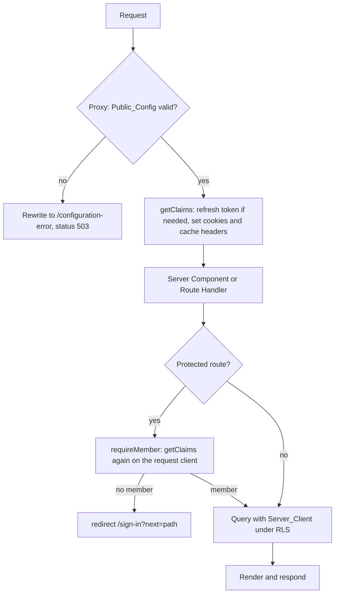
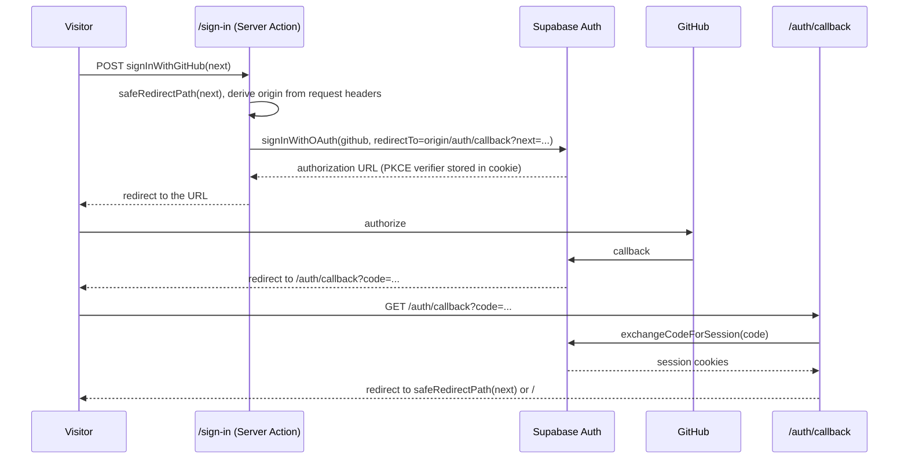

# Design Document

## Overview

`apps/web` is a Next.js 16 App Router application (`@lazarus/web`) that delivers the Lazarus shell and the first product stage, The Morgue. Everything that touches data runs on the server with a per-request Supabase client built from the anon key, so the database role is `anon` for a Visitor and `authenticated` for a Member and Row Level Security decides every result. The app never holds the service role key.

Design decisions:

1. **Server-first.** Pages are Server Components that query through the Server_Client. Client Components exist only for GSAP animation, the confirm-delete dialog, the file input, and the sign-in/out buttons' pending state.
2. **Writes are Server Actions.** Import, delete, sign-in, and sign-out are Server Actions. Each one starts with `requireMember()`, validates its input, and returns a typed result (`{ ok: true }` or `{ ok: false, errors }`) with fixed English messages. Database errors are logged on the server and replaced by a generic message.
3. **Identity comes from verified Claims.** `getCurrentMember()` calls `supabase.auth.getClaims()`. No server code uses `getSession()` for an authorization decision.
4. **Pure logic is separate from I/O.** Redirect sanitizing, import validation, hashing, config validation, and status mapping are pure functions in `src/lib/`, tested without a network. Supabase calls live in `src/lib/data/` and `src/app/**/actions.ts`.
5. **No new runtime dependency for validation.** Import validation is a small hand-written function. The only UI dependencies are those the requirements name plus what `shadcn/ui` generates.

### Facts verified while writing this design

| Fact | Evidence |
|---|---|
| Next.js 16.4.5 builds with `typescript@6.0.3` (strict, `moduleResolution: bundler`, `next.config.ts`) and detects `src/proxy.ts` as `Proxy (Middleware)`. | Probe project built outside the repository; build exit code 0. |
| Next.js reads `.env` files from the project directory (`apps/web`), not from the repository root. Calling `loadEnvConfig(root)` in `next.config.ts` has no effect unless the fourth argument `forceReload` is `true`, because Next already loaded the project env once. With `forceReload: true`, `NEXT_PUBLIC_*` values are inlined, server-only values are readable on the server, and the server-only value is absent from `.next/static`. | Probe: first attempt returned `missing`; second returned the root values. |
| `NextResponse.rewrite(url, { status: 503 })` in `proxy.ts` returns HTTP 503 with the rewritten page body. | Probe against `next start`. |
| Versions at design time: `next` 16.4.5, `react` and `react-dom` 19.3.1, `@supabase/ssr` 0.12.7 (peer `@supabase/supabase-js` `^2.114`), `@supabase/supabase-js` 2.119.0, `tailwindcss` 4.3.5, `shadcn` 4.23.0, `gsap` 3.15.1, `@gsap/react` 2.1.2 (peer `gsap ^3.12.5`), `eslint-config-next` 16.4.5 (peer `eslint >=9`). | `npm view`. After `pnpm install`, `pnpm-lock.yaml` is the source of truth (`tech.md`). |
| Supabase guidance for Next.js 16: the Proxy refreshes the token with `getClaims()`, `setAll` receives cache headers that must be applied to the response, and `getSession()` must not be trusted on the server. | Supabase docs, "Creating a Supabase client for SSR". |

## Architecture

### Folder layout

```text
apps/web/
├── package.json, tsconfig.json, next.config.ts, postcss.config.mjs
├── components.json              # shadcn/ui configuration (aliases to src/)
├── eslint.config.mjs            # root rules + eslint-config-next
├── vitest.config.ts             # extends ../../vitest.shared.ts
├── turbo.json                   # extends the root; env and inputs for the build
├── README.md
└── src/
    ├── proxy.ts                 # session refresh; 503 rewrite when config is invalid
    ├── app/
    │   ├── layout.tsx, globals.css, not-found.tsx, error.tsx, global-error.tsx
    │   ├── page.tsx, loading.tsx                     # Morgue
    │   ├── configuration-error/page.tsx
    │   ├── sign-in/page.tsx, sign-in/actions.ts
    │   ├── auth/callback/route.ts
    │   ├── corpses/[id]/page.tsx, loading.tsx, actions.ts   # Corpse_Page + delete
    │   ├── crypt/page.tsx, loading.tsx                      # The Crypt
    │   └── import/page.tsx, import/actions.ts, import/import-form.tsx
    ├── components/
    │   ├── ui/                  # shadcn/ui generated components
    │   ├── site-header.tsx, site-footer.tsx, skip-link.tsx
    │   ├── corpse-card.tsx, status-badge.tsx, language-badge.tsx
    │   ├── code-view.tsx, curse-list.tsx, delete-corpse-button.tsx
    │   └── notice.tsx, empty-state.tsx
    ├── animations/              # reveal.ts (timeline factory), use-reveal.ts (hook), reveal.tsx
    └── lib/
        ├── env.ts               # Public_Config validation
        ├── security/            # safe-redirect.ts, request-origin.ts
        ├── supabase/            # client.ts, server.ts, proxy.ts (updateSession)
        ├── auth/                # member.ts (getCurrentMember, requireMember)
        ├── data/                # corpses.ts (queries), types.ts (row types and guards)
        ├── import/              # validate.ts, hash.ts, limits.ts
        └── ui/                  # status.ts (status to badge mapping), format.ts (dates)
```

### Route map

| Route | Access | Rendering | Purpose |
|---|---|---|---|
| `/` | Visitor and Member | Dynamic | Morgue |
| `/sign-in` | Visitor (Member is redirected to `/`) | Dynamic | Starts the GitHub flow |
| `/auth/callback` | Any | Route Handler | Exchanges the OAuth `code` |
| `/corpses/[id]` | Visitor (samples) and Member (own) | Dynamic | Corpse_Page |
| `/crypt` | Member | Dynamic | Crypt |
| `/import` | Member | Dynamic | Import_Form |
| `/configuration-error` | Any | Dynamic | Shown with status 503 |

All routes are dynamic because they read cookies. The `next.config.ts` `headers()` sets `Cache-Control: private, no-store` on every path except `_next/static` and `_next/image`.

### Request lifecycle



### Sign-in sequence



## Components and Interfaces

### `lib/env.ts` (Requirement 2)

```ts
export type PublicConfig = { supabaseUrl: string; supabaseAnonKey: string };
export type ConfigProblem = { variable: 'NEXT_PUBLIC_SUPABASE_URL' | 'NEXT_PUBLIC_SUPABASE_ANON_KEY'; reason: 'missing' | 'invalid' };
export type ConfigResult = { ok: true; config: PublicConfig } | { ok: false; problems: ConfigProblem[] };

export function validatePublicConfig(input: { url: string | undefined; anonKey: string | undefined }): ConfigResult; // pure
export function readPublicConfig(): ConfigResult; // reads the two variables with LITERAL property access
```

`readPublicConfig` accesses `process.env.NEXT_PUBLIC_SUPABASE_URL` and `process.env.NEXT_PUBLIC_SUPABASE_ANON_KEY` as literal expressions, because Next.js only inlines literal accesses into client bundles. Problems carry the variable name and a reason, never the value. The URL rule is `https://`, or `http://` with host `localhost` or `127.0.0.1`.

No module in `src/` reads a Server_Only_Variable. The app needs none of them, so Requirement 2 criteria 5 to 7 hold by absence and are enforced by tests (Testing strategy).

### Root env loading (`next.config.ts`)

```ts
loadEnvConfig(path.resolve(here, '../..'), process.env.NODE_ENV !== 'production', console, true);
```

The `true` (`forceReload`) is required; without it the call is silently ignored. Real environment variables keep precedence over file values, and `.env.local` over `.env`, which is the behavior of `@next/env`. `@next/env` is a direct dependency pinned to the same version as `next`. The config also sets `distDir` from `process.env.NEXT_DIST_DIR ?? '.next'` (used by the bundle test) and the security headers.

### Supabase clients (Requirement 5)

- `client.ts`: `createBrowserClient(url, anonKey)`, returned from `createClient()`.
- `server.ts`: `async function createClient()`; reads `cookies()` from `next/headers`; `getAll` returns the request cookies; `setAll(cookies, headers)` writes them inside `try/catch` (Server Components cannot write) and ignores the thrown error.
- `proxy.ts` (`updateSession(request)`): builds a `NextResponse.next({ request })`, creates a server client whose `setAll` copies cookies to both the request and the response and copies the three cache headers to the response, calls `await supabase.auth.getClaims()`, and returns the response that `setAll` last built. The function wraps the Supabase call in `try/catch`; on failure it returns the plain `NextResponse.next({ request })` so a Supabase outage never blocks a page (Requirement 14 criterion 4).

`src/proxy.ts` exports `proxy(request)`: if `readPublicConfig()` is not ok and the path is not `/configuration-error`, it returns `NextResponse.rewrite(url, { status: 503 })`; otherwise it returns `updateSession(request)`. The matcher excludes `_next/static`, `_next/image`, `favicon.ico`, and common image and font extensions.

### Member and redirects (Requirements 5, 6, 7, 13)

```ts
export type Member = { id: string; email: string | null };
export async function getCurrentMember(): Promise<Member | null>;      // getClaims() -> sub, email
export async function requireMember(nextPath: string): Promise<Member>; // redirects to /sign-in?next=<safe path>
export function safeRedirectPath(value: unknown): string | null;
export function requestOrigin(headers: Headers): string;
```

`safeRedirectPath` returns the value unchanged when it is a string of at most 512 characters that starts with `/`, does not start with `//` or `/\`, and contains no backslash and no character below U+0020 or equal to U+007F. Otherwise it returns `null`; callers fall back to `/`. `requestOrigin` builds `proto://host` from `x-forwarded-proto` and `x-forwarded-host` (or `host`), defaulting to `http` for `localhost` and `https` otherwise. Supabase additionally checks `redirectTo` against the project's redirect allowlist, which bounds the risk of a forged `Host` header.

### Data layer (`lib/data/`) (Requirements 8 to 12)

All functions take a Supabase client created by the caller, return plain typed values, and throw a `DataError` (message only, no database text) that pages convert to the generic error state.

```ts
export type CorpseStatus = 'INFECTED' | 'IN_SEANCE' | 'RESURRECTED' | 'FAILED';
export type SourceLanguage = 'es3' | 'es5-jquery' | 'legacy-node';
export type CorpseSummary = { id: string; title: string; sourceLanguage: SourceLanguage; status: CorpseStatus; createdAt: string; isSample: boolean; curseCount: number };
export type CorpseDetail = CorpseSummary & { originalCode: string; repoUrl: string | null; userId: string | null; curses: Array<{ id: string; curseType: string; severity: string; lineNumber: number }> };

listSampleCorpses(client): Promise<CorpseSummary[]>
listOwnedCorpses(client, memberId, { page, pageSize }): Promise<{ items: CorpseSummary[]; total: number }>
getCorpse(client, id): Promise<CorpseDetail | null>
```

Queries:

- Summaries use one request with an embedded count: `.select('id,title,source_language,status,created_at,is_sample,curses(count)')`. PostgREST returns `curses: [{ count: n }]`, so Requirement 9 criterion 5 holds with one query per list.
- Samples: `.eq('is_sample', true).order('title')`. Owned: `.eq('user_id', memberId).eq('is_sample', false).order('created_at', { ascending: false }).range(from, to)` with `{ count: 'exact' }`.
- Detail: `.select('id,title,source_language,status,created_at,is_sample,user_id,repo_url,original_code,curses(id,curse_type,severity,line_number)').eq('id', id).maybeSingle()` with the curses ordered by `line_number`.
- Rows are mapped through type guards in `types.ts`; an unexpected shape throws `DataError`.

The explicit `user_id` filter in the Crypt is not a security control. RLS is. The filter keeps the Member's own list from including samples and uses the `corpses_user_id_idx` index.

### Import (`lib/import/`, `app/import/actions.ts`) (Requirement 11)

```ts
export const IMPORT_LIMITS = { maxBytes: 102_400, maxTitle: 200, maxCorpses: 100, maxRepoUrl: 2048 } as const;
export type ImportFields = { title: string; language: string; pastedCode: string; file: { size: number } | null; repoUrl: string };
export type ImportErrors = Partial<Record<'title' | 'language' | 'code' | 'repoUrl', string>>;
export function validateImport(fields: ImportFields, decoded: DecodedCode | null): { ok: true; value: ImportValue } | { ok: false; errors: ImportErrors };
export function normalizeNewlines(text: string): string;          // CR LF -> LF
export function sha256Hex(text: string): Promise<string>;         // UTF-8, lowercase hex
```

Server Action flow:

1. `requireMember('/import')`.
2. Read `FormData`. If a file is present, check `file.size` against `maxBytes` **before** reading it; then read `arrayBuffer()` and decode with `new TextDecoder('utf-8', { fatal: true })`, which rejects invalid UTF-8 (Requirement 11 criteria 3 and 11).
3. `validateImport` returns per-field messages. On failure the action returns `{ ok: false, errors, values }` and the form redisplays the title, language, and pasted text.
4. Normalize newlines, compute `code_hash`, and check for an existing row with the same `user_id` and `code_hash`; if found, redirect to it with `?notice=already-imported`.
5. Count the Member's corpses (`head: true, count: 'exact'`); at 100 or more, return the limit message.
6. Insert with `{ user_id: member.id, is_sample: false, status: 'INFECTED', ... }` and `.select('id').single()`, then `redirect('/corpses/<id>')`.
7. Any database error is logged with `console.error` (message and code, never the key) and replaced by "The corpse could not be saved. Try again later."

The duplicate check and the limit check are not atomic. The schema has no unique constraint on `(user_id, code_hash)`, so two simultaneous imports of the same code can both succeed. The harm is a duplicate row in the Member's own Crypt, so this spec accepts it and does not change the Foundation schema.

### Delete and sign-out actions (Requirements 6 and 12)

- `deleteCorpse(formData)`: `requireMember`, validates that `id` is a UUID, runs `.delete().eq('id', id).select('id')` with the Server_Client, and treats an empty result as "not deleted" (Requirement 12 criterion 6). Success redirects to `/crypt`. No explicit deletes of child rows are issued; the schema cascade removes them.
- `signOut()`: `supabase.auth.signOut()` then `redirect('/')`.
- `signInWithGitHub(formData)`: described in the sequence above.

### Auth callback (`app/auth/callback/route.ts`)

`GET` reads `code` and `next`. Without a code, or when `exchangeCodeForSession` returns an error, it redirects to `/?auth_error=callback`. The page maps the fixed value `callback` to a fixed English message; any other value of `auth_error` is ignored. The redirect target is built from `requestOrigin` and `safeRedirectPath(next) ?? '/'`.

### UI components

| Component | Notes |
|---|---|
| `SiteHeader` | Server Component. Brand, links by role, and either the GitHub sign-in form or the avatar, username, and sign-out form. |
| `CorpseCard` | Server Component wrapped by the Reveal client component. Link to `/corpses/<id>`. |
| `StatusBadge` | Uses `statusPresentation(status)`: `INFECTED` and `FAILED` map to the crimson token, `IN_SEANCE` to the neutral token, `RESURRECTED` to the emerald token. The text is always rendered. |
| `CodeView` | Splits `originalCode` on `\n`, renders a table or a list of lines with a number gutter, inside `overflow-x-auto`, as text children only. |
| `DeleteCorpseButton` | Client Component using the shadcn `AlertDialog`; submits the delete Server Action after confirmation. |
| `ImportForm` | Client Component with `useActionState` for field errors and pending state. |

### Theme (Requirement 3)

`globals.css` defines the tokens once in `@theme` (Tailwind 4): `--color-background: #09090b`, `--color-curse: #e11d48`, `--color-verified: #10b981`, plus neutral foreground and muted tokens chosen to reach 4.5:1 on the background (for example `#fafafa` and `#a1a1aa`, with the muted pair checked by a unit test that computes the contrast ratio). `html` sets `color-scheme: dark`. Fonts use system stacks (`ui-serif` for headings, `ui-monospace` for code) so the build needs no network access. The shadcn variables map onto the same tokens.

### Animation (Requirement 4)

`animations/reveal.ts` exports `createReveal(container, selector, { reducedMotion })`, which returns a `gsap.core.Timeline` animating `opacity` and `y` only. `use-reveal.ts` wraps it in `useGSAP({ scope })` and checks `window.matchMedia('(prefers-reduced-motion: reduce)')` through `gsap.matchMedia()`, so reverting on unmount and on media changes is handled by GSAP. `reveal.tsx` is a `'use client'` wrapper component with `children`. Server HTML always contains the final visible state; the timeline uses `gsap.from`, so a failed script leaves the content visible.

### Security headers (Requirement 13)

`next.config.ts` `headers()` returns, for `/:path*`, `X-Content-Type-Options: nosniff`, `Referrer-Policy: strict-origin-when-cross-origin`, `X-Frame-Options: DENY`, and `Permissions-Policy: camera=(), microphone=(), geolocation=()`, and a second rule that adds `Cache-Control: private, no-store` for every path except `_next/static` and `_next/image`. A Content-Security-Policy is not part of this spec; Next.js inline scripts and GSAP require a nonce-based policy that is better designed once with the final pages.

### Monorepo integration (Requirement 1 and 17)

- `apps/web/turbo.json` extends the root and sets for `build`: `outputs` (`.next/**`, `!.next/cache/**`), `env` (`NEXT_PUBLIC_SUPABASE_URL`, `NEXT_PUBLIC_SUPABASE_ANON_KEY`, `NEXT_DIST_DIR`), and `inputs` that add `$TURBO_ROOT$/.env` and `$TURBO_ROOT$/.env.local` to the cache key. Turborepo's strict environment mode would otherwise hide real environment variables from `next build`. This keeps all changes inside `apps/web`.
- `tsconfig.json` extends `../../tsconfig.base.json` and overrides `module: esnext`, `moduleResolution: bundler`, `jsx: react-jsx`, `noEmit`, `incremental`, `lib` (adds `dom`), and `paths` (`@/*`), plus the `next` plugin.
- `eslint.config.mjs` spreads the root configuration and adds `eslint-config-next`. ESLint 10 resolves the configuration from each linted file's directory, so the root `eslint .` and the package `lint` script use the same file for `apps/web` (to be confirmed at implementation).
- `package.json` scripts: `dev` (`next dev`), `build` (`next build`), `start` (`next start`), `test` (`vitest run`), `lint` (`eslint . && tsc --noEmit`).

## Data Models

There are no new tables. The app reads and writes `public.corpses` and reads `public.curses` and `public.profiles` as defined by `01-lazarus-foundation`. The import writes only: `user_id`, `is_sample`, `title`, `source_language`, `original_code`, `code_hash`, `repo_url`, `status`.

The profile display name comes from `public.profiles` (`github_username`, `avatar_url`) read with the Member's own session; if the row is missing or the fields are NULL the header falls back to the email and a generic avatar.

## Error Handling

| Condition | Behavior |
|---|---|
| Public_Config missing or invalid | Proxy rewrites to `/configuration-error` with status 503; the page lists variable names only. |
| Supabase unreachable in the Proxy | `updateSession` returns `NextResponse.next`; the page shows the generic error state if its own query fails. |
| Query error on a page | `DataError` is caught in the page; logs `console.error` with the message and code; the page renders the generic error state. |
| Corpse id is not a UUID, or no row | `notFound()`, same 404 response. |
| Visitor calls a write action | `requireMember` redirects to `/sign-in`; no write method is called. |
| Import validation failure | Field messages in English; nothing written. |
| Insert or delete rejected by the database | Generic message; details only in the server log. |
| OAuth callback failure | Redirect to `/?auth_error=callback`; fixed message. |
| Uncaught render error | `error.tsx` and `global-error.tsx` show a generic message and the error digest. |

## Testing Strategy

`pnpm test` runs Vitest in single-run mode with a config that extends `vitest.shared.ts`. No test needs a database, a network, or a Supabase project.

### Correctness properties

1. **Safe redirect.** For any string input, `safeRedirectPath` returns `null` or a string that starts with a single `/`, and `new URL(result, 'https://app.example')` has the origin `https://app.example`. Fixed examples cover the accepted and rejected lists of Requirement 15. (Requirements 6.3, 13.4)
2. **Hash.** `sha256Hex` equals the digest produced by `node:crypto` for any string; normalization is idempotent; `a\r\nb` and `a\nb` produce the same hash; non-ASCII text hashes over its UTF-8 bytes. (Requirement 11.5)
3. **Import validation is total and exact.** For any generated fields, `validateImport` never throws; it accepts exactly the inputs that satisfy every rule of Requirement 11 criterion 3 (checked against an independent oracle written in the test). (Requirement 11.3)
4. **Config validation never leaks.** For any pair of strings, no problem or message produced by `validatePublicConfig` contains the supplied value. (Requirement 2.2)
5. **Status mapping is total.** All four statuses map to a presentation with non-empty text; only `INFECTED` and `FAILED` use the crimson token and only `RESURRECTED` uses the emerald token. (Requirement 9.3)
6. **Contrast.** The foreground and muted tokens reach at least 4.5:1 against `#09090b`, computed from the hex values. (Requirement 3.6)
7. **Visitor cannot write.** With a fake Supabase client whose `getClaims` returns no user, calling the import, delete, and sign-out actions never calls `insert`, `update`, `delete`, or `signOut`. (Requirements 8.3, 15.6)

### Example and structural tests

- Public_Config: missing, blank, malformed, and valid values (Requirement 15.4).
- Import: one example per rejection rule and one accepted example (Requirement 15.3).
- Server-only isolation, static: every file with `'use client'` and every module reachable from it through relative or `@/` imports is scanned; none may contain a Server_Only_Variable name, and no `src/` file may contain `SUPABASE_SERVICE_ROLE_KEY`, `GROQ_API_KEY`, `LLM_MODEL`, `dangerouslySetInnerHTML`, or an import of `ai`, `@ai-sdk/groq`, or `@ai-sdk/google`.
- Server-only isolation, built output (Requirement 15.7): the test runs `next build` with `NEXT_DIST_DIR` set to a temporary directory and sentinel values for the Server_Only_Variables in its environment, then searches `static/` for the variable names and the sentinel values. The build uses placeholder Public_Config and no network. It takes tens of seconds, so the test has a long timeout.

### Manual verification (not automated)

GitHub OAuth against a real Supabase project, and the PostgREST queries (embedded `curses(count)`, `maybeSingle`, `range`) against the project's Data API, cannot run in the automated suite. The README lists the steps. A user must apply the Foundation migrations to the target project (`pnpm db:migrate`) before the Morgue shows the samples.

## Open Items

1. **ESLint configuration lookup.** Confirm at implementation that ESLint 10 applies `apps/web/eslint.config.mjs` to files under `apps/web` when invoked from the repository root. If it does not, add the Next rules through the package script only and keep the root run on the root configuration.
2. **pnpm build-script approvals.** `pnpm` 12 may require approval for dependency build scripts (for example `sharp`). If so, record the allowed packages in `apps/web/package.json` or in the workspace file; a change to `pnpm-workspace.yaml` must keep the globs `apps/*` and `packages/*` as its only globs (Foundation Requirement 1 criterion 2).
3. **shadcn/ui initialization.** `shadcn@4.23.0` runs a CLI that writes `components.json`, `globals.css`, and `lib/utils.ts`. Run it non-interactively inside `apps/web`, review its output against the Theme_Tokens, and keep only the components the pages use.
4. **No unique constraint on `(user_id, code_hash)`.** The duplicate check can race; accepted above. A later spec may add a unique index in a new migration.
5. **Supabase key naming.** The app reads `NEXT_PUBLIC_SUPABASE_ANON_KEY` as defined in `.env.example`. Supabase documentation now calls the client key the publishable key; the legacy anon key keeps working. Renaming is a one-line change in `lib/env.ts` and `.env.example` if wanted.
