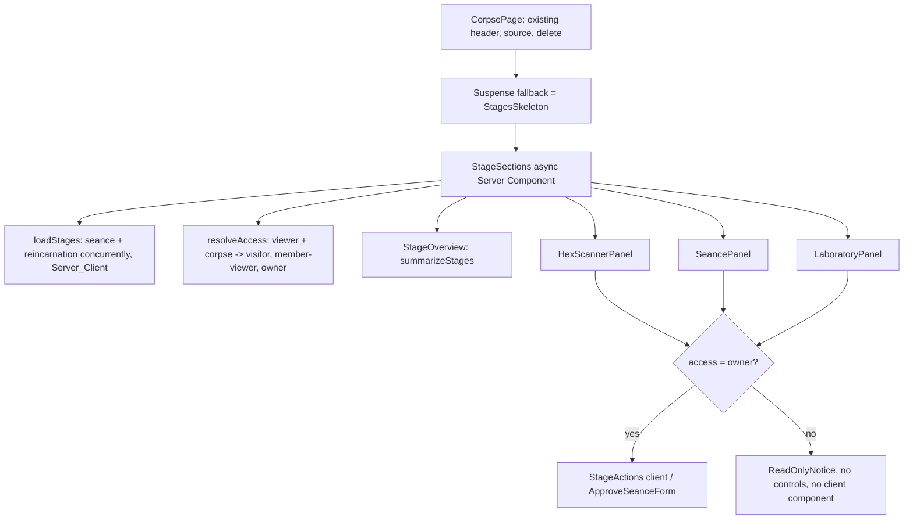

# Design Document

## Overview

This spec turns the corpse page (`/corpses/[id]`) of `apps/web` into the place where a corpse is scanned, interrogated, and resurrected. It adds three sections (Hex Scanner, Séance Chamber, Laboratory) and one navigation block (Stage_Overview). No new route and no new table are needed.

Design decisions:

1. **The database is the single source of truth for display.** Server Components read the curses, the Stored_Seance, and the Stored_Reincarnation with the per-request Server_Client (anon key, RLS). After a Pipeline_API call succeeds, the browser only calls `router.refresh()`; it never renders a response body. This removes a second mapping from API JSON to view and makes the Visitor path and the owner path render the same components.
2. **Visitors get a different tree, not a hidden one.** The Stage_Access is resolved on the server. For a Visitor or a Member looking at a sample, the `StageActions` client component is not in the tree at all, so the HTML contains no control and no `/api/` path (Requirement 7).
3. **Pure view models carry the logic.** Verification state, evidence text, control gating, stage summaries, scanner grouping, restricted markdown parsing, outcome parsing, error and retry text, and the pending-state reducer are pure functions under `src/lib/stages/`. They are tested with fast-check. Components are thin.
4. **Evidence text is computed by the UI from the stored columns.** The UI does not use the `evidence` field of the Pipeline_API (including the `reincarnation.evidence` of the Verify_Route), so it works for the seeded samples, for rows the API wrote, and for rows that the Verify_Route of `08-live-verification-api` updates.
5. **A tiny hand-written renderer for the spec text.** `requirements_md` and `design_md` have a known, narrow shape. A 100-line pure parser produces typed blocks that components render as text. No markdown library and no HTML path exist, so model-authored text cannot become markup.
6. **Approval is a UI-level gate owned by this spec.** `05-llm-pipeline-api` leaves `approved_at` NULL and does not require it: Requirement 12 criterion 10 of spec 05 deliberately lets the Reincarnate_Route generate whether or not `approved_at` is set. This spec adds the approval control (a Server Action under the owner `UPDATE` RLS policy) and enables the reincarnation control only for an approved spec. The gate is a UI policy (human review before generation), not a security boundary: a direct API client can bypass it, this is intended, 06 owns the policy, and no backend enforcement is planned (Requirement 8 criterion 10, Open Item 7).
7. **Reuse over invention.** The page reuses `CodeView`, `Notice`, `ErrorState`, `StatusBadge`, `Badge`, `Card`, `Button`, `Reveal`/`useReveal`, `formatDateUtc`, `pluralize`, `fakeClient`, `requireMember`, and the notice-code table. No new GSAP timeline is added.
8. **Live verification is one more route of the same pattern.** The "Verify live" control reuses `StageActions`, `runPipeline`, the reducer, and the failure map. It differs from the other controls in three places only: the path (`/api/verify`), the accepted `source` values (`executed` instead of `generated`), and the client timeout (70,000 ms, longer than the 60 s server deadline of spec 08). It is offered only to the owner for a reincarnation in the state `NOT_RUN`; final results (`VERIFIED`, `FAILED`, `INCOMPLETE`) have no re-run in spec 08, so the control never appears for them (Requirement 8 criterion 9, Requirement 18).

### Facts verified while writing this design

| Fact | Evidence |
|---|---|
| The corpse page loads one corpse with embedded curses through `getCorpse` and `loadCorpse` (React `cache`). `CurseRow` has `id`, `curseType`, `severity`, `lineNumber` only. | `src/lib/data/corpses.ts`, `types.ts`, `load-corpse.ts` |
| The page renders `CodeView`, `CurseList`, and the `NextStages` placeholder; the Delete control is shown to the owner. | `src/app/corpses/[id]/page.tsx`, `components/next-stages.tsx` |
| `CodeView` renders text-only lines with line numbers, a focusable region, and `aria-label="Original source code"`. It has no line ids and no markers. | `components/code-view.tsx` |
| `Reveal` wraps children and animates `[data-reveal]` descendants inside `gsap.matchMedia('(prefers-reduced-motion: no-preference)')`. | `animations/reveal-section.tsx`, `use-reveal.ts` |
| RLS: `seance_specs` and `reincarnations` allow `SELECT` for samples (to `anon` and `authenticated`) and for the owner; the owner also has `UPDATE`. `curses` follows the same pattern. | `db/migrations/V1__create_lazarus_schema.sql` |
| The three seeded samples have curses, one `seance_specs` row with `approved_at = now()`, and one `reincarnations` row with `pbt_passed` and `total_runs` produced by a real run (1000 runs per `sample.json`). | `db/migrations/V2__seed_sample_corpses.sql`, `db/seed/*/sample.json` |
| `seance_specs` has no `created_at`; `reincarnations` has `created_at`. | `V1` schema |
| Tests run in the `node` environment. No `.test.tsx` file, `jsdom`, or Testing Library exists in `apps/web`. The Vitest config includes `src/**/*.test.{ts,tsx}`. | `vitest.shared.ts`, `apps/web/vitest.config.ts`, `package.json` |
| Existing server-action tests mock `next/navigation` and `@/lib/supabase/server` and use `fakeClient` with `writeCalls`. | `src/app/actions.test.ts`, `lib/testing/fake-client.ts` |
| `05-llm-pipeline-api` (unfinished) fixes: the three routes, body `{ corpseId }`, header `Origin` required, JSON `source` of `precomputed | stored | cache | generated`, error envelope with `error.code` from a closed list of 21 codes (Requirement 17 of spec 05), `Retry-After` on 429, non-streaming responses (spec 05 is being edited to say that streaming is not planned in any spec; see Open Item 14), user reincarnations stored with `pbt_passed`, `total_runs`, `execution_time_ms` NULL, `approved_at` left NULL, and a cache copy inserted with `approved_at` NULL. | `05-llm-pipeline-api/requirements.md` (read at design time) |
| `08-live-verification-api` (its requirements were cross-checked against this contract by the cross-spec review: path, body, `source` values, the five codes with their statuses, `Retry-After` on `RATE_LIMITED` and `VERIFICATION_BUSY`, `maxDuration` 60, no re-run) owns `POST /api/verify`. Contract: success `{ ok: true, source: 'precomputed' / 'stored' / 'executed', reincarnation: { id, targetStack, pbtPassed, totalRuns, executionTimeMs, verification, evidence }, corpse: { id, status } }`; five new codes `REINCARNATION_REQUIRED` 409, `VERIFICATION_DISABLED` 503, `VERIFICATION_BUSY` 429 with `Retry-After`, `VERIFICATION_INCONCLUSIVE` 422, `SANDBOX_UNAVAILABLE` 503; a 60 s server deadline; a separate verification limit; no re-run of a final result. | `08-live-verification-api/requirements.md` (Requirements 2, 3, 5, 9); re-check at implementation time (task 7.3, Open Item 15) |
| The Live_Execution_Gate of `07-sandboxed-execution` has `userExecutionEnabled` set to `false` by default, so a freshly deployed server is expected to answer `VERIFICATION_DISABLED` to the Verify_Control until an operator enables user execution. | `07-sandboxed-execution/requirements.md` (Gate_Config; Requirement 3 criterion 5) |

## Architecture

### Folder layout (additions and changes)

```text
apps/web/src/
├── app/
│   └── corpses/[id]/
│       ├── page.tsx                 # CHANGED: Suspense + StageSections, notice codes, no NextStages
│       ├── loading.tsx              # CHANGED: reserves overview + three sections
│       └── actions.ts               # CHANGED: adds approveSeance (deleteCorpse stays)
├── components/
│   ├── code-view.tsx                # CHANGED: label, idPrefix, markedLines props (defaults keep 04 behavior)
│   ├── curse-list.tsx               # REMOVED (replaced by HexScannerPanel); its test, if any, moves
│   ├── next-stages.tsx              # REMOVED
│   └── stages/
│       ├── stage-sections.tsx       # async Server Component: loads data, resolves access, composes all
│       ├── stage-overview.tsx       # nav with three links and state words
│       ├── stage-section.tsx        # <section> wrapper: id, heading, tabIndex -1 for focus
│       ├── hex-scanner-panel.tsx
│       ├── seance-panel.tsx
│       ├── spec-markdown.tsx        # renders SpecBlock[] as text elements
│       ├── laboratory-panel.tsx
│       ├── verification-evidence.tsx
│       ├── readonly-notice.tsx      # visitor / member-viewer notice
│       ├── stage-actions.tsx        # 'use client': trigger + pending/success/failure region (scan, seance, reincarnate, verify)
│       ├── approve-seance-form.tsx  # 'use client': form + useFormStatus pending
│       └── stages-skeleton.tsx      # Suspense fallback, reused by loading.tsx
└── lib/
    ├── data/
    │   ├── types.ts                 # CHANGED: CurseRow fields, SeanceSpec, Reincarnation, guards
    │   ├── corpses.ts               # CHANGED: DETAIL_COLUMNS adds description, exorcism_strategy
    │   ├── stages.ts                # NEW: getSeanceSpec, getReincarnation, approveSeanceSpec
    │   └── load-stages.ts           # NEW: React cache wrapper
    ├── messages.ts                  # CHANGED: notice codes approved, approve-failed
    └── stages/                      # NEW: pure modules (no server-only, no next/*)
        ├── wording.ts               # FORBIDDEN_TERMS, containsForbiddenTerm
        ├── format.ts                # formatRunCount, formatDuration, formatRetryAfter
        ├── verification.ts          # buildVerificationView
        ├── spec-markdown.ts         # parseSpecMarkdown, parseInline, serializeInline
        ├── scanner-view.ts          # buildScannerView
        ├── controls.ts              # resolveAccess, stageControls (incl. verify), summarizeStages
        ├── errors.ts                # PIPELINE_ERROR_CODES (26), presentFailure (per route), presentSuccess
        ├── pipeline-client.ts       # PIPELINE_PATHS (incl. verify), RESULT_SOURCES per route, parseOutcome, runPipeline (fetch injected)
        └── action-state.ts          # actionReducer (pending state machine)
```

`lib/stages/*` imports nothing from `next/*`, `react`, or `process.env`, so the same modules run in Server Components, Client Components, and Vitest in the `node` environment.

### Page composition



The corpse is already loaded by `loadCorpse(id)` (cached per request). `StageSections` receives the `CorpseDetail` and the `Viewer` from the page, so it does not repeat those reads.

### Trigger sequence (owner)

```mermaid
sequenceDiagram
    participant U as Owner
    participant C as StageActions (client)
    participant API as Pipeline_API (specs 05 and 08)
    participant S as Server Components
    U->>C: activate "Begin séance"
    C->>C: reducer: idle -> pending (ignored if already pending)
    C->>API: POST /api/seance {"corpseId"} (same origin, JSON)
    API-->>C: 200 {ok, source} or error envelope (+ Retry-After)
    C->>C: parseOutcome(status, header, body)
    alt success
        C->>C: reducer: pending -> done(source)
        C->>S: router.refresh()
        S-->>U: sections re-render from the database
        C-->>U: status message stays; focus to section heading
    else failure
        C->>C: reducer: pending -> failed(presentation, retryAt)
        C-->>U: alert message; control enabled (or waits for retryAt)
    end
```

## Components and Interfaces

### Data layer (`lib/data/`)

`types.ts` additions (existing exports unchanged except `CurseRow`):

```ts
export interface CurseRow {
  id: string;
  curseType: string;
  severity: string;
  lineNumber: number;
  description: string;        // NEW
  exorcismStrategy: string;   // NEW
}

export interface InvariantsDocument {
  entryFunction: string;
  input: string;
  output: string;
  invariants: string[];
}

export interface SeanceSpec {
  id: string;
  requirementsMd: string;
  designMd: string;
  invariants: InvariantsDocument | null; // null = unreadable (Requirement 2.5)
  approvedAt: string | null;
}

export interface Reincarnation {
  id: string;
  targetStack: string;
  modernCode: string;
  pbtTestCode: string;
  pbtPassed: boolean | null;
  totalRuns: number | null;
  executionTimeMs: number | null;
  createdAt: string;
}

export function parseInvariants(value: unknown): InvariantsDocument | null; // never throws
export function parseSeanceSpec(value: unknown): SeanceSpec;               // DataError on bad shape
export function parseReincarnation(value: unknown): Reincarnation;         // DataError on bad shape
```

`parseInvariants` accepts an object with exactly the four keys, three non-empty strings, and an array of strings (empty array allowed); anything else returns `null`. `parseSeanceSpec` and `parseReincarnation` use the existing `asRow`, `text` helpers; nullable numeric and boolean columns map to `null` when absent. `totalRuns` and `executionTimeMs` are kept as the stored numbers; judging them valid is the job of `buildVerificationView`.

`corpses.ts`: `DETAIL_COLUMNS` becomes `...,curses(id,curse_type,severity,line_number,description,exorcism_strategy)`. The existing ordering by `line_number` stays; `parseDetail` sorts by `(lineNumber, curseType)` so the second key is deterministic (Requirement 2.2).

`stages.ts` (`SupabaseClient` is passed in, like the other data modules):

```ts
export async function getSeanceSpec(client: SupabaseClient, corpseId: string): Promise<SeanceSpec | null>;
export async function getReincarnation(client: SupabaseClient, corpseId: string): Promise<Reincarnation | null>;
export async function approveSeanceSpec(client: SupabaseClient, corpseId: string, nowIso: string): Promise<boolean>;
```

- `getSeanceSpec`: `.from('seance_specs').select('id,requirements_md,design_md,invariants_json,approved_at').eq('corpse_id', corpseId).limit(1).maybeSingle()`. `limit(1)` keeps it working before the unique index of `05-llm-pipeline-api` exists.
- `getReincarnation`: `.from('reincarnations').select('id,target_stack,modern_code,pbt_test_code,pbt_passed,total_runs,execution_time_ms,created_at').eq('corpse_id', corpseId).order('created_at', { ascending: false }).limit(1).maybeSingle()`.
- `approveSeanceSpec`: `.from('seance_specs').update({ approved_at: nowIso }).eq('corpse_id', corpseId).is('approved_at', null).select('id')`; returns `true` when at least one row came back. Only `approved_at` is written; RLS limits it to the owner.
- Errors are logged and converted to `DataError` with the same `fail()` helper pattern as `corpses.ts` (the helper moves to a shared internal module `lib/data/fail.ts`, or is duplicated if the move is judged too invasive; see Open Item 11).

`load-stages.ts`: `export const loadStages = cache(async (corpseId: string) => { const client = await createClient(); const [seance, reincarnation] = await Promise.all([getSeanceSpec(client, corpseId), getReincarnation(client, corpseId)]); return { seance, reincarnation }; });`

### Access and controls (`lib/stages/controls.ts`)

```ts
export type StageAccess = 'visitor' | 'member-viewer' | 'owner';

export function resolveAccess(
  viewer: { member: { id: string } } | null,
  corpse: { isSample: boolean; userId: string | null },
): StageAccess;
// owner  <=> viewer !== null && !corpse.isSample && corpse.userId === viewer.member.id
// member-viewer <=> viewer !== null and not owner
// visitor <=> viewer === null

export interface StageFacts {
  curseCount: number;
  hasSeance: boolean;
  seanceApproved: boolean;
  hasReincarnation: boolean;
  verificationState: VerificationState | null; // NEW: null when no Stored_Reincarnation exists
}

export type ControlState = { available: true } | { available: false; reason: string | null };

export interface StageControls {
  scan: ControlState;
  seance: ControlState;
  approve: ControlState;
  reincarnate: ControlState;
  verify: ControlState; // NEW
}

export function stageControls(access: StageAccess, facts: StageFacts): StageControls;
```

Rules (Requirement 8): non-owner access gives `{ available: false, reason: null }` for all five. For the owner: `scan` always available; `seance` available iff `!hasSeance`; `approve` available iff `hasSeance && !seanceApproved`; `reincarnate` available iff `hasSeance && seanceApproved && !hasReincarnation`; `verify` available iff `hasReincarnation && verificationState === 'NOT_RUN'` (the access is already `owner` at this point). The approval condition of `reincarnate` is a UI-level restriction only; the Reincarnate_Route does not check `approved_at` (Requirement 8 criterion 10). The `verify` entry is `{ available: false, reason: null }` for `VERIFIED`, `FAILED`, and `INCOMPLETE` (final results, no re-run in spec 08; the evidence block already explains the state) and for a missing reincarnation (the reincarnation reason is shown instead). Reasons for an owner: `seance` unavailable (spec exists): `null` (the section shows the result); `reincarnate` unavailable: "Run the séance first." when no spec, "Approve the séance spec to enable reincarnation." when unapproved, `null` when a reincarnation exists.

```ts
export interface StageSummary { id: 'hex-scanner' | 'seance-chamber' | 'laboratory'; name: string; state: string }
export function summarizeStages(facts: StageFacts): StageSummary[]; // Laboratory state comes from facts.verificationState
```

Summary words: `curseCount === 0` gives "No curses stored", otherwise `pluralize(n, 'curse') + ' stored'`. Séance: "Not started" / "Awaiting approval" / "Approved". Laboratory: `facts.verificationState === null` gives "Not started", otherwise the label from `VERIFICATION_LABELS` (`VERIFIED` "Verified", `FAILED` "Failed", `NOT_RUN` "Not verified yet", `INCOMPLETE` "Incomplete").

### Verification (`lib/stages/verification.ts`, `format.ts`)

```ts
export type VerificationState = 'VERIFIED' | 'FAILED' | 'NOT_RUN' | 'INCOMPLETE';
export interface VerificationView {
  state: VerificationState;
  tone: 'verified' | 'curse' | 'neutral';   // StatusTone from lib/ui/status
  headline: string;                          // Evidence_Text for VERIFIED
  details: string[];                         // extra sentences, in order
  runCount: number | null;                   // set only when a valid count is shown
}
export function buildVerificationView(
  r: Pick<Reincarnation, 'pbtPassed' | 'totalRuns' | 'executionTimeMs'>,
  options?: { verifyAvailable?: boolean }, // NEW; default false
): VerificationView;

export function formatRunCount(n: number): string;          // Intl.NumberFormat('en-US', { useGrouping: true }) on a validated integer
export function formatDuration(ms: number): string;         // `${formatRunCount(ms)} ms`
export function formatRetryAfter(seconds: number): string;  // "30 seconds", "5 minutes", "2 hours"
```

Validity: a run count is valid when `Number.isInteger(n) && n > 0 && n <= Number.MAX_SAFE_INTEGER`. `formatRunCount` is only called with valid integers (and `executionTimeMs >= 0`). The exact texts are in Requirement 6. For `NOT_RUN`, `options.verifyAvailable === true` makes the headline "Not verified yet." with no `details` (the Laboratory panel renders the Verify_Control right below it); otherwise the headline is "Not verified yet." and `details` holds "No property-based test result is stored for this module." (Requirement 6 criterion 5). Other states ignore the option. `formatRetryAfter` rounds up: under 60 s, seconds; under 3,600 s, `ceil(s / 60)` minutes; otherwise `ceil(s / 3600)` hours, with singular/plural handled by `pluralize`.

Mapping from the 4 states to tone: `VERIFIED` to `verified`, `FAILED` to `curse`, `NOT_RUN` and `INCOMPLETE` to `neutral`. The `VerificationEvidence` component renders `headline` in a heading-level element and `details` as paragraphs, with a text label for the state so color is never the only signal.

### Scanner view (`lib/stages/scanner-view.ts`)

```ts
export interface ScannerEntry {
  id: string; label: string; severity: string; lineNumber: number;
  anchor: string | null;   // `source-line-${n}` when 1 <= n <= lineCount, else null
  description: string; strategy: string;
}
export interface ScannerView {
  total: number;
  bySeverity: Array<{ severity: string; count: number }>;      // FATAL, BLOOD_CURSE, HEX order; only counts > 0
  byType: Array<{ curseType: string; label: string; count: number }>; // alphabetical by label; only counts > 0
  entries: ScannerEntry[];                                      // sorted by (lineNumber, curseType, id)
  markedLines: ReadonlySet<number>;                             // lines in 1..lineCount that have a curse
}
export function buildScannerView(curses: readonly CurseRow[], lineCount: number): ScannerView;
```

`lineCount` is computed once from the source with the same rule as `CodeView` (split on `\n`, drop one trailing empty line); the helper `countSourceLines(code)` lives in `scanner-view.ts` and `CodeView` imports it so both agree. The existing `humanize` in `curse-list.tsx` moves here as `curseLabel`.

### Spec_Markdown (`lib/stages/spec-markdown.ts`, `components/stages/spec-markdown.tsx`)

```ts
export type InlineSegment = { kind: 'text' | 'code' | 'keyword'; text: string };
export type SpecBlock =
  | { kind: 'heading'; level: 1 | 2 | 3; text: string }
  | { kind: 'criterion'; number: number | null; segments: InlineSegment[] }
  | { kind: 'item'; ordered: boolean; number: number | null; segments: InlineSegment[] }
  | { kind: 'paragraph'; segments: InlineSegment[] }
  | { kind: 'code'; lines: string[] };

export function parseSpecMarkdown(source: string): SpecBlock[];
export function parseInline(line: string, options?: { keywords?: boolean }): InlineSegment[];
export function serializeInline(segments: readonly InlineSegment[]): string;
```

Rules, applied line by line after normalizing CR LF to LF:

- A line that starts with three backticks opens or closes a fenced block; lines in between become one `code` block (an unclosed fence runs to the end). Fence lines are dropped.
- `^#{1,3}\s+(.*)$` is a heading (more than three `#` is a paragraph).
- `^\s*(\d+)\.\s+(.*)$` is a numbered line; `^\s*[-*]\s+(.*)$` is a bulleted line. If the text is an EARS_Criterion (starts with `THE|WHEN|WHILE|IF|WHERE` followed by a space, and contains `SHALL` as a whole word), the block is `criterion` with `number` (null for bullets) and keyword segments; otherwise it is `item`.
- A blank line ends the current paragraph; consecutive non-blank, non-structural lines are joined into one `paragraph` with a single space.
- `parseInline` splits on balanced single backticks: text between a pair is a `code` segment; an unmatched backtick stays in a `text` segment. With `keywords: true`, uppercase whole words `THE`, `WHEN`, `WHILE`, `IF`, `WHERE`, `THEN`, `SHALL`, and `SHALL NOT` in `text` segments become `keyword` segments (`SHALL NOT` is one keyword). Segment texts always concatenate (with backticks restored around `code`) to the input line, so `serializeInline(parseInline(s)) === s` for every `s` (Property 3).

`SpecMarkdown` maps blocks to `h3`/`h4`/`h5` (levels shifted so the section heading stays the page's `h2`), `ol`/`ul` entries, `p`, and `pre > code`. `keyword` segments render in `<strong>`, `code` segments in `<code>`. Every string is a React text child.

### Pipeline client (`lib/stages/pipeline-client.ts`, `errors.ts`, `action-state.ts`)

```ts
export const PIPELINE_PATHS = {
  scan: '/api/scan', seance: '/api/seance', reincarnate: '/api/reincarnate',
  verify: '/api/verify', // NEW: route of 08-live-verification-api
} as const;
export type PipelineRoute = keyof typeof PIPELINE_PATHS;
export const CLIENT_TIMEOUT_MS = 110_000;        // scan, seance, reincarnate (spec 05 deadline is 100 s)
export const VERIFY_CLIENT_TIMEOUT_MS = 70_000;  // verify: longer than the 60 s server deadline fixed by spec 08
export function clientTimeoutFor(route: PipelineRoute): number; // VERIFY_CLIENT_TIMEOUT_MS for 'verify', else CLIENT_TIMEOUT_MS

// Per route: `verify` accepts `executed` where the other routes accept `generated`.
export const RESULT_SOURCES = {
  scan: ['precomputed', 'stored', 'cache', 'generated'],
  seance: ['precomputed', 'stored', 'cache', 'generated'],
  reincarnate: ['precomputed', 'stored', 'cache', 'generated'],
  verify: ['precomputed', 'stored', 'executed'],
} as const satisfies Record<PipelineRoute, readonly string[]>;
export type ResultSource = (typeof RESULT_SOURCES)[PipelineRoute][number];
export function isResultSource(route: PipelineRoute, value: unknown): value is ResultSource; // membership in RESULT_SOURCES[route]

export const PIPELINE_ERROR_CODES = [
  'INVALID_REQUEST', 'AUTH_REQUIRED', 'FORBIDDEN_ORIGIN', 'NOT_FOUND', 'NOT_PRECOMPUTED', 'METHOD_NOT_ALLOWED',
  'SEANCE_REQUIRED', 'REQUEST_TOO_LARGE', 'UNSUPPORTED_MEDIA_TYPE', 'SOURCE_TOO_LARGE', 'SOURCE_SYNTAX_ERROR',
  'SOURCE_NOT_SCANNABLE', 'NO_ENTRY_FUNCTION', 'RATE_LIMITED', 'INTERNAL_ERROR', 'PERSISTENCE_FAILED',
  'LLM_OUTPUT_INVALID', 'LLM_PROVIDER_ERROR', 'LLM_NOT_CONFIGURED', 'QUOTA_UNAVAILABLE', 'LLM_TIMEOUT', // the 21 codes of spec 05
  'REINCARNATION_REQUIRED', 'VERIFICATION_DISABLED', 'VERIFICATION_BUSY', 'VERIFICATION_INCONCLUSIVE', 'SANDBOX_UNAVAILABLE', // the 5 codes of spec 08: 26 in total
] as const;
export type PipelineErrorCode = (typeof PIPELINE_ERROR_CODES)[number];
export type FailureKind = PipelineErrorCode | 'NETWORK' | 'CLIENT_TIMEOUT' | 'UNKNOWN';

export type PipelineOutcome =
  | { kind: 'success'; source: ResultSource }
  | { kind: 'failure'; failure: FailureKind; status: number | null; retryAfterSeconds: number | null };

export function parseOutcome(route: PipelineRoute, status: number, retryAfterHeader: string | null, body: unknown): PipelineOutcome; // pure, never throws
export function parseRetryAfter(header: string | null): number | null;  // integer 1..86400 else null

export async function runPipeline(
  deps: { fetch: typeof fetch; timeoutMs?: number },
  route: PipelineRoute,
  corpseId: string,
  signal?: AbortSignal,
): Promise<PipelineOutcome>; // never throws; maps network error to NETWORK, abort by timer to CLIENT_TIMEOUT, abort by caller to NETWORK-silent (see reducer)
// timer = deps.timeoutMs ?? clientTimeoutFor(route); the override exists for tests only
```

`parseOutcome`: a body `{ ok: true, source }` with status 200 and a `source` accepted for that route (`isResultSource(route, source)`) is a success; `{ ok: false, error: { code } }` with `code` in `PIPELINE_ERROR_CODES` is that failure; every other combination is `UNKNOWN` (for example `executed` from `seance`, or `generated` from `verify`). For the route `verify` the success body also carries `reincarnation` and `corpse`; both are ignored, and so is the `evidence` field inside `reincarnation`. The `message` field is never read. The `Retry-After` value is parsed only when the failure is `RATE_LIMITED` or `VERIFICATION_BUSY`.

`errors.ts`:

```ts
export interface FailurePresentation {
  title: string;
  message: string;
  signIn: boolean;            // show the sign-in link (AUTH_REQUIRED)
  waitSeconds: number | null; // disable the control for this long (RATE_LIMITED or VERIFICATION_BUSY with a valid header)
}
export const FAILURE_PRESENTATIONS: Record<FailureKind, Omit<FailurePresentation, 'waitSeconds'>>; // exhaustive by type, 26 codes + 3 client kinds
// Route-specific wording, applied over FAILURE_PRESENTATIONS: only `verify` + RATE_LIMITED ("verification limit") today.
export const ROUTE_FAILURE_OVERRIDES: Partial<Record<PipelineRoute, Partial<Record<FailureKind, Omit<FailurePresentation, 'waitSeconds'>>>>>;
export function presentFailure(outcome: Extract<PipelineOutcome, { kind: 'failure' }>, route: PipelineRoute): FailurePresentation;
export function presentSuccess(route: PipelineRoute, source: ResultSource): string;
```

`Record<FailureKind, ...>` makes a missing or extra code a compile error (Requirement 11.1). Message groups:

| Group | Codes | Message idea |
|---|---|---|
| Sign-in | `AUTH_REQUIRED` | "Sign in to run this stage." + link |
| Not found | `NOT_FOUND`, `NOT_PRECOMPUTED` | "This corpse or result is not available." |
| Order | `SEANCE_REQUIRED` | "Run the séance first." |
| Source | `SOURCE_TOO_LARGE`, `SOURCE_SYNTAX_ERROR`, `SOURCE_NOT_SCANNABLE`, `NO_ENTRY_FUNCTION` | "This source cannot be processed: it is too large for the model stages." etc. |
| Rate | `RATE_LIMITED` | "The request limit was reached. Try again in about N minutes." For the route `verify`: "The verification limit was reached. Try again in about N minutes." |
| Verification order | `REINCARNATION_REQUIRED` | "Generate the module first, then verify it." |
| Verification off | `VERIFICATION_DISABLED` | "Live verification is switched off on this server. Nothing was run." |
| Verification busy | `VERIFICATION_BUSY` | "The verification service is busy. Try again shortly." (wait from `Retry-After`, same lock as `RATE_LIMITED`) |
| Verification inconclusive | `VERIFICATION_INCONCLUSIVE` | "The check could not complete, for example because it ran out of time or memory. No result was stored. This attempt may count toward the verification limit." |
| Isolated environment | `SANDBOX_UNAVAILABLE` | "The isolated environment is not available right now. Nothing was run." |
| Model | `LLM_OUTPUT_INVALID`, `LLM_PROVIDER_ERROR`, `LLM_TIMEOUT` | "The model request failed. A failed attempt can still count toward your request limit." |
| Service | `LLM_NOT_CONFIGURED`, `QUOTA_UNAVAILABLE`, `PERSISTENCE_FAILED`, `INTERNAL_ERROR` | "The service is unavailable right now. Try again later." |
| Contract | `INVALID_REQUEST`, `FORBIDDEN_ORIGIN`, `METHOD_NOT_ALLOWED`, `REQUEST_TOO_LARGE`, `UNSUPPORTED_MEDIA_TYPE` | "The request could not be completed. Reload the page and try again." |
| Client | `NETWORK`, `CLIENT_TIMEOUT`, `UNKNOWN` | "The request could not be completed. Try again later." (timeout: "The request took too long.") |

`presentSuccess` returns, by route and source (all fixed): scan `generated` "Scan finished. The stored curses were updated."; scan `stored`/`precomputed` "The stored scan result is shown."; seance `generated` "The séance finished. A new spec was stored."; seance `stored` "A séance was already stored. Showing it."; seance `cache` "Reused a stored result for identical code. No model request was made."; reincarnate has the same three with "module" instead of "spec"; verify `executed` "The check finished. The stored result is shown below.", verify `stored` "A result was already stored. Showing it.", verify `precomputed` "The result is precomputed. Showing it."; any other pair falls back to "Done." (cannot occur for a valid route and source pair, kept for totality).

`action-state.ts`:

```ts
export type ActionState =
  | { phase: 'idle' }
  | { phase: 'pending' }
  | { phase: 'done'; message: string }
  | { phase: 'failed'; presentation: FailurePresentation; retryAt: number | null };
export type ActionEvent =
  | { type: 'start' }
  | { type: 'finish'; route: PipelineRoute; outcome: PipelineOutcome; now: number }
  | { type: 'cancel' };
export function actionReducer(state: ActionState, event: ActionEvent): ActionState;
export function isLocked(state: ActionState, now: number): boolean; // pending, or failed with retryAt > now
```

`start` while `pending` returns the same state (the component also checks `isLocked` before sending, so one click sends one request). `finish` is accepted only from `pending`. `cancel` (unmount) returns `idle`. The reducer takes `now` from the caller, so it is deterministic.

### `StageActions` (client component)

Props: `{ route: PipelineRoute; corpseId: string; available: boolean; label: string; note: string; pendingText: string; headingId: string; currentPath: string }`. `route` now includes `verify`. The props for the Verify_Control are fixed in `LaboratoryPanel`: `label` "Verify live", `note` "Runs the legacy and the modern function in an isolated environment on generated inputs. This can take up to a minute and counts toward a separate verification limit.", `pendingText` "Running the check. This can take up to a minute.", and `headingId` the Laboratory heading.

- Holds `useReducer(actionReducer, { phase: 'idle' })`, an `AbortController` ref, and a `now` state updated by one `setTimeout` set to `retryAt` when a wait is active (cleared on unmount).
- On click: if `isLocked`, return; dispatch `start`; call `runPipeline({ fetch }, route, corpseId, controller.signal)` with the timer of `clientTimeoutFor(route)` (`CLIENT_TIMEOUT_MS`, or `VERIFY_CLIENT_TIMEOUT_MS` for `verify`); dispatch `finish`; on success call `router.refresh()` once and move focus to the element with `headingId` (`tabIndex={-1}`).
- The root element carries `data-stage-actions` (used by the Visitor markup test to prove the component is absent).
- Renders the button only when `available` (so after a successful séance the button disappears, but the component and its status message stay mounted, Requirement 10.4). The message regions: `role="status"` for pending and done, `role="alert"` for failed. The failure for `AUTH_REQUIRED` adds a link to `/sign-in?next=` + `encodeURIComponent(currentPath)` where `currentPath` is `/corpses/<id>` built on the server from the validated id.
- The pending indicator is a Tailwind `motion-safe:animate-pulse` bar. No GSAP in this component. It is indeterminate: the routes return one JSON document, so there is no progress value to show (Requirement 9 criterion 9).
- **Mount rule for the verify instance.** For an owner with a Stored_Reincarnation, `LaboratoryPanel` always renders the verify `StageActions` at the same tree position, passing `available` from `stageControls`. After a successful run the refreshed state is `VERIFIED` or `FAILED`, `available` becomes `false`, the button disappears, and the instance (with its success message) stays mounted (Requirement 18 criterion 9). For `VERIFIED`, `FAILED`, or `INCOMPLETE` on first load the instance renders no button and no message. For a `visitor` or a `member-viewer` the panel renders no instance at all.
- `StageActions` imports only `lib/stages/*`, `next/navigation`, React, and shadcn `Button`.

### Panels

| Component | Server/Client | Content |
|---|---|---|
| `StageSections` | Server | `async`; takes `{ corpse, viewer, notice? }`; calls `loadStages`, `resolveAccess`, builds the `StageFacts` (with `verificationState` taken from `buildVerificationView(reincarnation).state`, or `null` without a reincarnation), then `stageControls` and `summarizeStages`; wraps the stage bodies in `Reveal` with `data-reveal` on result blocks; on `DataError` returns `<ErrorState what="the stage results" />`. |
| `StageOverview` | Server | `nav aria-label="Resurrection stages"`, `ol` of links `#hex-scanner` etc. with name and state words. |
| `HexScannerPanel` | Server | Summary line, severity and type chips (text), `ol` of entries with the `Line N` link (anchor or plain), description, strategy. Empty text. Owner: `StageActions route="scan"`. |
| `SeancePanel` | Server | Approval line, `SpecMarkdown` for requirements and design, invariants list or the unreadable text. Owner: `StageActions route="seance"` when `available`, `ApproveSeanceForm` when approval is available, reason text otherwise. |
| `LaboratoryPanel` | Server | `VerificationEvidence` (built with `verifyAvailable` from `controls.verify.available`), then, for the owner, the verify `StageActions route="verify"` (mount rule above), then `CodeView label="Resurrected TypeScript" idPrefix="modern"`, `<details>` with `CodeView label="Property-based test" idPrefix="pbt"`, stack and date. Owner: `StageActions route="reincarnate"` when available, reason text otherwise. Receives the whole `StageControls`, so adding the verify control needs no change in `StageSections`. |
| `ReadOnlyNotice` | Server | `Notice` for `visitor` (with sign-in link) and `member-viewer` (no link). |
| `ApproveSeanceForm` | Client | `<form action={approveSeance}>` with hidden `id`, a submit `Button` using `useFormStatus` for the pending label. |

`CodeView` change: new optional props `label?: string` (default `Original source code`), `idPrefix?: string` (default `source`), `markedLines?: ReadonlySet<number>`. Each `li` gets `id={`${idPrefix}-line-${n}`}`. A marked line gets `border-l-2 border-curse` and `<span className="sr-only">Curse on this line</span>`. With the defaults the output is the same as in 04 except for the added ids.

`page.tsx`: removes `CurseList` and `NextStages`, keeps the header and source view, computes `lineCount` and `markedLines` (needs `buildScannerView`; the page calls it once and passes the same view to `HexScannerPanel`), and renders `<Suspense fallback={<StagesSkeleton />}><StageSections .../></Suspense>`. Because the source `CodeView` must be marked by the scanner view and the curses are part of the corpse query, the marking does not wait for the stage data.

### `approveSeance` Server Action (`app/corpses/actions.ts`)

```ts
export async function approveSeance(formData: FormData): Promise<void> {
  const id = formData.get('id');
  await requireMember(isUuid(id) ? `/corpses/${id}` : '/crypt'); // a Visitor is sent to sign-in and nothing is written
  if (!isUuid(id)) redirect('/crypt?notice=approve-failed');
  let approved = false;
  try { approved = await approveSeanceSpec(await createClient(), id, new Date().toISOString()); } catch { approved = false; }
  redirect(approved ? `/corpses/${id}?notice=approved#seance-chamber` : `/corpses/${id}?notice=approve-failed#seance-chamber`);
}
```

`requireMember` takes the path to return to after sign-in (the existing helper builds `/sign-in?next=<path>` from it). `messages.ts` gains `approved: 'The séance spec was approved.'` and `'approve-failed': 'The séance spec could not be approved.'`. The failure redirect goes to the corpse page when the id is a valid UUID and to `/crypt` otherwise, with the same notice text. The `/crypt` page already renders notice codes through the same table; if it does not render `approve-failed`, the unknown code is ignored and no URL text is echoed.

## Data Models

No tables or migrations. Reads: `corpses` (existing), `curses` (adds `description`, `exorcism_strategy`), `seance_specs`, `reincarnations`. The single write is `seance_specs.approved_at` through the owner `UPDATE` policy of `V1`. Stored text is displayed as received.

## Error Handling

| Condition | Behavior |
|---|---|
| Stage data query fails or a row has an unexpected shape | `DataError` is caught in `StageSections`; generic `ErrorState`; server log with message and code only. Header and source still render. |
| `invariants_json` has an unexpected shape | Panel shows "The stored invariants could not be read." and continues. |
| Stored `total_runs` or `execution_time_ms` is invalid | `buildVerificationView` returns `INCOMPLETE` or omits the duration; no exception. |
| Visitor or member-viewer | No `StageActions`, no forms; `approveSeance` redirects a Visitor to sign-in without a write. |
| Pipeline call returns an error envelope | Fixed message by Error_Code; response text is never rendered. |
| Pipeline call returns non-JSON, a wrong shape, or an unknown code | `UNKNOWN`: generic message. |
| Network error or abort | `NETWORK`; after 110 s (70 s for `verify`) `CLIENT_TIMEOUT`. |
| 429 (`RATE_LIMITED` or `VERIFICATION_BUSY`) with a valid `Retry-After` | Message with the wait; control disabled until the client clock passes it; one `setTimeout`, cleared on unmount. |
| `verify` answered with `VERIFICATION_DISABLED` | The Verify_Control stays visible and enabled; the alert says live verification is switched off and nothing was run. No stored row changes. |
| `verify` answered with `VERIFICATION_INCONCLUSIVE`, `SANDBOX_UNAVAILABLE`, or `REINCARNATION_REQUIRED` | Fixed message by code; no stored row changes; the control is enabled again. |
| `verify` success with a `source` not accepted for the route (for example `generated`) | `UNKNOWN`: generic message; no refresh. |
| `approveSeance` updates zero rows or the database errors | Generic notice, no database text. |

## Testing Strategy

`pnpm test` runs Vitest in single-run mode, in the existing `node` environment. No browser automation and no new test dependency. Server-renderable components are tested with `renderToStaticMarkup` from `react-dom/server`. The client component's logic is in pure modules (`parseOutcome`, `runPipeline` with an injected `fetch`, `actionReducer`), which are tested directly; its thin React wrapper is covered by a static-markup test of the initial state and by the manual checks below.

### Correctness properties (fast-check, explicit `numRuns`)

1. **Verification and evidence.** For any `pbtPassed` in `{true, false, null}`, any `totalRuns` (integers, zero, negatives, `null`), and any `executionTimeMs`: the state follows Requirement 6.1; the Evidence_Text appears if and only if the state is `VERIFIED`; when it appears it contains `formatRunCount(totalRuns)` exactly and removing the commas gives `String(totalRuns)`; no produced string contains a Forbidden_Term. (R6.1 to R6.7, R6.9)
2. **Stage controls gating.** For every access and every combination of facts (including `verificationState` in `{VERIFIED, FAILED, NOT_RUN, INCOMPLETE, null}`): a non-owner gets no available control; an owner's `reincarnate` is available only if a spec exists and is approved and no reincarnation exists; `seance` is available only without a spec; `approve` only with an unapproved spec; `scan` always; `verify` only for the owner with `hasReincarnation` and `verificationState === 'NOT_RUN'`. (R8.1 to R8.6, R8.9, R7.1)
3. **Spec_Markdown round trip and totality.** For any string: `parseSpecMarkdown` never throws; for any line, `serializeInline(parseInline(line)) === line`; the number of `code` segments equals the number of balanced backtick pairs; no block kind outside the five defined appears. (R4.7)
4. **EARS detection.** For generated lines `<KEYWORD> <words> SHALL <words>` the block is a `criterion`; the same line without `SHALL` is an `item` or `paragraph`. (R4.1)
5. **Outcome parsing is total and does not echo.** For any route in `PIPELINE_PATHS`, any status in 100..599, any header string or `null`, and any `fc.jsonValue()` body: `parseOutcome` does not throw, returns a success only for `{ ok: true, source ∈ RESULT_SOURCES[route] }`, returns a known `FailureKind` otherwise, and `JSON.stringify(presentFailure(outcome, route))` contains no string taken from the body's `message`. (R9.6, R9.7, R11.2, R11.3)
6. **Retry-after.** For integers 1..86,400 `parseRetryAfter(String(n)) === n`; for other inputs it is `null`; `formatRetryAfter(n)` states a duration that is at least `n` seconds and less than `n` plus one unit of its own granularity. (R11.4)
7. **Scanner view.** For any list of curses and any `lineCount`: entries are sorted by `(lineNumber, curseType)`; counts per severity and per type sum to `total`; `anchor` is non-null exactly when `1 <= lineNumber <= lineCount`; `markedLines` equals the set of valid curse lines. (R3.1, R3.3 to R3.5)
8. **No double submit.** For any sequence of `start`, `finish`, and `cancel` events: a `start` event in the `pending` phase returns the same state, a `finish` event outside the `pending` phase is ignored, and a `start` is accepted only from `idle`, `done`, or `failed`, so two requests are never in flight. (R9.3)
9. **Visitor markup has no controls.** For generated stage data (spec present or absent, reincarnation present or absent with any `pbtPassed` and `totalRuns`, including `NOT_RUN`, arbitrary strings including `<script>`), the markup rendered for `visitor` and `member-viewer` contains no `<button`, `<form`, `/api/` (so no `/api/verify`), `Verify live`, or `data-stage-actions`, and contains the stored text escaped. (R7.1, R7.2, R14.1) — `numRuns` 100 (each run renders a few components).

### Example tests

- Run-count formatting: `1000` gives `1,000`, `100` gives `100`, `1234567` gives `1,234,567`; Evidence_Text for 1000 runs equals `Verified behavioral equivalence across 1,000 generated inputs.` (R6.2, R16.3).
- One example per Verification_State against the exact strings of Requirement 6, including `pbt_passed` true with `total_runs` NULL (`INCOMPLETE`).
- Error mapping: `PIPELINE_ERROR_CODES.length === 26` and every code has a non-empty title and message; the five codes of spec 08 have their own distinct messages; unknown code and non-JSON give the generic message; `Retry-After` examples `missing`, `0`, `-5`, `abc`, `1`, `59`, `60`, `3600`, `86400`, `86401`, run for `RATE_LIMITED` and for `VERIFICATION_BUSY` (R16.5); `RATE_LIMITED` for `verify` says "verification limit" and for the other routes "request limit" (R11.11).
- Per-route sources: `executed` is a success for `verify` and `UNKNOWN` for the other three routes; `generated` and `cache` are `UNKNOWN` for `verify`; the success body of `verify` with extra `reincarnation` and `corpse` objects (including an `evidence` string) parses to `{ kind: 'success', source }` and nothing from those objects reaches the outcome (R9.7, R18.7).
- `runPipeline` with a fake `fetch`: request shape (method, headers, body is exactly `{"corpseId":"..."}`, `credentials`, `cache`), network rejection, abort by timer, and a never-resolving fetch with a short `timeoutMs`. For `verify`: the path is `/api/verify`, `clientTimeoutFor('verify') === VERIFY_CLIENT_TIMEOUT_MS`, `VERIFY_CLIENT_TIMEOUT_MS === 70_000` and is greater than 60,000, and `clientTimeoutFor` of the other routes is 110,000 (R16.10).
- Pure `stageControls` table tests for the `verify` entry: rows for every Stage_Access crossed with `verificationState` `NOT_RUN`, `VERIFIED`, `FAILED`, `INCOMPLETE`, and `null` (only `owner` with `NOT_RUN` and a reincarnation is available); the reasons of the other entries are unchanged.
- Reducer: `VERIFICATION_BUSY` with `Retry-After` 30 locks the control until `now + 30,000` ms and unlocks after; without a valid header it does not lock.
- Owner markup for each stored state: no spec (start control, reincarnate reason), unapproved spec (approve form, reason), approved spec (reincarnate control), reincarnation present (no start control). Markup includes the exact route path only in props of the client component, not in Visitor markup.
- Laboratory markup (R16.11): `visitor` and `member-viewer` markup contains no "Verify live", no `data-stage-actions`, and no `/api/verify`; owner markup with a `NOT_RUN` reincarnation contains the "Verify live" button, its note, and "Not verified yet."; owner markup for `VERIFIED`, `FAILED`, and `INCOMPLETE` contains no "Verify live" button.
- Scanner panel: curses at lines inside and outside the source, two curses on one line, markup in a description rendered literally.
- `approveSeance` with `fakeClient`: Visitor no write; owner one `update` with `{ approved_at }` and `is('approved_at', null)` and `eq('corpse_id', id)`; zero rows and DB error give `approve-failed` with no database text; invalid id touches nothing.
- Data layer: curse mapping with the new fields, `parseInvariants` accept and reject cases, `parseSeanceSpec` and `parseReincarnation` with NULL columns and wrong types, the two stage queries' parameters (`limit`, `order`, filter).
- Static scan (reads source files): no Forbidden_Term in non-test files under `src/lib/stages/` and `src/components/stages/`; no `dangerouslySetInnerHTML`; no import of `ai`, `@ai-sdk/*`, `server-only` in `src/lib/stages/*`, `stage-actions.tsx`, or `approve-seance-form.tsx`; no LLM variable names.

### Manual verification (not automated)

Against a real project with specs 05 and 08 deployed: as a Visitor open each sample and check the three sections and that the Network tab shows no `/api/` call; as an owner import code, run scan, séance, approve, reincarnate, then "Verify live" (with live verification switched off, expect the "switched off" message and an enabled control; with it switched on, expect the refreshed evidence block with the exact run count or the failure text); trigger a cache hit with a second corpse with identical code; reach the rate limit; throttle the network to see the pending state; use the keyboard only; enable reduced motion; check 360 px width. The README lists these steps.

## Open Items

1. **Specs 05 and 08 are unfinished.** Confirm the routes `POST /api/scan|seance|reincarnate|verify`, the body `{ "corpseId": "<uuid>" }`, and that a success response has `ok: true` and a `source` of `precomputed | stored | cache | generated` (scan, séance, reincarnate) or `precomputed | stored | executed` (verify). The UI reads nothing else from a success body.
2. **Error envelope and codes.** Confirm `{ ok: false, error: { code } }`, the 21 codes of Requirement 17 of spec 05, and the five codes of spec 08 (26 in total). If codes are added or renamed, `PIPELINE_ERROR_CODES` and `FAILURE_PRESENTATIONS` change in one file; the exhaustive `Record` makes a mismatch a compile error.
3. **`Retry-After`.** Assumed to be an integer number of seconds from 1 to 86,400 on `RATE_LIMITED` and on `VERIFICATION_BUSY`. Any other value gives the "Try again later." text.
4. **Origin header.** The browser sends `Origin` on a same-origin `POST` fetch, which satisfies the origin check of spec 05. Behind a proxy that changes the host, the API would answer `FORBIDDEN_ORIGIN`; the UI shows the contract-error message.
5. **No remaining-quota endpoint.** Spec 05 exposes no read of the remaining quota, so the UI cannot show "N requests left"; the notes say "counts toward your hourly request limit" without a number.
6. **No persisted "scanned" flag.** A scan with zero findings leaves zero rows, which looks the same as "never scanned". The owner always sees the scan control; the success message after a scan is the only confirmation.
7. **Approval gate (UI-level only).** Spec 05 does not require `approved_at` for reincarnation: Requirement 12 criterion 10 of spec 05 deliberately lets the Reincarnate_Route generate whether or not `approved_at` is set. This spec enables the reincarnation control only for an approved spec as a product decision (human review before generation). A direct API client can therefore bypass the gate; this is intended. The gate is a UI policy owned by this spec (06), and no backend enforcement is planned in any spec. Confirm; removing the gate is a one-line change in `stageControls`.
8. **Cache copy needs a second approval.** Spec 05 inserts a cache copy with `approved_at` NULL, so the owner approves the copy before reincarnation (Requirement 10.5).
9. **Verification of user code.** A reincarnation of an owned corpse is stored with `pbt_passed` NULL by spec 05, so the Laboratory shows `NOT_RUN` until a live verification runs. This spec depends on `08-live-verification-api` (the route `POST /api/verify`) and, through it, on `07-sandboxed-execution` (the isolated execution). The "Verify live" control is offered to the owner for `NOT_RUN` only (Requirement 8 criterion 9, Requirement 18). It does not depend on the server being ready: the control stays visible and enabled, and the server answers `VERIFICATION_DISABLED` (HTTP 503) while live verification is switched off. `07-sandboxed-execution` ships with `userExecutionEnabled` set to `false` by default, so a default deployment shows the "switched off" message to every owner who tries. Hiding the control while the server has the feature off would need a public flag or a read endpoint that no spec defines; this spec does not add one.
10. **`target_stack` text differs by origin.** Seeds store `TypeScript 6 (strict mode, ES2022)`; spec 05 stores `TypeScript (strict, ES2022)`. The UI shows the stored text as is.
11. **Shared error helper.** The `fail()` helper in `lib/data/corpses.ts` is not exported. Tasks either export it or duplicate it in `stages.ts`; choose the smaller diff at implementation.
12. **First `.test.tsx` file.** The repository has none. Confirm at implementation that Vitest compiles TSX with the `react-jsx` setting of `tsconfig.json` in the `node` environment, and that `renderToStaticMarkup` works with the shadcn components used. If not, add `@vitejs/plugin-react` or `esbuild.jsx: 'automatic'` to `apps/web/vitest.config.ts` only.
13. **`curse-list.tsx` tests.** No test for `CurseList` was found in `src/`. If one exists at implementation time, move it to the Hex Scanner panel test.
14. **Streaming is out of scope and not planned.** The routes of specs 05 and 08 return one JSON document and may take up to about 100 seconds (60 seconds for verify). The UI shows an indeterminate pending message (Requirement 9 criterion 9). Spec 06 does not deliver streaming and no spec plans it; adding it later would need changes in the route specs first. The text of spec 05 that says "Streaming progress belongs to `06-resurrection-ui`" is being corrected by its reviewer; if it still says so when this spec is implemented, treat that sentence as outdated.
15. **Contract with spec 08 (re-check at the end).** The names used here (`verify` path, `source` values, the five codes and their HTTP statuses, `Retry-After` on `VERIFICATION_BUSY`, the 60 s server deadline) were checked against `08-live-verification-api/requirements.md` by the cross-spec review, and all of them match. Task 7.3 repeats the check at implementation time, because both specs may change before then. If spec 08 differs, keep `VERIFY_CLIENT_TIMEOUT_MS` at 70,000 ms and list the difference here. Also check that spec 08 returns `RATE_LIMITED` (429, with `Retry-After`) for its separate verification limit, and that `07-sandboxed-execution` allows a wall-clock timeout (up to 60 s plus 2 s kill grace) that still fits in the 60 s deadline of spec 08.
16. **Client timeout after the server deadline.** With a 60 s server deadline and a 70 s client timeout, a client timeout should be rare. If it happens, the check may still have stored a result; the `CLIENT_TIMEOUT` message tells the user the request took too long, and a reload shows whatever is stored.
17. **No re-run of final results.** Spec 08 offers no re-run, so the Verify_Control is not offered for `VERIFIED`, `FAILED`, or `INCOMPLETE`. A re-run control would need a change in spec 08 first (for example a flag that allows replacing a stored result).
