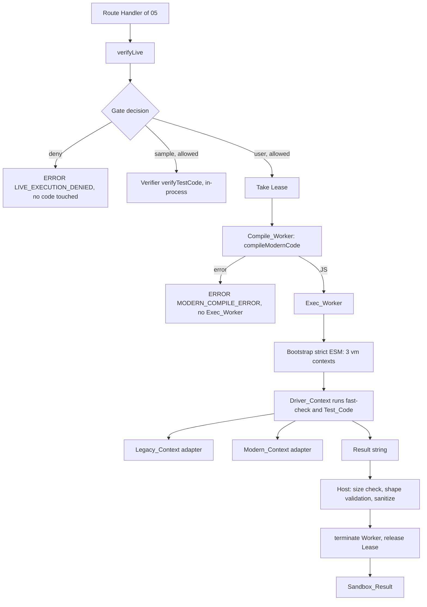

# Design Document

## Overview

`@lazarus/sandbox-runner` runs user-imported legacy JavaScript, its generated TypeScript counterpart, and the generated Test_Code inside a layered isolation environment, so that live Property-Based Testing can be offered to authenticated users. It is a library (ESM, Node `>=24`) with no HTTP surface, no database access, and no environment variables.

**Honest framing.** The Sandbox is defense in depth, not a proof of safety. It combines a policy gate, a fresh Worker thread per run, fresh `node:vm` contexts inside the Worker, an empty set of reachable host objects, resource limits, and output limits. It runs in the same OS process as the web server, so an engine-level escape would reach the server's privileges. The Threat_Model section lists what is not covered and the hardening to apply before wider exposure.

### Isolation mechanism: options considered

| Option | Memory limit | Hard stop | FS / network / env denial | Cost and risk | Decision |
|---|---|---|---|---|---|
| `node:vm` in the web process (spec 03) | none | `timeout` for sync code only | none (relies on empty globals) | Node documents `vm` as not a security mechanism | Rejected for user code; kept for samples |
| **Worker thread + fresh `vm` contexts inside it** | `resourceLimits` (heap only) | `terminate()` | empty `env`; no host object reachable by construction; no OS-level denial | Same process; per-run start-up cost (not measured yet, see D3); no extra infrastructure | **Chosen** |
| Child process with `node --permission` | OS limits possible | kill | fs and child process denied; no network scope in Node.js 24; Worker creation needs `--allow-worker` | Heavier; platform differences; still same machine | Future hardening |
| Container, microVM, or external execution service | cgroups | kill | namespaces, seccomp, no network | Infrastructure and operations | Recommended before untrusted audiences |

The Worker option is chosen because the steering names "an isolated Worker (or equivalent)" and because it is the strongest option that needs no infrastructure outside the repository. The design keeps the executor behind one function (`spawnRun`), so replacing it with a process, container, or remote service changes one module.

### Design decisions

1. **Nothing from the Worker's own realm enters an untrusted context.** The classic `vm` escape is `someHostFunction.constructor('return process')()`. The design removes the precondition: helper logic (codec, comparator, adapters, `fast-check`) is JavaScript text evaluated inside the contexts, and only strings, numbers, and booleans cross from the Worker realm.
2. **The whole property runs inside the Sandbox.** `fast-check` is bundled and evaluated in the Driver_Context, so the LLM-generated Test_Code (which is untrusted) never executes on the host stack. This is the gap that `03-pbt-verifier` documents as "Known Limitations".
3. **Values cross as strings.** Inputs and outcomes use one deterministic JSON text format (Tagged_Value). The Canonical_Form of an outcome is that text, so equivalence is string equality and does not depend on the realm that created a value.
4. **One Worker per run, never reused.** No state survives a run. Pre-warmed spare Workers are an optimization listed under Open Items, not part of this spec.
5. **Fail closed.** User-origin execution is disabled by default, anonymous callers are always denied, and an unavailable Sandbox never falls back to in-process execution.
6. **Compilation is isolated too.** Type-checking user-influenced TypeScript can be made slow with pathological types. It runs in a Compile_Worker with a timeout and a memory limit. The compiler never executes the code.
7. **Result parity with spec 03.** Same result shapes, same comparison rules, same Test_Code_Contract, same evidence text. A differential test checks parity.

## Architecture



### Module layout

```text
packages/sandbox-runner/
├── package.json            # @lazarus/sandbox-runner
├── tsconfig.json
├── vitest.config.ts
├── README.md               # usage, Threat_Model, limits, uncovered escape classes
├── scripts/build-worker.mjs# esbuild: bundles worker entries; embeds Trusted_Scripts and fast-check as text
├── src/
│   ├── index.ts            # public exports
│   ├── types.ts            # options, results, error codes, gate types
│   ├── options.ts          # validation, defaults, limit ranges
│   ├── gate/policy.ts      # decideLiveExecution(request, config): pure
│   ├── gate/gate.ts        # createLiveExecutionGate(): leases, counters
│   ├── live.ts             # verifyLive(): gate -> executor -> result
│   ├── host/supervisor.ts  # spawnRun(): Worker options, timers, watchdog, termination
│   ├── host/compile-stage.ts
│   ├── host/result-parser.ts
│   ├── host/tagged-value.ts# host-side encoder of inputs
│   ├── property-mode.ts    # runSandboxedVerification
│   ├── cases-mode.ts       # runSandboxedCases
│   └── worker/
│       ├── exec-entry.ts   # strict ESM bootstrap; imports only node:vm and node:worker_threads
│       ├── compile-entry.ts# imports @lazarus/pbt-verifier compile function; runs no user code
│       └── scripts/        # Trusted_Scripts as plain ES2022 text: prelude.js, codec.js, side.js, driver.js
└── test/
    ├── corpus/hostile.ts   # hostile snippets and expected results
    └── *.test.ts
```

Only `src/worker/exec-entry.ts` and the Trusted_Scripts run inside an Exec_Worker. They import no `node:fs`, `node:net`, `node:http(s)`, or `node:child_process` (Requirement 1.7). The Trusted_Scripts reach the Worker as text constants embedded by the build script, so the Worker reads no file.

## Components and Interfaces

### Public types (`types.ts`)

```ts
export type Origin = 'sample' | 'user';
export type Caller =
  | { kind: 'anonymous' }
  | { kind: 'member'; userId: string };

export interface GateConfig {
  userExecutionEnabled: boolean;       // default false
  allowAnonymousSampleRuns: boolean;   // default false
  perUserConcurrency: number;          // integer >= 1, default 1
  globalConcurrency: number;           // integer >= 1, default 4
}

export type DenialReason =
  | 'INVALID_REQUEST' | 'ANONYMOUS_NOT_ALLOWED' | 'AUTH_REQUIRED'
  | 'USER_EXECUTION_DISABLED' | 'NOT_OWNER'
  | 'USER_CONCURRENCY_LIMIT' | 'GLOBAL_CONCURRENCY_LIMIT';

export interface SandboxLimits {
  wallClockTimeoutMs?: number;      // 100..60000, default 10000
  caseTimeoutMs?: number;           // 1..10000, default 1000
  compileTimeoutMs?: number;        // 1000..30000, default 10000
  maxOldGenerationSizeMb?: number;  // 32..512, default 128
  maxYoungGenerationSizeMb?: number;// 8..64, default 16
  maxExternalMemoryMb?: number;     // 16..1024, default 256
  maxValueBytes?: number;           // 1024..262144, default 65536
  maxResultBytes?: number;          // 4096..2097152, default 524288
  maxSourceBytes?: number;          // 1024..1048576, default 262144
}

export interface SandboxVerifyOptions {
  legacyCode: string;
  modernCode: string;
  entryFunction: string;
  testCode: string;
  numRuns?: number;   // integer 100..1000, default 1000
  seed?: number;      // 32-bit signed integer, default Date.now() | 0
  allowDynamicCode?: boolean; // default false
  limits?: SandboxLimits;
}

export interface LiveRequest extends SandboxVerifyOptions {
  origin: Origin;
  caller: Caller;
  corpusOwnerId: string | null;
}

export type SandboxErrorCode =
  | 'LIVE_EXECUTION_DENIED' | 'SANDBOX_UNAVAILABLE' | 'SANDBOX_TIMEOUT'
  | 'SANDBOX_OUT_OF_MEMORY' | 'SANDBOX_FORBIDDEN_CAPABILITY' | 'SANDBOX_CRASH'
  | 'OUTPUT_LIMIT_EXCEEDED' | 'UNSUPPORTED_VALUE';

// Verifier codes that the Sandbox can still produce.
export type SharedErrorCode =
  | 'INVALID_OPTIONS' | 'LEGACY_LOAD_ERROR' | 'ENTRY_FUNCTION_NOT_FOUND'
  | 'MODERN_COMPILE_ERROR' | 'MODERN_LOAD_ERROR' | 'TEST_CODE_ERROR' | 'INTERNAL_ERROR';

export type Executor = 'sandbox-worker' | 'in-process' | 'none';

export type SandboxResult =
  | { status: 'PASSED'; executor: Executor; totalRuns: number; seed: number;
      executionTimeMs: number; evidence: string }
  | { status: 'FAILED'; executor: Executor; totalRuns: number; seed: number;
      executionTimeMs: number; counterexample: Counterexample; evidence: string }
  | { status: 'ERROR'; executor: Executor; code: SandboxErrorCode | SharedErrorCode;
      message: string; executionTimeMs: number; reason?: DenialReason };
```

`Counterexample` is the Verifier's type. Cases mode has its own result (Requirement 10):

```ts
export type CaseOutcome =
  | { kind: 'returned'; rendered: string }  // at most 200 characters
  | { kind: 'threw'; name: string };
export type CasesResult =
  | { status: 'COMPLETED'; executor: 'sandbox-worker'; executionTimeMs: number;
      cases: Array<{ equivalent: boolean; legacy: CaseOutcome; modern: CaseOutcome }> }
  | Extract<SandboxResult, { status: 'ERROR' }>;
```

### Gate (`gate/policy.ts`, `gate/gate.ts`)

`decideLiveExecution(request, config)` is a pure function that returns `{ allow: true; executor: 'in-process' | 'sandbox' }` or `{ allow: false; reason: DenialReason }`. Order of checks (Requirement 3.8):

```text
1. malformed request                              -> INVALID_REQUEST
2. origin = sample:
     caller member                                -> allow in-process
     caller anonymous and allowAnonymousSampleRuns-> allow in-process
     else                                         -> ANONYMOUS_NOT_ALLOWED
3. origin = user:
     caller anonymous                             -> AUTH_REQUIRED
     not userExecutionEnabled                     -> USER_EXECUTION_DISABLED
     corpusOwnerId is null or != caller.userId    -> NOT_OWNER
     else                                         -> allow sandbox
```

`createLiveExecutionGate(config)` returns `{ acquire(request): AcquireResult }`. For an allowed `sandbox` decision it checks and increments two counters (a `Map<userId, number>` and a total) in one synchronous step, so concurrent callers in one process cannot oversubscribe (JavaScript runs the step without interleaving). It returns `{ ok: true; lease }` or `{ ok: false; reason }`. `lease.release()` is idempotent. Counters live in process memory, so the limits are per process; a deployment with several instances multiplies them (Requirement 3.12). Time-window rate limits and quota storage belong to `05-llm-pipeline-api`.

The `origin` and `corpusOwnerId` values must come from the database row loaded under RLS, never from the request body. This is an assumption on the caller (Open Items, A1).

### Facade (`live.ts`)

```ts
export async function verifyLive(request: LiveRequest, gate: LiveExecutionGate): Promise<SandboxResult>;
```

1. `gate.acquire(request)`. A denial returns `ERROR LIVE_EXECUTION_DENIED` with `executor: 'none'` and the reason. No code is parsed (Requirement 3.13).
2. Executor `in-process`: call the Verifier's `verifyTestCode({ origin: 'sample', ... })` and add `executor: 'in-process'`.
3. Executor `sandbox`: `try { return await runSandboxedVerification(request) } finally { lease.release() }`. If the worker files cannot be loaded, return `SANDBOX_UNAVAILABLE` (Requirement 3.14).

Everything is wrapped in one `try/catch` that returns `INTERNAL_ERROR`; the lease is released in the `finally`.

### Supervisor (`host/supervisor.ts`)

```ts
type WorkerEnd =
  | { kind: 'message'; payload: string }
  | { kind: 'timeout' } | { kind: 'oom' }
  | { kind: 'crash' } | { kind: 'output-limit' };

function spawnRun(entry: 'exec' | 'compile', data: WorkerData, limits: ResolvedLimits): Promise<WorkerEnd>;
```

`WorkerData` contains only strings, numbers, and booleans. The Worker is created with:

```ts
new Worker(entryUrl, {
  workerData: data,
  env: {},            // default would copy process.env
  argv: [],
  execArgv: [],       // do not inherit parent CLI options
  stdout: true, stderr: true,   // captured; the host drains and discards them
  resourceLimits: { maxOldGenerationSizeMb, maxYoungGenerationSizeMb },
  name: 'lazarus-sandbox',
});
```

Control flow:

1. Start the kill timer (`wallClockTimeoutMs + 2000` for an Exec_Worker, `compileTimeoutMs` for a Compile_Worker) and the memory watchdog (interval 100 ms, reads `process.memoryUsage().arrayBuffers`, compares with the value taken before the Worker started).
2. On the first string `message`: check its UTF-8 length against `maxResultBytes`; settle as `message` or `output-limit`.
3. On `error`: `err.code === 'ERR_WORKER_OUT_OF_MEMORY'` settles `oom`; anything else settles `crash`.
4. On `exit` before a settlement: `crash`.
5. On a timer: settle `timeout`; on the watchdog: settle `oom`.
6. Settling clears timers, calls `worker.terminate()`, and waits for it for up to 1000 ms. The first settlement wins; later events are ignored.

The host never reads Worker stdout or stderr content. It only drains the streams. The supervisor keeps a counter of live Workers and exposes it to tests only (an internal export), which Property 9 uses.

### Compile stage (`host/compile-stage.ts`, `worker/compile-entry.ts`)

The Compile_Worker calls `compileModernCode(source, entryFunction)` from `@lazarus/pbt-verifier` (strict type-check, import scan, transpile to CommonJS) and posts one JSON string: `{ ok: true, js }` or `{ ok: false, code, message }`. It runs only the TypeScript compiler on text. It executes no user code. Its limits are `compileTimeoutMs` and 256 MB of old generation. A compile error returns `MODERN_COMPILE_ERROR` before any Exec_Worker exists (Requirement 5.12).

### Exec_Worker bootstrap (`worker/exec-entry.ts`)

An ES module (strict mode). V8's stack trace API hides the receiver and function of any frame that is, or lies below, a strict-mode frame, so a call-site attack from inside a context cannot read the bootstrap's functions (see Verified facts).

Steps for property mode:

1. Read `workerData`. Install `process.on('unhandledRejection', ...)` that records only `reason.code` when it equals `ERR_VM_DYNAMIC_IMPORT_CALLBACK_MISSING` (a dynamic `import()` attempt) and ignores everything else.
2. Create three contexts: `vm.createContext(vm.constants.DONT_CONTEXTIFY, { microtaskMode: 'afterEvaluate', codeGeneration: { strings: allowDynamicCode, wasm: false } })`. No `importModuleDynamically`.
3. In each context, run `prelude.js` (a Trusted_Script) and then `codec.js`. The prelude captures intrinsics in closures, deletes `SharedArrayBuffer` and `Atomics`, locks `Error.prepareStackTrace` (non-writable, non-configurable, `undefined`), and defines nothing else on the global.
4. In the Legacy_Context run `side.js`, which defines the side adapter (decode input, call the entry function, encode the outcome, classify forbidden capabilities) and binds its entry point under a random non-enumerable global name. Then run the Legacy_Code as a classic script under the remaining time budget. Do the same in the Modern_Context with an `exports` object created by a Trusted_Script, then the transpiled Modern_Code.
5. Resolve the Entry_Function in each context with a fixed script (`typeof NAME === 'function' ? NAME : undefined`; `NAME` was validated as an identifier). Bind it into the adapter.
6. Assign the two adapter entry points (context-realm functions) to random-named globals of the Driver_Context. Run `driver.js` there, which contains the bundled `fast-check`, the comparator, and the `fc.check` runner. Compile the Test_Code with `new vm.Script('(function (fc, legacyFn, modernFn, assertEquivalent, numRuns) {\n' + testCode + '\n})')` and run it in the Driver_Context. The compile uses the `vm` API, not string evaluation, so it works with dynamic code generation disabled. A syntax error becomes `TEST_CODE_ERROR`. Assign the resulting context-realm function to a random-named global.
7. Run the driver entry point with a `vm` `timeout` equal to the remaining time budget. The call returns the result as a string.
8. Check the length against `maxResultBytes`, post the string, and let the host terminate the Worker.

All three contexts follow `allowDynamicCode` (default `false`). The isolation does not depend on this setting (Requirement 6.2), and the adversarial corpus runs with both values. If the bundled `fast-check` turns out to need dynamic code generation (Open Items, O1), only the Driver_Context will enable it and Requirement 6.2 will be amended.

Each phase gets `timeout = min(remaining budget, phase cap)`. The progress marker (`phase` and `side`) is a variable in a Trusted_Script closure that the Worker reads with a small script after a timeout; it only labels the error message.

For cases mode the bootstrap creates only the Legacy_Context and the Modern_Context. For each case it assigns the encoded input to a random-named string global of each context, then calls the adapter entry point with `vm.runInContext(callName + '()', context, { timeout: caseTimeoutMs })`. The two returned outcome strings are compared by equality; a rendering function in the Trusted_Script produces the `rendered` text.

### Trusted_Scripts

- **`prelude.js`**: intrinsic capture, deletions, `Error.prepareStackTrace` lock, `Object.freeze` on the captured helper table (inside the closure only).
- **`codec.js`**: `encode(value) -> string` and `decode(string) -> value`, size and depth counters, canonical key order, back-references for cycles, markers for functions and symbols.
- **`side.js`**: the side adapter. `call(encodedInput)` decodes into a fresh copy built with this context's constructors, calls the Entry_Function in `try/catch`, and returns the Canonical_Form of the outcome (`{"k":"r","v":<Tagged_Value>}` or `{"k":"t","n":"<name>"}`). A thrown value is read only for `name` (own, string) and for the `message` used to classify a Forbidden_Capability. It never reads `stack`.
- **`driver.js`**: `fast-check` (bundled IIFE), the Test_Code wrapper, `assertEquivalent`, the result classification, and the progress marker.

### Value codec and Canonical_Form

| Value | Tagged_Value text |
|---|---|
| `undefined` | `{"$":"u"}` |
| `null`, `true`, `false`, string | JSON literal |
| finite number except `-0` | JSON number |
| `-0`, `NaN`, `Infinity`, `-Infinity` | `{"$":"-0"}`, `{"$":"nan"}`, `{"$":"inf"}`, `{"$":"-inf"}` |
| bigint | `{"$":"big","v":"<decimal>"}` |
| array | `{"$":"arr","v":[<element or {"$":"hole"}>...]}` |
| plain or other object | `{"$":"obj","e":[["key",<value>],...]}`, keys sorted by code unit, own enumerable string keys |
| `Date` | `{"$":"date","t":<number or tagged number>}` |
| `RegExp` | `{"$":"re","s":"<source>","f":"<flags>"}` |
| `Map` / `Set` | `{"$":"map","e":[[k,v],...]}` / `{"$":"set","e":[v,...]}` in insertion order |
| `Error` | `{"$":"err","n":"<name>","m":"<message>"}` |
| typed array | `{"$":"ta","c":"Uint8Array","e":[<tagged numbers>]}` |
| function / symbol | `{"$":"fn"}` / `{"$":"sym"}` (output only) |
| ancestor reference | `{"$":"cyc","d":<depth of the ancestor>}` (output only) |

Rules (Requirement 7):

- Every object is tagged, so a user key named `$` cannot be confused with a tag.
- Encoder counters stop the write when the text exceeds `maxValueBytes` or the depth exceeds 256, so a hostile value is rejected before it is fully built.
- The host encoder (`host/tagged-value.ts`) mirrors this for inputs, rejects functions, symbols, cycles, `WeakMap`, `Promise`, and host-only objects with `UNSUPPORTED_VALUE` and a path, and expands shared references into independent copies.
- The decoder builds values with `Object.defineProperty` and constructors of its own context. It never assigns `__proto__` and never calls a getter.
- Structured clone (`postMessage`) is not used for user values, because it would create host-realm objects and run in the Worker realm. The Node.js documentation notes that it drops prototypes and accessors, turns class instances into plain objects, and throws on some host types. The Tagged_Value format makes the same simplification explicit, and it also gives functions and symbols in outputs a marker instead of a failure, which comparison needs.
- Class instances encode as plain objects, as structured clone would. This matches 03 (prototypes are not compared).

**Equality.** `canonical(a) === canonical(b)` for `returned` outcomes, and equal `n` for `threw` outcomes. This implements `database-and-exorcism.md` section 3 and `03-pbt-verifier` Requirement 6. A shared (non-cyclic) reference expands in full, so `[x, x]` equals `[clone(x), clone(x)]`, as `deepEquivalent` treats them. A conformance property test checks agreement with the Verifier's `deepEquivalent` (Property 2).

### Property mode (`property-mode.ts`)

```ts
export function runSandboxedVerification(options: SandboxVerifyOptions): Promise<SandboxResult>;
```

Pipeline: validate options and limits (no Worker on failure) → Compile_Worker → Exec_Worker → parse → sanitize → result.

Inside the Driver_Context:

- `legacyFn(input)` and `modernFn(input)` (for Test_Code that calls them directly) encode `input`, call the adapter, and either decode the returned value into the driver realm or throw an `Error` whose `name` is the recorded `name`.
- `assertEquivalent(input)` encodes `input` once, calls both adapters with the same text (so each side builds its own copy), compares the two outcome strings, and on a difference records `{ legacy, modern, inputText }` in the progress state (rendered, truncated to 500 and 2000 characters) and throws `EquivalenceError`.
- The Test_Code is compiled as `(function (fc, legacyFn, modernFn, assertEquivalent, numRuns) {\n<testCode>\n})` and called with the bundled `fc`. A syntax error, a throw, or a non-property return is `TEST_CODE_ERROR`.
- `fc.check(property, { numRuns, seed })` runs in one `vm` call. The classification mirrors 03: success → `PASSED`; failure with a recorded difference or a `false` return → `FAILED` with `fc.stringify` of the shrunk input; any other error → `TEST_CODE_ERROR`; a Forbidden_Capability record → `SANDBOX_FORBIDDEN_CAPABILITY`.
- When the `vm` timeout fires, the Worker reads the progress state. If a difference had been recorded (the check was shrinking), the result is `FAILED` with the smallest recorded counterexample, as in `03-pbt-verifier` Requirement 7.11. Otherwise it is `SANDBOX_TIMEOUT`.

The host then adds `executor`, `executionTimeMs`, and `evidence` (`formatEvidence`), validates every field, and runs `sanitizeResult`.

### Cases mode (`cases-mode.ts`)

```ts
export function runSandboxedCases(options: SandboxCasesOptions): Promise<CasesResult>;
```

Encodes all inputs on the host (so unsupported values fail before any Worker exists), compiles, runs the loop of the bootstrap, and returns one entry per input. Each case decodes fresh copies, so the permutation property holds (Property 8).

### Result parsing (`host/result-parser.ts`)

The Worker result is a string. The parser enforces the byte limit, parses JSON, and validates the exact field names, types, and ranges for the expected result kind. Unknown fields are dropped, not forwarded. Failure is `SANDBOX_CRASH` (Requirement 6.7).

## Data Models

There is no persistence. The result fields of a `PASSED` or `FAILED` `SandboxResult` map to `reincarnations` columns exactly as in `03-pbt-verifier` Requirement 11 (`pbt_passed`, `total_runs`, `execution_time_ms`). Writing them is the caller's job, and spec 05 currently stores NULL for user corpora (Open Items, A2).

## Error Handling

| Condition | Result |
|---|---|
| Invalid options, limit out of range, source too large | `ERROR INVALID_OPTIONS` (no Worker) |
| Gate denial | `ERROR LIVE_EXECUTION_DENIED` + `reason` (no code touched) |
| Worker files missing or the Worker cannot start | `ERROR SANDBOX_UNAVAILABLE` (no fallback) |
| Input value not encodable | `ERROR UNSUPPORTED_VALUE` (no Worker) |
| Type error or import in Modern_Code | `ERROR MODERN_COMPILE_ERROR` (no Exec_Worker) |
| Compile stage exceeds `compileTimeoutMs` | `ERROR SANDBOX_TIMEOUT` (message names the compile stage) |
| Legacy syntax error or top-level throw | `ERROR LEGACY_LOAD_ERROR` |
| Entry function missing on a side | `ERROR ENTRY_FUNCTION_NOT_FOUND` (names the side) |
| Modern top-level throw | `ERROR MODERN_LOAD_ERROR` |
| Test_Code syntax error, throw, no property, unrelated throw | `ERROR TEST_CODE_ERROR` |
| `vm` timeout or host kill timer | `ERROR SANDBOX_TIMEOUT` (or `FAILED` if a difference was already recorded) |
| Heap limit reached or external-memory watchdog | `ERROR SANDBOX_OUT_OF_MEMORY` |
| Forbidden_Capability recorded | `ERROR SANDBOX_FORBIDDEN_CAPABILITY` |
| Outcome or counterexample over `maxValueBytes` or depth 256; result over `maxResultBytes` | `ERROR OUTPUT_LIMIT_EXCEEDED` |
| Worker exit, error, or malformed result without another cause | `ERROR SANDBOX_CRASH` |
| Unexpected exception in the host code | `ERROR INTERNAL_ERROR` (name and message only) |

Messages contain no stack trace, host path, environment detail, or code text (Requirement 2.7).

## Verified facts

Checked against the official Node.js 24 documentation and the V8 documentation while writing this design (local runtime: Node.js 24.22.2).

- **Worker `resourceLimits`** (`maxOldGenerationSizeMb`, `maxYoungGenerationSizeMb`, `codeRangeSizeMb`, `stackSizeMb`; default stack 4 MB) limit only the JS engine, "no external data, including no ArrayBuffers", and the process may still abort on a global out-of-memory condition. `--max-old-space-size` on the command line overrides `maxOldGenerationSizeMb`. [worker_threads](https://nodejs.org/docs/latest-v24.x/api/worker_threads.html)
- **`ERR_WORKER_OUT_OF_MEMORY`** exists: "The Worker instance terminated because it reached its memory limit." The documentation lists the code; that the host sees it on the `error` event is confirmed by the OOM test (Open Items, O4). [errors](https://nodejs.org/docs/latest-v24.x/api/errors.html)
- **`env` option**: `process.env` inside a Worker is a copy of the parent's by default, so `env: {}` is needed. `execArgv` accepts Node CLI options but not V8 options. `stdout` and `stderr` can be captured. `workerData` is cloned with structured clone and throws for functions. [worker_threads](https://nodejs.org/docs/latest-v24.x/api/worker_threads.html)
- **A Worker has most Node.js APIs** (`require`, `fs`, `net`, and so on), so isolation must come from what untrusted code can reach, not from the Worker alone. `terminate()` stops JavaScript execution "as soon as possible" and returns a promise for the exit code. [worker_threads](https://nodejs.org/docs/latest-v24.x/api/worker_threads.html)
- **Structured clone** drops prototypes and accessors, turns class instances into plain objects, and throws `DataCloneError` for some built-in types such as `URL`. [worker_threads](https://nodejs.org/docs/latest-v24.x/api/worker_threads.html)
- **`node:vm`**: "not a security mechanism. Do not use it to run untrusted code." `timeout` covers synchronous code only; promise callbacks escape it unless the context is created with `microtaskMode: 'afterEvaluate'`; timer functions made available in a context place callbacks in global queues that the timeout cannot control; `timeout` starts extra event loops and threads (overhead). `codeGeneration.strings: false` makes `eval` and the function constructors throw `EvalError`; `codeGeneration.wasm: false` makes WebAssembly compilation throw. `vm.constants.DONT_CONTEXTIFY` (Node.js 22.8 and later) creates a context with an ordinary global object. [vm](https://nodejs.org/docs/latest-v24.x/api/vm.html)
- **Permission model**: `--permission` restricts the file system, child processes, Worker threads, native addons, WASI, and the inspector. The Node.js 24 page lists no network scope. The page says the model "does not inherit to a worker thread" and that malicious code can bypass it (the page's own warning). Process-wide, not per Worker. Secondary sources report a `--allow-net` flag from Node.js 25; this is not verified here and does not apply to Node.js 24. [permissions](https://nodejs.org/docs/latest-v24.x/api/permissions.html)
- **V8 stack trace API**: "frames that have a strict mode function and all frames below (its caller etc.) are not allow[ed] to access their receiver and function objects" (`getThis()` and `getFunction()` return `undefined`). This is why the bootstrap is an ES module. [V8](https://v8.dev/docs/stack-trace-api)

Not verified in this spec: that `DONT_CONTEXTIFY` combines with `microtaskMode` and `codeGeneration` in one `createContext` call (the documented signature accepts both, a test confirms it), and the exact semantics of `process.memoryUsage().arrayBuffers` under several Workers.

## Threat Model

**Assets.** The server process (files, environment secrets such as the service role key and database credentials, network position), other users' data, availability of the service.

**Attacker.** An authenticated user who imports legacy JavaScript, or who controls the content from which an LLM generates TypeScript and Test_Code (prompt injection). The attacker can run arbitrary JavaScript in the Sandbox but cannot change the host code or the Trusted_Scripts.

**Layers implemented and what each addresses**

| Layer | Addresses |
|---|---|
| Gate (origin, auth, owner, kill switch, concurrency) | Accidental or anonymous execution; many parallel runs from one user |
| Fresh Worker per run, terminated in `finally` | State leaking between runs; runaway threads |
| `resourceLimits`, host kill timer, `vm` timeout with `afterEvaluate` | Heap bombs, infinite loops (sync and promise-based), regex backtracking |
| `env: {}`, captured stdio, primitive-only `workerData` | Environment variable exposure through the Worker's `process.env`; output flooding |
| Fresh contexts with an ordinary global, no host-realm values inside, trusted helpers evaluated inside | Reaching `process`, `require`, `fs`, `net`, `child_process` through the classic `constructor.constructor` route |
| Strict-mode bootstrap, locked `Error.prepareStackTrace` | Call-site (`getFunction`/`getThis`) route to host functions |
| Dynamic code and WebAssembly disabled by default; no `importModuleDynamically` | Dynamic code and module loading from strings |
| Tagged_Value codec, size and depth caps, validated result shape | Oversized or malformed results; getter and prototype tricks at the boundary |
| Compile_Worker with timeout and memory limit | Type-checker denial of service |
| Sanitized, bounded results | Leaking paths, stacks, and source text |

**What the Sandbox does NOT protect against**

1. **Engine and runtime vulnerabilities.** A V8 or Node.js bug that breaks context isolation gives the attacker the server process. The Worker is a thread in the same process, not an OS sandbox. In the escaped state nothing denies file reads (including `/proc/self/environ` on Linux, `.env` files), network access, or child processes, and `env: {}` hides only the Worker's own copy of `process.env`.
2. **Side channels.** Timing, CPU contention, and cache effects between the Sandbox and the server are not mitigated. `SharedArrayBuffer` and `Atomics` are removed from the contexts, which removes only one timer source.
3. **Resource exhaustion that outpaces the controls.** External memory (`ArrayBuffer` contents) is outside `resourceLimits`; the host watchdog polls every 100 ms and a fast allocation burst can exceed the limit before it fires. CPU use of up to `globalConcurrency` busy Workers is allowed. A global out-of-memory condition can still abort the process.
4. **Verdict integrity against the code's author.** Hostile code shares a realm with `fast-check` and the driver, and can discover the entry-point global names. It can alter its own verdict (for example, fake a pass) or detect the harness. The verdict is therefore Empirical_Evidence about the behavior the author chose to show, visible only to the owner under RLS; it is not an attestation.
5. **Abuse at scale.** Time-window rate limits and quotas belong to `08-live-verification-api` (its separate verification ledger). The Gate limits only concurrency, per process.
6. **Native addons and unusual hosts.** Any native addon loaded by the server is outside this analysis. Behavior on operating systems or Node.js patch versions other than those tested is not assessed.
7. **Node.js permission model.** It is not used by this design. In Node.js 24 it has no network scope and, per the documentation, does not inherit to Worker threads.
8. **LLM prompt injection itself.** The Sandbox contains its effects when generated code runs; it does not prevent bad generation.

**Recommended hardening before exposing the feature beyond a small trusted audience**

1. Run the Sandbox in a separate OS process or container that has no application secrets in its environment, a read-only root filesystem, no network namespace, CPU and memory cgroup limits, a non-root user, and a seccomp profile. Keep `spawnRun` as the only seam.
2. Prefer a microVM (for example Firecracker or gVisor-based) or an external code-execution service when users are not trusted.
3. For the hosting process, start Node.js with `--permission` and the narrowest `--allow-fs-read` and `--allow-worker` grants, and consider Node.js 25 or later for its network scope if it fits the support policy (verify first).
4. Keep `userExecutionEnabled` off until 1 or 2 is in place, and log every run (user id, corpus id, result code, duration) on the server.
5. Add pre-warmed single-use spare Workers only if start-up latency matters.

## Testing Strategy

`pnpm test` runs Vitest in single-run mode. Per `testing-conventions.md`, every property test passes an explicit `numRuns`, starts its `it` body with `// Feature: 07-sandboxed-execution, Property <N>: <title>` (or `Supporting check: <title>`), and has a name that begins with the requirement it covers (`R<n>.<m> ...`). Tests that start Workers use small limits (for example `wallClockTimeoutMs` of 300 to 500 and `maxOldGenerationSizeMb` of 32) and small outer `numRuns`, so the suite stays below 120 seconds.

### Correctness properties

1. **Codec round trip.** For any supported value `v`, `canonical(decode(encode(v))) === canonical(v)`, and mutating the decoded copy never changes the original. Include `-0`, `NaN`, holes, nested `Map`/`Set`, and `__proto__` keys. (Requirements 7.9, 7.8, 4.10)
2. **Agreement with the Verifier.** For any pair of supported values (generated with `fc.anything()` restricted to supported types, with and without structural variations), `canonical(a) === canonical(b)` iff `deepEquivalent(a, b)`; includes pairs built in different contexts. (Requirement 8.5, 8.3)
3. **Gate truth table.** For any generated request and config, `decideLiveExecution` equals the table in the Gate section, an anonymous caller never gets `sandbox`, and `origin: 'user'` never gets `in-process`. (Requirements 3.1 to 3.8)
4. **Lease conservation.** For any interleaving of acquire and release calls (including double release), active leases never exceed the limits and return to 0 when all are released. (Requirements 3.9 to 3.11)
5. **Seed determinism.** The same options and explicit seed give the same `status`, `totalRuns`, and `counterexample.input`, for an equivalent and a differing pair, with at least two seeds. (Requirement 9.8)
6. **Parity with the Verifier.** For pure function templates (arithmetic, string, array transforms) and an equivalent or differing modern version, the Sandbox and `verifyTestCode` give the same `status`, `totalRuns`, and `counterexample.input`. (Requirements 9.5, 9.9)
7. **Result hygiene.** For arbitrary option objects and hostile corpus entries, `runSandboxedVerification` resolves to a JSON-serializable result with no stack trace, no host path, no Forbidden_Phrase, and `message` of at most 500 characters. (Requirements 2.4, 2.5, 2.7, 2.8)
8. **Case independence.** For any list of inputs and any permutation of it, each input has the same outcome. (Requirement 10.5)
9. **Termination and cleanup.** For every hostile corpus entry (sampled by `fc.constantFrom`), the call returns within the wall-clock limit plus the kill grace plus a fixed margin, the Lease is released, and the number of live Workers equals the number before the call. (Requirements 4.2, 5.3, 5.4, 12.3)
10. **Evidence text.** For any `PASSED` or `FAILED` result, `evidence` equals `formatEvidence(result)`. (Requirements 9.5, 9.10)

### Adversarial corpus (`test/corpus/hostile.ts`)

Each entry runs as Legacy_Code, as Modern_Code, and as Test_Code where it applies, with `allowDynamicCode` set to `false` and to `true`. "Terminal" means the result is some `ERROR` code or a normal verdict and the host is unaffected.

| Id | Snippet idea | Expected result |
|---|---|---|
| H1 | `for(;;){}` at load time | `SANDBOX_TIMEOUT` |
| H2 | infinite loop inside the Entry_Function | `SANDBOX_TIMEOUT` |
| H3 | `while(true)` inside a callback of `Array.prototype.map` | `SANDBOX_TIMEOUT` |
| H4 | `Promise.resolve().then(function(){for(;;){}})` | `SANDBOX_TIMEOUT` (needs `afterEvaluate`) |
| H5 | retained heap allocation loop | `SANDBOX_OUT_OF_MEMORY` (heap limit set to 32 MB in the test) |
| H6 | string doubling `s += s` | terminal: `RangeError` outcome or `SANDBOX_OUT_OF_MEMORY` |
| H7 | `new ArrayBuffer(2 ** 40)` | terminal: `RangeError` outcome |
| H8 | retained 8 MB `ArrayBuffer` allocation loop with a 16 MB external limit | terminal: `SANDBOX_OUT_OF_MEMORY` or `SANDBOX_TIMEOUT`; best effort, no claim about peak memory |
| H9 | returns a 2 MB string; returns a value nested 10,000 deep; returns an object with a getter that loops forever | `OUTPUT_LIMIT_EXCEEDED`; `OUTPUT_LIMIT_EXCEEDED`; `SANDBOX_TIMEOUT` |
| H10 | uses `process`, `require('fs')`, `module`, `fetch(...)`, `console.log` | `SANDBOX_FORBIDDEN_CAPABILITY` |
| H11 | `this.constructor.constructor('return process')()` | `SANDBOX_FORBIDDEN_CAPABILITY` (EvalError when dynamic code is off, ReferenceError for `process` when on) |
| H12 | `globalThis.process`, `(function(){return this})().process` | terminal: returns `undefined`; the host object is not reached |
| H13 | `import('node:fs')` | `SANDBOX_FORBIDDEN_CAPABILITY` |
| H14 | `eval('1+1')` | forbidden-capability when off; normal outcome `2` when on |
| H15 | `setTimeout(function(){for(;;){}}, 0)` and `setInterval` | `SANDBOX_FORBIDDEN_CAPABILITY`; no Worker remains afterwards |
| H16 | overwrites `Object.keys`, `JSON.stringify`, `Array.prototype.push`, `Function.prototype.call`, `Object.prototype.toJSON`, `Symbol.iterator` | terminal: valid result structure, never `SANDBOX_CRASH` |
| H17 | `Error.prepareStackTrace` call-site attack calling `getFunction()` / `getThis()` | terminal: no host function obtained (the result of `typeof` on the obtained value is `undefined`) |
| H18 | mutates its input | verdict unaffected by the mutation (independent copies) |
| H19 | unbounded recursion | `RangeError` outcome on that side, compared by name |
| H20 | catastrophic regular expression | `SANDBOX_TIMEOUT` (host kill timer as backstop) |
| H21 | Test_Code with `for(;;){}` at the top level | `SANDBOX_TIMEOUT` naming `test` |
| H22 | Test_Code that replaces `fc.check` with a function returning success | terminal; documented forging case, host unaffected |
| H23 | Legacy_Code that writes to `Object.prototype` and reads it back in the next run | next run unaffected (fresh Worker and contexts) |

Host-integrity checks run around each entry: `process.env` snapshot, `Object.prototype` key list, `Object.keys(globalThis)` before and after, and a 250 ms timer-responsiveness probe.

**Escape classes the tests do not cover.** Vulnerabilities in V8 or Node.js (including patch-specific escapes), native addons, WebAssembly-based attacks (compilation is disabled; not fuzzed), side channels, rapid external-memory exhaustion beyond the polling interval, behavior under many concurrent Workers, other operating systems, and attacks on the build or the bundled `fast-check`. A passing suite shows that the listed attacks fail on the tested Node.js version and platform; it does not show that no escape exists.

### Fixtures and parity

The three fixtures of `03-pbt-verifier` (`es3`, `es5-jquery`, `legacy-node`) run through property mode with `numRuns: 1000` and must give `PASSED` (Requirement 12.6).

## Open Items

Assumptions and decisions the user must confirm:

- **A1 (caller contract, resolved by spec 08).** The only intended caller is the Route Handler `POST /api/verify` of `08-live-verification-api`, which adopts this contract: the Route Handler derives `origin` from the `is_sample` column of a row loaded under RLS, derives `corpusOwnerId` from `user_id`, calls `verifyLive` only after the Member and ownership checks, and treats `LIVE_EXECUTION_DENIED` as a user-visible refusal.
- **A2 (resolved by spec 08).** `05-llm-pipeline-api` never executes code and stores `pbt_passed`, `total_runs`, and `execution_time_ms` as NULL for user corpora. The HTTP route, the quota cost of a live run (a separate ledger), the storage of the sandbox result (`public.record_verification`, migration `V4`), and the corpse status update are defined by `08-live-verification-api`. This spec still defines none of them.
- **A3 (03 not implemented yet).** `packages/pbt-verifier` does not exist in the repository at the time of writing. This spec depends on it for `compileModernCode`, `sanitizeResult`, `formatEvidence`, `deepEquivalent` (tests only), and the fixtures. Task 1.3 adds the additive subpath export; if 03 names things differently, adjust.
- **A4 (kill switch name, resolved).** The package reads no environment variable. The kill switch is `LAZARUS_SANDBOX_KILL_SWITCH` (server-only, optional), documented in `.env.example` and validated under `04-web-shell-auth`. `08-live-verification-api` maps it, together with its reviewed constant `USER_EXECUTION_ENABLED` (shipped `false`), to `GateConfig.userExecutionEnabled`: the flag is true only when the constant is true and the kill switch is not engaged.
- **D1.** `allowAnonymousSampleRuns` defaults to `false`: anonymous visitors see precomputed sample results only. Confirm this reading of the steering ("sample corpses: allowed by default").
- **D2.** Dynamic code generation (`eval`, `Function`) is disabled by default in the side contexts, so a legacy function that uses `eval` is reported as `SANDBOX_FORBIDDEN_CAPABILITY` rather than compared. Confirm, or set the default to allowed (the isolation does not depend on it).
- **D3.** Default limits (10 s wall clock, 128 MB old generation, 1 user and 4 global concurrent runs) are starting values, not measured. Tune after a first benchmark on the target host.
- **D4.** The concurrency limits are per process. On a multi-instance or serverless deployment they apply per instance.

To verify at implementation time:

- **O1.** `esbuild` bundles `fast-check` 4.10.x into a single IIFE with no Node.js built-in dependency, and the bundle runs with dynamic code generation disabled. If it does not, evaluate the package's own prebuilt bundle if one exists, enable dynamic code generation in the Driver_Context only (and amend Requirement 6.2), or restrict Test_Code to a documented subset.
- **O2.** `vm.createContext(vm.constants.DONT_CONTEXTIFY, { microtaskMode, codeGeneration })` is accepted in Node.js 24, and `Error.prepareStackTrace` can be redefined as non-configurable in a fresh context.
- **O3.** Worker file resolution when the web app is bundled by Next.js (`new URL('./worker/exec-entry.js', import.meta.url)` may need `serverExternalPackages` and file tracing). This is an integration concern for `apps/web`.
- **O4.** The OOM adversarial test confirms that `ERR_WORKER_OUT_OF_MEMORY` reaches the `error` event on the supported Node.js version.
- **O5.** `process.memoryUsage().arrayBuffers` is process-wide, so unrelated allocations can trip the watchdog. Tune `maxExternalMemoryMb` or switch to a per-Worker signal if one exists.
- **O6.** An `fc.asyncProperty` settles within microtasks only (Requirement 9.7). If `fast-check` needs timers for async properties, narrow the support statement.
- **O7.** An unhandled `import()` rejection raised inside the Worker is delivered to the `unhandledRejection` handler of the bootstrap and does not terminate the Worker before the result is collected.
