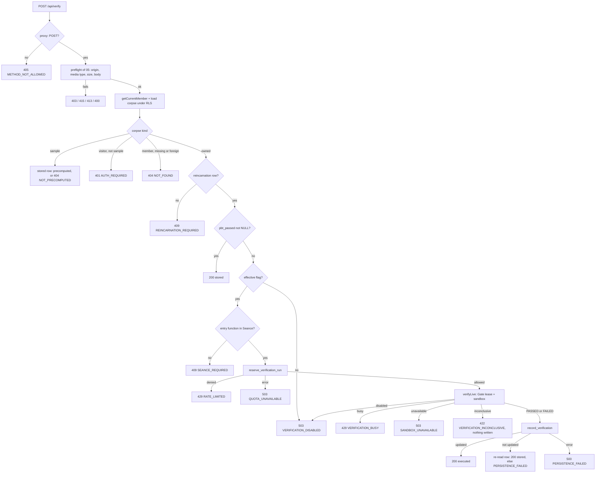

# Design Document

## Overview

This spec adds one Route Handler, `POST /api/verify`, and the code around it. The route lets a Member run the stored property-based test of an owned reincarnation in the sandbox of `07-sandboxed-execution`, stores a completed result in `public.reincarnations`, and moves the corpse to `RESURRECTED` or `FAILED`. For sample corpses it returns the stored result and never executes anything.

Design decisions:

1. **A thin layer on top of 05 and 07.** The route reuses the request pre-checks, JSON response builder, access resolution, log writer, and presentation helpers of `05-llm-pipeline-api` by importing them. It adds its own error table, store seam, sandbox seam, and handler under `lib/verification/`. The 05 error table is not touched, so 05's tests keep their meaning.
2. **Two seams for testing.** `VerificationStore` wraps the Server_Client (RLS decides every result). `SandboxPort` wraps `verifyLive` of `@lazarus/sandbox-runner`. Tests pass an in-memory store and a scripted sandbox. Only `sandbox.ts` imports the runner.
3. **The decision order is the contract.** The handler is a flat sequence of guards in the order of Requirement 3 criterion 8. Every guard that fails returns before the next one can have an effect, so cost (quota, CPU) is only incurred after every cheap check has passed.
4. **Two switches, both fail closed.** Execution needs the reviewed constant `USER_EXECUTION_ENABLED` (shipped `false`) and a kill switch that is not engaged. An unparseable kill switch counts as engaged. The Gate receives the same effective value.
5. **The database enforces the hard rules.** The quota (atomic, ledger-based) and the one-verdict rule (`UPDATE ... WHERE pbt_passed IS NULL` plus the status change in one transaction) live in migration `V4`. Concurrent requests cannot oversubscribe the quota or store two verdicts.
6. **Only a finished property run is evidence.** Pass or counterexample is stored. Everything else stores nothing and still costs a quota unit.
7. **Honest limits.** The verdict is an owner-visible, owner-writable value, not an attestation. The README says so (Requirement 10).

### Facts checked while writing this design

| Fact | Source |
|---|---|
| 07 `verifyLive(request, gate)` takes `LiveRequest` (`origin`, `caller`, `corpusOwnerId`, plus `legacyCode`, `modernCode`, `entryFunction`, `testCode`, optional `numRuns`, `seed`, `allowDynamicCode`, `limits`) and never throws. `GateConfig.userExecutionEnabled` defaults to `false`. A denial returns `ERROR` with `code` `LIVE_EXECUTION_DENIED` and a `reason`. | `07-sandboxed-execution` Requirements 2, 3, and design. |
| 03/07 `FAILED.totalRuns` is the number of runs up to and including the first failing run. It can be less than 100. `PASSED.totalRuns` equals the requested `numRuns`. | `03-pbt-verifier` Requirement 9 criterion 3; `07` Requirement 9 criterion 5. |
| 07 concurrency counters are in process memory. The package reads no environment variable. The mapping from an operator setting to `userExecutionEnabled` is left to the web app (07 Open Item A4). | `07` design. |
| 05 exports (by design) `preflight`, `jsonResponse`, `resolveAccess`, `verificationOf`, `evidenceOf`, `createSupabaseStore`, `PipelineStore`, `QuotaVerdict`, `StoreError`, and the log writer through `deps.log`. | `05` design, Components and Interfaces. |
| `apps/web/src/lib/env.ts` is imported by client code (`readPublicConfig`), so a server-only variable cannot be read there. | `apps/web/src/lib/env.ts`. |
| The `reincarnations` and `corpses` owner UPDATE policies of the Foundation allow an owner to update their own rows. | `database-and-exorcism.md`, section 2. |

## Architecture

### Module layout

```text
apps/web/src/
├── proxy.ts                           # + '/api/verify' in the method guard set
├── app/api/verify/route.ts            # exports POST, runtime, dynamic, maxDuration = 60
├── lib/
│   ├── env-server.ts                  # server-only. parseKillSwitch, readKillSwitch, serverConfigProblems
│   ├── verification/
│   │   ├── limits.ts                  # pure. VERIFICATION_LIMITS, VERIFY_TARGET constants
│   │   ├── flags.ts                   # pure. USER_EXECUTION_ENABLED = false
│   │   ├── execution.ts               # server-only. effectiveExecution(): decision with reason
│   │   ├── errors.ts                  # pure. VERIFY_ERROR_CODES, table, verifyErrorResponse
│   │   ├── classify.ts                # pure. SandboxResult -> Classification
│   │   ├── present.ts                 # pure. verifyBody(source, row, corpse)
│   │   ├── store.ts                   # server-only. VerificationStore + createSupabaseVerificationStore
│   │   ├── sandbox.ts                 # server-only. SandboxPort; the only import of @lazarus/sandbox-runner
│   │   ├── gate.ts                    # server-only. getVerificationGate(): per-process singleton
│   │   ├── deps.ts                    # server-only. production dependency container
│   │   ├── run-verify-route.ts        # server-only. pre-checks, timing, error mapping, logging
│   │   └── verify.ts                  # server-only. handleVerify(request, deps)
│   └── testing/
│       ├── memory-verification-store.ts   # in-memory store, wraps 05's MemoryStore for reads
│       ├── mock-sandbox.ts                # scripted SandboxPort that records requests
│       └── verification-arbitraries.ts    # fast-check generators for this spec
db/migrations/V4__live_verification_support.sql
db/tests/live-verification.test.ts
```

Pure modules start without `import 'server-only'`; the others start with it.

### Request flow



## Components and Interfaces

### Route file and proxy guard (Requirements 1, 2)

```ts
import { handleVerify } from '@/lib/verification/verify';
import { verificationDeps } from '@/lib/verification/deps';

export const runtime = 'nodejs';
export const dynamic = 'force-dynamic';
export const maxDuration = 60; // seconds. Worst case: compile 10 s + run 10 s + 2 s kill grace + quota 5 s.

export async function POST(request: Request): Promise<Response> {
  return handleVerify(request, verificationDeps());
}
```

In `proxy.ts`, the `PIPELINE_PATHS` set of 05 gains `'/api/verify'`. The guard returns the same 405 envelope with `Allow: POST` (the builder of 05 is reused; the code `METHOD_NOT_ALLOWED` is in both tables).

### Constants and flags (Requirements 4, 5, 6)

```ts
// limits.ts (pure)
export const VERIFICATION_LIMITS = {
  userQuota: { limit: 10, windowSeconds: 3_600 },
  globalQuota: { limit: 100, windowSeconds: 86_400 },
  numRuns: 1_000,                 // 100..1000, never from the client
  quotaCallTimeoutMs: 5_000,
  busyRetryAfterSeconds: 15,      // about one default run (10 s) plus the 2 s kill grace
  perUserConcurrency: 1,
  globalConcurrency: 4,
} as const;

// flags.ts (pure)
/**
 * Live execution of user-imported code. Shipped as false.
 * Flip only in a reviewed change, after the hardening in the Threat_Model of
 * 07-sandboxed-execution is judged adequate for the intended audience.
 */
export const USER_EXECUTION_ENABLED = false;
```

The value `10 s + 2 s` for the busy retry comes from the 07 defaults (`wallClockTimeoutMs` 10,000 and kill grace 2,000). It is a hint, not a promise: the Gate has no wait queue.

### Kill switch (`env-server.ts`) (Requirement 4)

```ts
import 'server-only';
export type KillSwitchState = 'engaged' | 'not-engaged' | 'invalid';
export function parseKillSwitch(raw: string | undefined): KillSwitchState; // pure rule of Req 4.2
export function readKillSwitch(): KillSwitchState; // the only read of process.env.LAZARUS_SANDBOX_KILL_SWITCH
export type ServerConfigProblem = { variable: 'LAZARUS_SANDBOX_KILL_SWITCH'; reason: 'invalid' };
export function serverConfigProblems(): ServerConfigProblem[]; // never contains a value
```

`parseKillSwitch` trims, lower-cases, then: `1` or `true` gives `engaged`; `undefined`, empty, `0`, or `false` gives `not-engaged`; anything else gives `invalid`. `lib/env.ts` (client-safe) is not changed. The problems list is reported in two places: the failure log line (`detail: 'kill_switch_invalid'`) and the README. It is deliberately not part of the Public_Config page of 04, because a bad verification flag should not make the whole site answer 503.

`execution.ts`:

```ts
export type ExecutionDecision =
  | { enabled: true }
  | { enabled: false; reason: 'flag-off' | 'kill-switch' | 'kill-switch-invalid' };
export function decideExecution(flag: boolean, state: KillSwitchState): ExecutionDecision; // pure
export function effectiveExecution(): ExecutionDecision; // decideExecution(USER_EXECUTION_ENABLED, readKillSwitch())
```

Truth table: the decision is enabled only for `(true, 'not-engaged')`.

### Gate (`gate.ts`) and sandbox port (`sandbox.ts`)

```ts
let gate: LiveExecutionGate | null = null;
export function getVerificationGate(): LiveExecutionGate {
  gate ??= createLiveExecutionGate({
    userExecutionEnabled: effectiveExecution().enabled,
    allowAnonymousSampleRuns: false,
    perUserConcurrency: VERIFICATION_LIMITS.perUserConcurrency,
    globalConcurrency: VERIFICATION_LIMITS.globalConcurrency,
  });
  return gate;
}
```

The handler also checks `effectiveExecution()` on every request, so the Gate's copy is a second layer: if the flag was off when the Gate was created and later reads as on, the Gate still denies and the route maps `USER_EXECUTION_DISABLED` to `VERIFICATION_DISABLED`. The Gate counters live in module memory, so they are per process (and a development hot reload resets them).

```ts
export interface SandboxPort { run(request: LiveRequest): Promise<SandboxResult>; }
export function createSandboxPort(gate: LiveExecutionGate): SandboxPort; // run = verifyLive(request, gate)
```

### Store (`store.ts`)

```ts
export interface VerificationStore
  extends Pick<PipelineStore, 'loadCorpse' | 'getSeance' | 'getReincarnation'> {
  reserveVerificationRun(): Promise<QuotaVerdict>;
  recordVerification(input: RecordInput): Promise<RecordResult>;
}
export type RecordInput = { reincarnationId: string; passed: boolean; totalRuns: number; executionTimeMs: number };
export type RecordResult =
  | { wasUpdated: true; passed: boolean; totalRuns: number; executionTimeMs: number; corpseStatus: CorpseStatus }
  | { wasUpdated: false };
```

`createSupabaseVerificationStore(client)` composes `createSupabaseStore(client)` of 05 for the three reads and adds:

| Method | Call |
|---|---|
| `reserveVerificationRun` | `rpc('reserve_verification_run', { p_user_limit: 10, p_user_window: '3600 seconds', p_global_limit: 100, p_global_window: '86400 seconds' })` with a 5,000 ms abort signal. The guard of 05's `quota.ts` (exactly one row, `allowed` with `denied_by` `none`, or denied with `user`/`global` and an integer retry-after) is reused; anything else throws `QuotaUnavailable`. |
| `recordVerification` | `rpc('record_verification', { p_reincarnation_id, p_passed, p_total_runs, p_execution_time_ms })`. One result row; `was_updated` false gives `{ wasUpdated: false }`. A database error throws `StoreError`. |

### Classification (`classify.ts`) (Requirement 7)

```ts
export type Classification =
  | { kind: 'conclusive'; passed: boolean; totalRuns: number; executionTimeMs: number }
  | { kind: 'inconclusive'; detail: string }                          // 422 VERIFICATION_INCONCLUSIVE
  | { kind: 'denied-disabled' }                                       // 503 VERIFICATION_DISABLED
  | { kind: 'denied-busy' }                                           // 429 VERIFICATION_BUSY
  | { kind: 'unavailable' }                                           // 503 SANDBOX_UNAVAILABLE
  | { kind: 'internal'; detail: string };                             // 500 INTERNAL_ERROR
export function classifySandboxResult(result: SandboxResult): Classification; // pure, total
```

| Sandbox_Result | Classification |
|---|---|
| `PASSED`, `FAILED` | `conclusive` (after the value checks of Requirement 7.3; a failed check is `internal`) |
| `LIVE_EXECUTION_DENIED` with `USER_EXECUTION_DISABLED` | `denied-disabled` |
| `LIVE_EXECUTION_DENIED` with `USER_CONCURRENCY_LIMIT` or `GLOBAL_CONCURRENCY_LIMIT` | `denied-busy` |
| `LIVE_EXECUTION_DENIED`, any other reason | `internal` |
| `SANDBOX_UNAVAILABLE` | `unavailable` |
| `SANDBOX_TIMEOUT`, `SANDBOX_OUT_OF_MEMORY`, `SANDBOX_FORBIDDEN_CAPABILITY`, `SANDBOX_CRASH`, `OUTPUT_LIMIT_EXCEEDED`, `UNSUPPORTED_VALUE`, `MODERN_COMPILE_ERROR`, `LEGACY_LOAD_ERROR`, `ENTRY_FUNCTION_NOT_FOUND`, `MODERN_LOAD_ERROR`, `TEST_CODE_ERROR` | `inconclusive` (detail is the code) |
| `INVALID_OPTIONS`, `INTERNAL_ERROR`, any unknown code or shape | `internal` |

The `detail` strings go only to the log. The response uses the fixed message of the code.

### Errors (`errors.ts`) and presentation (`present.ts`)

`VERIFY_ERROR_CODES` lists the 18 codes of Requirement 9 criterion 1 with their statuses. The messages of the codes shared with 05 are the 05 texts, except `RATE_LIMITED`, which has two verification-specific texts. New fixed messages:

| Code | Status | Message |
|---|---|---|
| `REINCARNATION_REQUIRED` | 409 | Generate the reincarnation for this corpse before verification. |
| `VERIFICATION_DISABLED` | 503 | Live verification is not enabled. |
| `VERIFICATION_BUSY` | 429 | The verification service is busy. Try again shortly. |
| `VERIFICATION_INCONCLUSIVE` | 422 | The verification run did not complete. Nothing was stored. |
| `SANDBOX_UNAVAILABLE` | 503 | The verification sandbox is not available. |
| `RATE_LIMITED` (user) | 429 | You have reached your limit of verification runs. Try again later. |
| `RATE_LIMITED` (global) | 429 | The service-wide limit of verification runs was reached. Try again later. |

`verifyErrorResponse(error)` builds the envelope with `jsonResponse` of 05 (same headers) and sets `Retry-After` for the two 429 codes.

`verifyBody(source, row, corpse)` returns the success shape of Requirement 2 criterion 4 and uses `verificationOf` and `evidenceOf` of 05 for the two derived fields. It never receives a Sandbox_Result, only the stored row.

### Handler (`verify.ts`) (Requirements 3 to 7)

```ts
export interface VerifyDeps {
  session(): Promise<{ member: Member | null; store: VerificationStore }>;
  sandbox: SandboxPort;
  execution(): ExecutionDecision;       // production: effectiveExecution
  randomSeed(): number;                 // production: crypto.getRandomValues, as int32
  now(): number;
  log(line: LogLine): void;
  appOrigin(request: Request): string | null;
}
```

Sequence after pre-checks and identity (each line throws a `VerifyError` or returns):

```text
 1. access = resolveAccess(member, corpse)          sample | owned | AUTH_REQUIRED | NOT_FOUND
 2. sample:  row = getReincarnation(corpse.id)      null -> NOT_PRECOMPUTED ; else respond precomputed
 3. owned:   row = getReincarnation(corpse.id)      null -> REINCARNATION_REQUIRED
 4.          row.pbtPassed !== null                 -> respond stored
 5.          decision = deps.execution()            !enabled -> VERIFICATION_DISABLED (detail = reason)
 6.          seance = getSeance(corpse.id); entry = entryFunctionOf(seance)   null -> SEANCE_REQUIRED
 7.          verdict = store.reserveVerificationRun()   denied -> RATE_LIMITED ; error -> QUOTA_UNAVAILABLE
 8.          seed = deps.randomSeed()
 9.          result = await deps.sandbox.run(liveRequest(corpse, row, entry, seed, member))
10.          log verification_run line
11.          c = classifySandboxResult(result)      map non-conclusive kinds to errors
12.          rec = store.recordVerification(...)    error -> PERSISTENCE_FAILED
13.          rec.wasUpdated ? respond executed(rec) : reread -> stored | PERSISTENCE_FAILED
```

`liveRequest` is a pure function of its arguments:

```ts
{ origin: 'user', caller: { kind: 'member', userId: member.id }, corpusOwnerId: corpse.userId,
  legacyCode: corpse.originalCode, modernCode: row.modernCode, testCode: row.pbtTestCode,
  entryFunction: entry, numRuns: VERIFICATION_LIMITS.numRuns, seed }
```

`entryFunctionOf` is the guard of 05 applied to `invariants_json` (a non-empty string `entry_function`). It does not validate that the name is a valid identifier: the Sandbox_Runner does (`INVALID_OPTIONS`, which maps to `INTERNAL_ERROR`). This case needs a corrupt Séance row, because 05 only stores `entry_function` values that match a scanner candidate.

`run-verify-route.ts` mirrors the contract of 05's `runPipelineRoute` for this route: it records the start time, runs `preflight`, calls `handle`, converts a thrown `VerifyError` to `verifyErrorResponse`, converts any other throw to `INTERNAL_ERROR`, and writes exactly one failure log line `{ event: 'verification_error', route: 'verify', code, corpseId, elapsedMs, detail }` through `deps.log`. It has no provider deadline, because the sandbox bounds the run. Its body is small and it calls the same `preflight` and `jsonResponse` functions; if 05's wrapper turns out to take the route name and error table as parameters, switch to it and delete this file (Open Item 4).

### Migration `V4` (Requirement 8)

```sql
-- V4: live verification support (usage ledger, quota function, verdict recording).

CREATE TABLE public.verification_usage_events (
  id uuid PRIMARY KEY DEFAULT gen_random_uuid(),
  user_id uuid NOT NULL REFERENCES public.profiles (id) ON DELETE CASCADE,
  created_at timestamptz NOT NULL DEFAULT now()
);
CREATE INDEX verification_usage_events_user_created_idx ON public.verification_usage_events (user_id, created_at);
CREATE INDEX verification_usage_events_created_idx ON public.verification_usage_events (created_at);
ALTER TABLE public.verification_usage_events ENABLE ROW LEVEL SECURITY;   -- no policy
REVOKE ALL ON TABLE public.verification_usage_events FROM PUBLIC, anon, authenticated;

CREATE FUNCTION public.reserve_verification_run(
  p_user_limit integer, p_user_window interval, p_global_limit integer, p_global_window interval)
RETURNS TABLE (allowed boolean, denied_by text, retry_after_seconds integer)
LANGUAGE plpgsql SECURITY DEFINER SET search_path = ''
AS $$
-- Same body as public.reserve_llm_call of V3, with these differences only:
--   * no p_route argument and no route check,
--   * table public.verification_usage_events,
--   * advisory lock key hashtextextended('lazarus.reserve_verification_run', 0).
-- Validation and the auth.uid() check come first; then lock, cleanup of rows older than
-- 24 hours, two counts, retry-after from the (count - limit + 1)-th oldest counted row,
-- insert only when allowed.
$$;
REVOKE EXECUTE ON FUNCTION public.reserve_verification_run(integer, interval, integer, interval) FROM PUBLIC, anon;
GRANT EXECUTE ON FUNCTION public.reserve_verification_run(integer, interval, integer, interval) TO authenticated;

CREATE FUNCTION public.record_verification(
  p_reincarnation_id uuid, p_passed boolean, p_total_runs integer, p_execution_time_ms integer)
RETURNS TABLE (was_updated boolean, stored_passed boolean, stored_total_runs integer,
               stored_execution_time_ms integer, corpse_status text)
LANGUAGE plpgsql SECURITY INVOKER SET search_path = ''
AS $$
DECLARE v_corpse_id uuid; v_status text;
BEGIN
  IF auth.uid() IS NULL THEN
    RAISE EXCEPTION 'record_verification: no authenticated user' USING ERRCODE = '28000';
  END IF;
  IF p_reincarnation_id IS NULL OR p_passed IS NULL OR p_total_runs IS NULL
     OR p_execution_time_ms IS NULL OR p_execution_time_ms < 0 OR p_total_runs > 1000
     OR (p_passed AND p_total_runs < 100) OR (NOT p_passed AND p_total_runs < 1) THEN
    RAISE EXCEPTION 'record_verification: invalid arguments' USING ERRCODE = '22023';
  END IF;

  UPDATE public.reincarnations r
     SET pbt_passed = p_passed, total_runs = p_total_runs, execution_time_ms = p_execution_time_ms
   WHERE r.id = p_reincarnation_id AND r.pbt_passed IS NULL        -- RLS limits this to owned rows
  RETURNING r.corpse_id INTO v_corpse_id;

  IF NOT FOUND THEN
    RETURN QUERY SELECT false, NULL::boolean, NULL::integer, NULL::integer, NULL::text;
    RETURN;
  END IF;

  UPDATE public.corpses c
     SET status = CASE WHEN p_passed THEN 'RESURRECTED' ELSE 'FAILED' END
   WHERE c.id = v_corpse_id AND c.status NOT IN ('RESURRECTED', 'FAILED');
  SELECT c.status INTO v_status FROM public.corpses c WHERE c.id = v_corpse_id;

  RETURN QUERY SELECT true, p_passed, p_total_runs, p_execution_time_ms, v_status;
END;
$$;
REVOKE EXECUTE ON FUNCTION public.record_verification(uuid, boolean, integer, integer) FROM PUBLIC, anon;
GRANT EXECUTE ON FUNCTION public.record_verification(uuid, boolean, integer, integer) TO authenticated;

NOTIFY pgrst, 'reload schema';
```

Notes:

- The output columns are prefixed (`stored_*`, `was_updated`) so they cannot clash with the column names `pbt_passed`, `total_runs`, and `execution_time_ms` inside the function.
- The function runs in the caller's transaction (one RPC call is one transaction). If the corpse update raised, the reincarnation update would roll back.
- Under READ COMMITTED, two concurrent calls on the same row serialize on the row lock; the second re-evaluates `pbt_passed IS NULL`, finds it set, updates nothing, and returns `was_updated` false.
- `total_runs` is checked as 1 to 1,000 for a failed run because `FAILED.totalRuns` counts runs up to the first failure. The contract of the user asked for a 100 to 1,000 range; applying it to failures would reject valid results (see Open Item 1).
- The test stub grants `EXECUTE` to `anon` on new functions by default, so the revokes are explicit.

## Data Models

```ts
type VerifySource = 'precomputed' | 'stored' | 'executed';
type VerifyResponse = {
  ok: true; source: VerifySource;
  reincarnation: {
    id: string; targetStack: string; pbtPassed: boolean | null; totalRuns: number | null;
    executionTimeMs: number | null; verification: 'VERIFIED' | 'FAILED' | 'NOT_RUN'; evidence: string | null;
  };
  corpse: { id: string; status: 'INFECTED' | 'IN_SEANCE' | 'RESURRECTED' | 'FAILED' };
};
```

Writes: pbt_passed, 	otal_runs, execution_time_ms, and the corpse status, only through 
ecord_verification and only where pbt_passed is NULL; one erification_usage_events row per reservation, only through 
eserve_verification_run. Nothing else is written. The seed and the counterexample go to no table.

## Error Handling

| Condition | Response and effect |
|---|---|
| Method not POST | 405 `METHOD_NOT_ALLOWED` from the proxy |
| Pre-check failure | 403, 415, 413, or 400; first failure only; no database access |
| Session or corpse query throws | 500 `INTERNAL_ERROR`; nothing else happens |
| Visitor, corpse not a visible sample | 401 `AUTH_REQUIRED`, identical body |
| Member, corpse missing or foreign | 404 `NOT_FOUND`, identical body |
| Sample without a stored row | 404 `NOT_PRECOMPUTED` |
| Owned corpse without reincarnation | 409 `REINCARNATION_REQUIRED` |
| Stored verdict | 200 `stored` |
| Effective flag false | 503 `VERIFICATION_DISABLED`; no quota |
| No Séance row or no entry function | 409 `SEANCE_REQUIRED`; no quota |
| Quota denied | 429 `RATE_LIMITED` with `Retry-After` |
| Quota error, malformed answer, or 5 s timeout | 503 `QUOTA_UNAVAILABLE`; fail closed |
| Gate concurrency limit | 429 `VERIFICATION_BUSY` with `Retry-After: 15`; reservation kept |
| Gate says execution disabled | 503 `VERIFICATION_DISABLED`; reservation kept |
| Sandbox cannot start | 503 `SANDBOX_UNAVAILABLE`; reservation kept |
| Inconclusive sandbox outcome | 422 `VERIFICATION_INCONCLUSIVE`; nothing written; reservation kept |
| Other Sandbox error, invalid values, other Gate reasons | 500 `INTERNAL_ERROR`; reservation kept |
| `record_verification` error | 500 `PERSISTENCE_FAILED`; the run result is dropped; reservation kept |
| `record_verification` updated nothing and the re-read is not a verdict | 500 `PERSISTENCE_FAILED` |
| Any other thrown value | 500 `INTERNAL_ERROR`; not rethrown |

## Testing Strategy

The suite runs under `vitest run` from `pnpm test`, with no network, no database, no environment variable, and a fake sandbox, except the one wiring test of Requirement 11 criterion 9, which uses the built Sandbox_Runner. Property tests pass an explicit `numRuns` of 100 to 300 and start the `it` body with `// Feature: 08-live-verification-api, Property <N>: <title>`. Test names start with `R<n>.<m>`.

### Test doubles

- **`memory-verification-store.ts`** wraps 05's `MemoryStore` for corpse, Séance, and reincarnation reads (same RLS-like visibility) and adds a ledger counter with scripted verdicts (`allowed`, `denied`, `error`, `malformed`), a `record` implementation that enforces `pbt_passed IS NULL` and the status rule of the SQL function, scripted failures, a hook that inserts a competing verdict just before `record`, and a write log with kinds `quota.reserve` and `verification.record`.
- **`mock-sandbox.ts`** returns a scripted `SandboxResult` per call and records each `LiveRequest`.
- **Guards** are those of 05 plus the Kill_Switch name.
- **Wiring test.** `verifyLive` with `createLiveExecutionGate({ userExecutionEnabled: true, ... })` built inside the test (the production Gate is never enabled in tests), run over the seed fixtures of `db/seed/` with the memory store.

Property files: erify.gating.test.ts (1), erify.free.test.ts (2), erify.access.test.ts (3), env-server.test.ts and execution.test.ts (4), classify.test.ts and erify.results.test.ts (5), erify.persist.test.ts (6), present.test.ts (7), erify.quota.test.ts (8), errors.test.ts and 
un-verify-route.test.ts (9), and db/tests/live-verification.test.ts (10, 11, gated by TEST_DATABASE_URL). Example and scan tests: the pre-check and classification examples (Requirement 11 criteria 4 and 6), erification-boundaries.test.ts with the amended isolation.test.ts (criterion 10), and erification-readme.test.ts.

## Correctness Properties

*A property is a characteristic or behavior that should hold true across all valid executions of a system. Properties bridge human-readable specifications and machine-verifiable correctness statements.*

This feature suits property-based testing for the decision logic (a matrix of guards over a recording store and a scripted sandbox) and for the pure functions (parsing, classification, presentation). It does not apply to packaging, the build, the README, and the real isolation of the sandbox (covered by 07's own tests).

### Property 1: Execution gating and call budget

*For any* combination of body, caller (Visitor or Member), corpse kind (sample, owned, foreign, missing), reincarnation presence, Stored_Verdict presence, Séance and entry-function validity, Effective_Execution_Flag, and quota result (allowed, denied, error), the fake sandbox is called if and only if the caller is a Member, the corpse is owned, the reincarnation exists and has no verdict, the flag is effective, the entry function resolves, and the quota allowed the request; the quota function is called exactly once when every earlier guard passed and never otherwise; the quota call precedes the sandbox call; the sandbox is called at most once; the error code of a request that does not reach the sandbox is the one of the first failing guard in the order of Requirement 3 criterion 8; and a request that fails before the quota step performs zero writes.

**Validates: Requirements 3.8, 3.9, 3.10, 3.11, 4.5, 5.1, 6.4, 11.2**

### Property 2: Free paths

*For any* request by a Visitor, whatever the body and store contents, and *for any* request that ends as `precomputed` or `stored`, the number of sandbox calls, quota calls, Kill_Switch reads, and store writes is zero, and the response body is identical for every combination of Execution_Flag and Kill_Switch value.

**Validates: Requirements 3.2, 3.3, 3.6, 3.12, 4.9**

### Property 3: Access resolution

*For any* caller and corpse relation, the outcome is: for a sample, the stored row (`precomputed`) or `NOT_PRECOMPUTED`; for a Visitor and a non-sample or missing corpse, `AUTH_REQUIRED` with one identical body; for a Member and a missing or foreign corpse, `NOT_FOUND` with one identical body; and when the session or the corpse query throws, `INTERNAL_ERROR` with no further effect.

**Validates: Requirements 3.1, 3.4, 3.5, 3.7**

### Property 4: Kill switch and effective flag

*For any* string or `undefined`, `parseKillSwitch` returns `engaged` exactly when its trimmed, lower-cased value is `1` or `true`, `not-engaged` exactly when it is `undefined` or the trimmed value is empty, `0`, or `false` (any case), and `invalid` otherwise; `invalid` never produces an enabled decision; `decideExecution(flag, state)` is enabled exactly for `(true, 'not-engaged')`; and no problem entry, log field, or message contains the supplied value.

**Validates: Requirements 4.2, 4.3, 4.4, 4.6**

### Property 5: Result classification

*For any* Sandbox_Result (every status and code, with arbitrary `message`, `reason`, counts, and extra fields), `classifySandboxResult` is total and returns `conclusive` only for `PASSED` and `FAILED` results whose `totalRuns` and `executionTimeMs` pass the checks of Requirement 7.3; and *for any* request whose sandbox returns anything other than a conclusive result, the store records no `verification.record` write, the corpse status is unchanged, the quota reservation is recorded, and the response body contains no part of the Sandbox_Runner `message` or `code`.

**Validates: Requirements 5.8, 6.6, 6.7, 7.1, 7.2, 7.3, 7.4, 7.5**

### Property 6: Persistence and race

*For any* conclusive result and any store state in which a competing verdict may appear before the record call, the route performs exactly one record call; when the call updates the row the response is `executed` with `RESURRECTED` for a pass and `FAILED` for a failure (unless the status was already terminal); when it updates nothing the response is the stored row with `source` `stored` (or `PERSISTENCE_FAILED` if that row has no verdict); two racing requests end with one stored verdict and equal stored values in both responses; a record error gives `PERSISTENCE_FAILED` with the run result absent from the body; no write updates or deletes a Stored_Verdict; and `FAILED` is only ever written for a conclusive failing result.

**Validates: Requirements 7.6, 7.7, 7.8, 7.9, 7.10, 7.11, 7.12**

### Property 7: Response shape and wording

*For any* stored reincarnation row and source, the success body has exactly the keys of Requirement 2.4; `verification` is `VERIFIED` for true, `FAILED` for false, `NOT_RUN` for NULL; `evidence` is `Verified behavioral equivalence across N generated inputs.` with `N` comma-formatted only for `VERIFIED` with a non-NULL `total_runs`, and `null` otherwise; for `NOT_RUN` no string value contains the whole words `verified`, `tested`, `proven`, `proof`, or `equivalent`, and for `FAILED` none contains `verified`, `proven`, or `proof`; and no authored string contains a Forbidden_Phrase.

**Validates: Requirements 2.4, 2.5, 2.6, 2.7, 10.1, 10.2**

### Property 8: Quota verdict handling

*For any* result of the quota call (allowed; denied by `user` or `global` with any integer retry-after, including values outside 1 to 86,400; `null`; objects with missing or mistyped fields; a thrown error; a timeout), the route continues if and only if the verdict is a well-formed allow; a deny gives 429 `RATE_LIMITED` with `Retry-After` clamped to 1 to 86,400 and a message that names only the denying limit; every other result gives 503 `QUOTA_UNAVAILABLE`; in all non-allow cases there is no sandbox call and no write; and after an allow, no later failure issues a call that removes or changes the reservation.

**Validates: Requirements 5.1, 5.5, 5.6, 5.7, 5.8**

### Property 9: Envelope and non-leakage

*For any* error code of the closed list and any failure path, the response status equals the listed status, the body has exactly `ok` false and `error.code` and `error.message`, the message is the fixed text of the code (1 to 200 ASCII characters, no Forbidden_Phrase), `Retry-After` is present only for `RATE_LIMITED` and `VERIFICATION_BUSY` as an integer from 1 to 86,400, exactly one failure log line is written with the route, code, corpse id (or absent), and a non-negative integer elapsed time, and neither the body nor any log line contains the sentinels placed in the sandbox message, database error text, code fixtures, or Kill_Switch value.

**Validates: Requirements 9.1, 9.2, 9.3, 9.4, 9.5, 9.7**

### Property 10: Quota function matches a rolling-window model (database)

*For any* sequence of reservation calls by several users with chosen ages of existing ledger rows, limits from 1 to 30, and windows from 1 minute to 24 hours, `reserve_verification_run` allows a call if and only if a reference model counts fewer than `p_user_limit` rows of that user in the user window and fewer than `p_global_limit` rows of all users in the global window; an allowed call inserts exactly one row; a denied call inserts none, returns `user` when the user limit is reached (also when both are) and `global` otherwise, and a retry-after of the whole seconds, rounded up, until the oldest counted row of the exceeded window leaves it, clamped to 1 to 86,400; rows older than 24 hours are deleted by every valid call and younger rows are not; and one user's rows never count for another user.

**Validates: Requirements 5.2, 5.4, 8.3, 8.4**

### Property 11: Verdict recording (database)

*For any* reincarnation row (owned unverified, owned verified, sample, foreign, missing) and any valid or invalid argument tuple, `record_verification` raises on an invalid tuple and changes nothing; on a valid tuple it updates the row if and only if the caller owns it and `pbt_passed` is NULL, returning `was_updated` true with the written values; it sets the corpse status to `RESURRECTED` for a pass and `FAILED` for a failure only when the current status is neither of the two; a second call on the same row returns `was_updated` false and leaves the first values; and of two concurrent valid calls on one row exactly one returns `was_updated` true.

**Validates: Requirements 7.6, 7.12, 8.7, 8.8, 8.9**

## Open Items

1. **`total_runs` range for failures (confirmed by the user).** The original brief asked `record_verification` to range-check `total_runs` from 100 to 1,000. A `FAILED` result from spec 03/07 carries the number of runs up to the first failing run, which can be 1 to 1,000. This spec checks 100 to 1,000 for a pass and 1 to 1,000 for a failure. Alternatives: store the requested run count for failures (loses the exact count shown by `06-resurrection-ui`, whose failed state prints "after N generated inputs"), or store a failure only when `totalRuns` is at least 100.
2. **Quota unit on `VERIFICATION_BUSY` (decided).** The reservation is kept on purpose (confirmed by the user): it follows the rule of 05 Requirement 8 criterion 8, and it makes repeated attempts to saturate the sandbox concurrency cost quota, which limits a denial-of-service pattern. The cost is that the user pays for a run that never started. Taking the Gate lease before the quota would need a split Gate API (`acquire` without running), which 07 exposes only inside `verifyLive`.
3. **Kill switch home.** This spec adds `apps/web/src/lib/env-server.ts` because `lib/env.ts` is client-shared. If the update of `04-web-shell-auth` defines its own reader and reporting for `LAZARUS_SANDBOX_KILL_SWITCH`, use it, and remove the file and its entry in the allowed list. The invalid state is reported through the server-configuration problems list and the log, not through the Public_Config error page, so a bad verification flag cannot take the site down.
4. **Own run wrapper.** `run-verify-route.ts` composes the pieces of 05. If 05's `runPipelineRoute` is parameterized by route name and error table when implemented, use it instead.
5. **Status of cached copies.** A reincarnation copied by 05's cache from a corpse with a verdict is a Stored_Verdict, so `/api/verify` returns it as `stored` without writing. 05 sets `RESURRECTED` for a passing copy when it returns it, but nothing sets `FAILED` for a failing copy, so that corpse can show a failed verification next to a non-terminal status. Fixing it needs a write on the `stored` path or a change in 05.
6. **Flipping the flag.** The shipped constant is `false`. The decision to flip it, and the hardening it depends on (process or container isolation, no secrets in the environment), are not made by this spec.
7. **Worker files in the deployed output.** The Sandbox_Runner starts Workers from files in its `dist/worker/`. `next.config.ts` may need `serverExternalPackages` and `outputFileTracingIncludes` for `/api/verify` (Open Item O3 of 07). Task 8.3 checks this on a production build.
8. **Dependency on unimplemented code.** The names of 05's shared functions come from its design. If they differ when this spec is implemented, adapt the imports and record the difference in the task notes.
9. **Decisions confirmed by the user.** (a) The "Verify live" control of `06-resurrection-ui` stays visible for the owner when execution is switched off, and the server answers `VERIFICATION_DISABLED`. (b) `VERIFIED` and `FAILED` are final: there is no re-run and no regeneration for the same reincarnation. (c) The limitation that the owner can write the verdict columns directly (the Foundation owner `UPDATE` policy) is accepted and documented in the README; the optional hardening stays out of this spec. (d) A failed run may store a `total_runs` from 1 to 1,000, and a passing run from 100 to 1,000. (e) A `VERIFICATION_BUSY` answer keeps its quota reservation.
